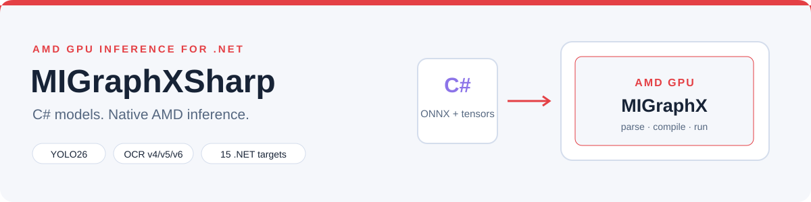

<picture>
  <source media="(prefers-color-scheme: dark)" srcset="docs/images/readme/hero-dark.svg">
  <source media="(prefers-color-scheme: light)" srcset="docs/images/readme/hero-light.svg">
  
</picture>

# MIGraphX C# API · MIGraphXSharp

English | [简体中文](README.zh-CN.md)

MIGraphXSharp brings AMD MIGraphX inference to C# and .NET. Load ONNX models, compile for AMD GPUs, prepare typed tensors, and read results through managed objects with explicit resource lifetimes. The optional HIP adapter adds stream submission and device-buffer input.

The two complete vision examples run **YOLO26 detection, classification, segmentation, pose and oriented boxes**, plus **PP-OCRv6 text detection and recognition**. Image processing and postprocessing are written in C#; running them requires no Python or OpenCV.

[Quick start](#quick-start) · [Samples](#vision-samples) · [Documentation](#documentation) · [Release notes](CHANGELOG.md) · [Report an issue](https://github.com/guojin-yan/MIGraphX-CSharp-API/issues)

## Release 0.0.1

The first release provides the core managed package, the optional HIP adapter, bilingual XML API documentation and two independent vision sample projects. Download packages, source and offline documentation from [v0.0.1](https://github.com/guojin-yan/MIGraphX-CSharp-API/releases/tag/v0.0.1).

Official runtime checks cover the supplied vision models, dynamic inputs, program persistence/cache and HIP host/device-input workflows on Ubuntu 24.04, ROCm 7.2.1, MIGraphX 2.15.0 and gfx1100. See [platform support](docs/compatibility/platforms.md) for the scope of these checks.

## Features

| Area | What you can do |
| --- | --- |
| ONNX inference | Parse from file or memory, configure input dimensions, compile a target, execute and copy typed outputs |
| Tensors and ownership | Inspect immutable shapes, create typed host arguments, use multiple inputs/outputs, dispose native resources |
| Dynamic shapes and cache | Set dimension ranges, validate concrete inputs, save/load programs and reuse compiled models |
| Graph APIs | Create program-owned modules, parameters, literals and instructions; build typed operation attributes |
| HIP integration | Submit on HipSharp streams, wait or poll for completion, use validated device memory as input |
| Advanced APIs | TensorFlow parsing, FP16/BF16/INT8/FP8 quantization and experimental custom-operation callbacks |
| Vision samples | YOLO26 five tasks and PP-OCRv6 tiny/small/medium; JSON, image previews, masks, text and timing |
| .NET integration | 15 target frameworks, consistent public APIs, Chinese/English XML comments and loader diagnostics |

## Packages and requirements

| Package | Version | Purpose |
| --- | --- | --- |
| [JYPPX.ROCm.MIGraphX.CSharp.API](https://www.nuget.org/packages/JYPPX.ROCm.MIGraphX.CSharp.API/0.0.1) | 0.0.1 | Core inference and managed resource API |
| [JYPPX.ROCm.MIGraphX.CSharp.API.HIP.Interop](https://www.nuget.org/packages/JYPPX.ROCm.MIGraphX.CSharp.API.HIP.Interop/0.0.1) | 0.0.1 | Optional stream/device-input integration; exact core and HipSharp 0.10.0 dependencies |

The C# namespace is <code>JYPPX.ROCm.MIGraphXSharp</code>. Both packages contain managed assemblies for <code>net46</code>–<code>net481</code>, <code>netcoreapp3.1</code> and <code>net5.0</code>–<code>net10.0</code>. The vision samples target .NET 10.

| Component | Validated baseline |
| --- | --- |
| Operating system | Ubuntu 24.04 x86-64 |
| AMD runtime | ROCm 7.2.1 and MIGraphX 2.15.0.70201-81~24.04 |
| GPU architecture | gfx1100 |
| Native library | /opt/rocm/lib/libmigraphx_c.so.3 |

Install ROCm/MIGraphX from [AMD's official system repository](https://rocm.docs.amd.com/projects/install-on-linux/en/docs-7.2.1/install/quick-start.html). The NuGet packages do not bundle AMD native libraries. Windows managed builds are available; an official Windows MIGraphX runtime is not supplied. Other devices and runtime versions need application validation.

## Quick start

### 1. Install

~~~bash
dotnet new console -n MigraphxDemo
cd MigraphxDemo
dotnet add package JYPPX.ROCm.MIGraphX.CSharp.API --version 0.0.1

# Optional HIP stream and device-input integration:
dotnet add package JYPPX.ROCm.MIGraphX.CSharp.API.HIP.Interop --version 0.0.1
~~~

Offline installation is also available from the Release assets. See [Getting started](docs/guides/getting-started.md).

### 2. Run an ONNX model

For an existing model with one static, standard float32 input/output and four input elements:

~~~csharp
using JYPPX.ROCm.MIGraphXSharp;

var result = MIGraphXOnnxWorkflow.RunFile(
    "/opt/rocm/lib/libmigraphx_c.so.3",
    "/absolute/path/to/model.onnx",
    new[] { 1f, 2f, 3f, 4f });

Console.WriteLine(string.Join(", ", result.Output));
~~~

Use absolute paths and supply the exact number of input elements required by your model. This helper compiles for GPU with host offload-copy and returns a managed output copy. For image models, begin with the samples below; for multiple inputs/outputs, use [managed objects](docs/guides/managed-objects.md).

### 3. Diagnose the runtime

~~~csharp
var report = MIGraphXEnvironment.Probe("/opt/rocm/lib/libmigraphx_c.so.3");
Console.WriteLine(report.State);
foreach (var diagnostic in report.Diagnostics)
    Console.WriteLine(diagnostic);
~~~

See [deployment and troubleshooting](docs/guides/runtime-deployment.md) for native library loading and runtime setup.

## Vision samples

Each sample contains its own complete image, inference, postprocessing and timing code. They reference this library and ImageSharp, with no shared sample project. Supply your own ONNX models, images, labels and OCR dictionary.

| Project | Task | Typical input | Output |
| --- | --- | --- | --- |
| [Yolo26](samples/Yolo26/README.md) | Detection | 640 × 640 | Boxes, classes and scores |
| Yolo26 | Classification | 224 × 224 | Top-5 classes |
| Yolo26 | Instance segmentation | 640 × 640 | Per-instance masks and boxes |
| Yolo26 | Pose | 640 × 640 | 17 keypoints per person and skeleton |
| Yolo26 | Oriented boxes | 1024 × 1024 | Rotated quadrilaterals |
| [PaddleOcrV6](samples/PaddleOcrV6/README.md) | Text detection + recognition / recognition only | Detector sizes aligned to 32; recognition 48 × 320 | Text, quadrilaterals, crops and confidence |

Run from the repository root on the configured Linux host:

~~~bash
dotnet run --project samples/Yolo26 -c Release -- \
  --native /opt/rocm/lib/libmigraphx_c.so.3 --task detect \
  --model /models/yolo26n.onnx --image /images/bus.jpg \
  --output /results/yolo26 --warmup 5 --iterations 30

dotnet run --project samples/PaddleOcrV6 -c Release -- \
  --native /opt/rocm/lib/libmigraphx_c.so.3 \
  --det-model /models/PP-OCRv6_tiny_det_inference.onnx \
  --rec-model /models/PP-OCRv6_tiny_rec_inference.onnx \
  --dictionary /models/PP-OCRv6_tiny_rec_dict.txt \
  --image /images/document.jpg --output /results/ocr
~~~

Change the YOLO task and matching model for other tasks. OCR small/medium use the same entry point with matching models/dictionaries. Omit the detector argument to recognize a cropped text line. Both projects save JSON, PNG and standalone SVG; segmentation also saves masks, and OCR saves text/crops.

For the tested pose model on MIGraphX 2.15.0, set <code>MIGRAPHX_DISABLE_REDUCE_FUSION=1</code> before starting the process. Model weights and sample images are not redistributed.

### Measured image latency

The supplied models were measured sequentially on gfx1100 with a 16-core CPU quota: batch=1, float32, 5 warmups and 30 measured iterations. These are wall-clock measurements for the specific images, not a GPU comparison.

| Model / workload | Inference mean, ms | Pipeline mean, ms | Pipeline P95, ms |
| --- | ---: | ---: | ---: |
| YOLO26 n detection | 3.23 | 16.82 | 19.94 |
| YOLO26 s detection | 4.96 | 17.83 | 22.27 |
| YOLO26 s classification | 1.47 | 5.65 | 6.14 |
| YOLO26 s segmentation | 7.88 | 59.05 | 64.76 |
| YOLO26 s pose | 5.43 | 18.06 | 21.23 |
| YOLO26 s oriented boxes | 8.35 | 36.88 | 45.22 |
| PP-OCRv6 tiny / 16 lines | 23.71 | 66.42 | 84.18 |
| PP-OCRv6 small / 16 lines | 58.95 | 102.76 | 133.39 |
| PP-OCRv6 medium / 16 lines | 75.73 | 115.69 | 148.64 |

Inference includes synchronous execution and host output readback; OCR includes detector plus all recognition runs. The pipeline also includes C# preprocessing/postprocessing, crops and masks. File decode, model parsing/compilation, visualization and disk output are excluded. No GPU clock/power controls or cache purge were applied. See [sample timing options](docs/guides/vision-samples.md) to measure your own workloads.

## Documentation

Read the [Chinese technical blog](docs/blog/README.md) for standalone release and application articles.

| Start here | Reference |
| --- | --- |
| [Installation and first inference](docs/guides/getting-started.md) | [API reference](docs/api/index.md) |
| [Managed objects and resource ownership](docs/guides/managed-objects.md) | [Framework compatibility](docs/compatibility/frameworks.md) |
| [Dynamic inputs, persistence and cache](docs/guides/dynamic-shapes-cache.md) | [Platform support and limits](docs/compatibility/platforms.md) |
| [Typed operation attributes](docs/guides/operation-attributes.md) | [Versioning](docs/guides/api-versioning.md) |
| [HIP asynchronous execution](docs/guides/hip-interop.md) | [Deployment and troubleshooting](docs/guides/runtime-deployment.md) |
| [Graph, TensorFlow and quantization](docs/guides/advanced-apis.md) | [Vision sample guide](docs/guides/vision-samples.md) |

The Release includes offline HTML documentation. Open <code>index.html</code> after extracting the documentation archive.

## Supported scope

Common integer, float, Boolean, string, null and array attributes are available through the typed builder. Modules created or obtained through a program retain that program's lifetime. General C format varargs and independent modules without a native destroy contract are outside the public wrapper.

Experimental custom-operation callbacks have host-reference numerical checks; GPU/device callback memory and complete provider lifetimes remain unqualified. No zero-copy, overlap or arbitrary workload performance guarantee is made. OCR uses rectangle unclip and does not include page layout, orientation classification or table recognition. See the platform guide before integrating experimental paths.

## Build from source

Install the SDK selected by <code>global.json</code>, PowerShell 7 and the [HipSharp source dependency](CONTRIBUTING.md), then run:

~~~powershell
./eng/build.ps1 -Configuration Release -Version 0.0.1
./eng/pack.ps1 -Configuration Release -Version 0.0.1 -NoBuild
~~~

Development builds without an explicit version use <code>0.0.0</code>. Build output, packages and generated documentation go to the sibling <code>MIGraphXSharp.Workspace/</code> directory. [CONTRIBUTING.md](CONTRIBUTING.md) covers the complete build setup.

## Project layout

| Directory | Contents |
| --- | --- |
| src/ | Core library and optional HIP adapter |
| samples/ | Runnable C# examples |
| docs/ | User guides, deployment and API documentation |
| tests/, native/ | Managed tests and native test sources |
| eng/, tools/ | Build, packaging, generation and diagnostic tools |
| eng/contracts/ | Generator inputs, public API snapshots and native/package contracts |

## Community and license

Report problems through [GitHub Issues](https://github.com/guojin-yan/MIGraphX-CSharp-API/issues), including package/native versions, OS, GPU and a minimal reproduction. Contributions are welcome.

Related .NET inference projects: [OpenVINO C# API](https://github.com/guojin-yan/OpenVINO-CSharp-API) · [TensorRT C# API](https://github.com/guojin-yan/TensorRT-CSharp-API) · [HIP C# API](https://github.com/guojin-yan/HIP-CSharp-API).

Copyright 2026 Guojin Yan. Licensed under [Apache-2.0](LICENSE); see [NOTICE](NOTICE). AMD, ROCm, MIGraphX, ImageSharp and model assets retain their respective licenses.
