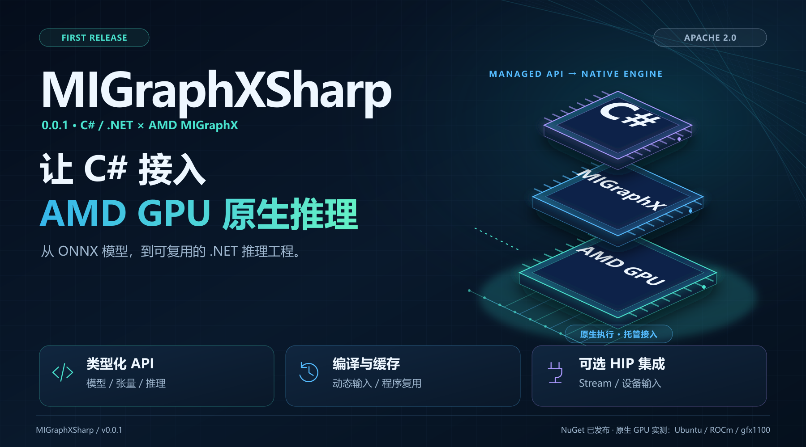
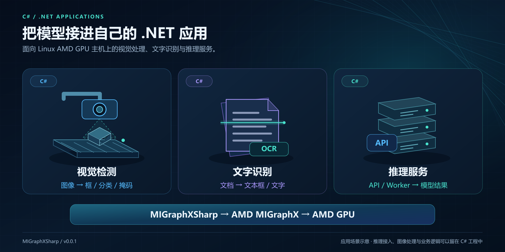
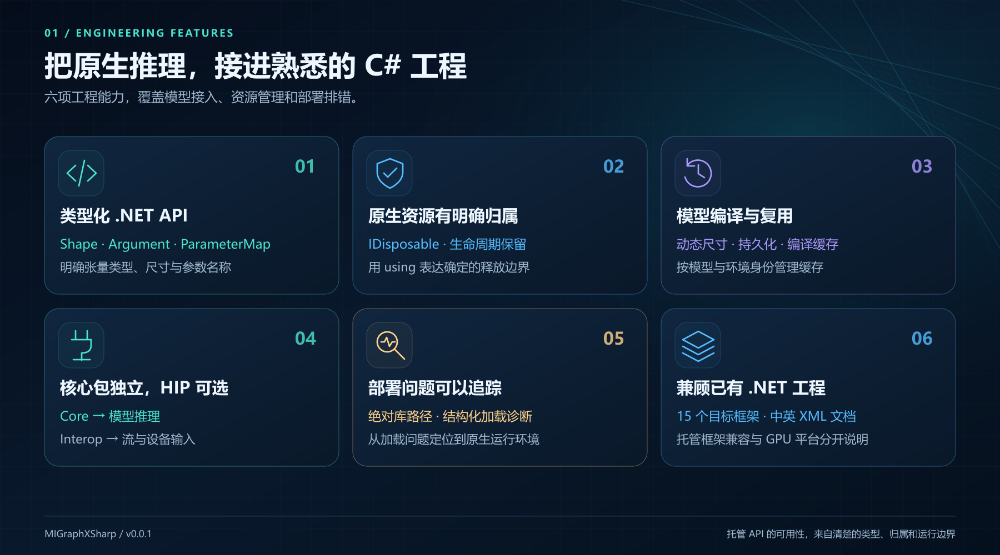
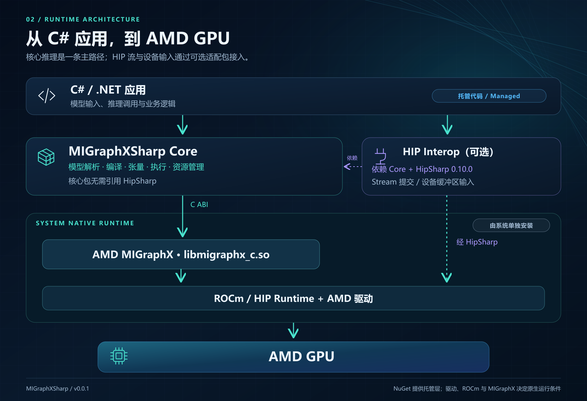
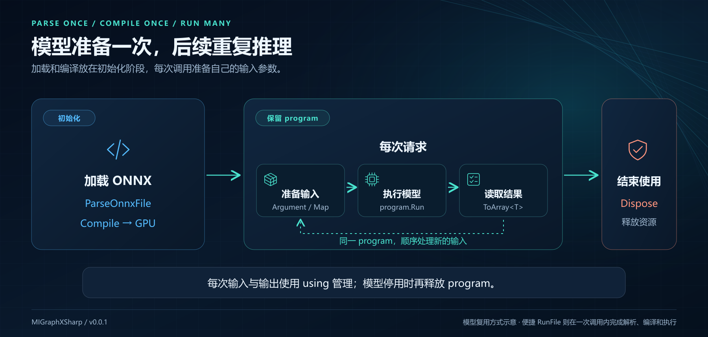
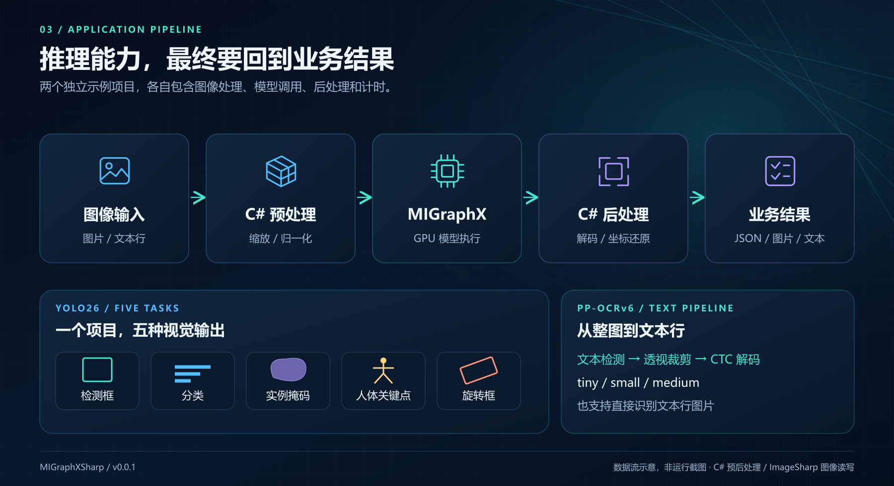
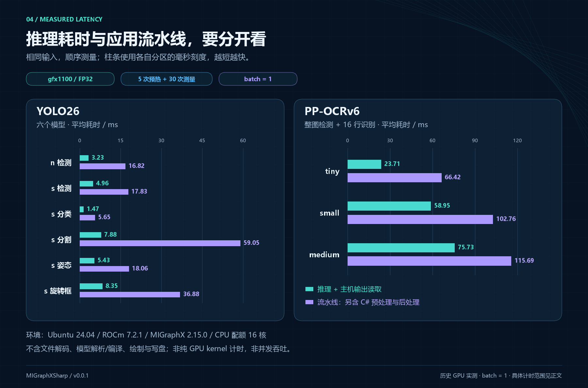

# MIGraphXSharp 0.0.1 首发：让 C# 接入 AMD GPU 原生推理



作者：Guojin Yan · 适用版本：0.0.1

## 前言

之前和大家分享过 OpenVINO、TensorRT 的 C# 接口，这次带来一个新的开源项目：**MIGraphXSharp**。

做模型部署时，经常需要根据设备选择推理引擎。用到 AMD GPU，除了驱动和 ROCm，C# 开发者还需要一套方便调用的模型推理接口。我在做 HIP 的 C# 接口时，也一直想把这一部分补上：底层计算可以用 HIP，已有 ONNX 模型则交给 MIGraphX。

现在，MIGraphXSharp 的第一个版本 **0.0.1** 已经发布到 NuGet。模型解析、GPU 编译、张量输入输出、动态尺寸和程序缓存，都可以在 C# 中完成。

这篇文章先给大家介绍这个库的特点和主要 API，再用几段代码看看具体怎么用。环境安装和视觉模型的完整教程，后面再单独展开。

## 一、什么是 MIGraphXSharp

**MIGraphXSharp 是 AMD MIGraphX 的 C# / .NET 封装库。** MIGraphX 是 AMD ROCm 生态中的模型推理引擎，负责模型计算图的优化、编译和执行；MIGraphXSharp 将这些能力封装成 C# 接口，供 .NET 应用调用。

简单说，就是把 ONNX 模型交给 MIGraphX 编译，在 C# 中准备输入，再拿到模型输出。推理由 AMD 原生引擎执行，图像处理和业务代码继续使用自己熟悉的 .NET 工程。



对于正在使用 AMD GPU 的朋友，这个库可以用在以下场景：

- **视觉检测：** 在 C# 中完成图像预处理、目标检测、分割或姿态结果处理。
- **OCR 与图像分析：** 把文本检测、文字识别、图像分类等模型接入现有程序。
- **服务端推理：** 在 Linux 上通过 ASP.NET Core、Worker 或控制台程序调用模型。

之前做的 OpenVINO、TensorRT 接口，加上这次的 MIGraphXSharp，都是希望让 .NET 开发者在选择部署硬件时，有更多可以直接使用的工具。已有的设备通信、业务处理和数据管理代码，也可以继续复用。

## 二、核心特性

### 2.1 按 C# 的习惯使用模型和张量

MIGraphXSharp 将模型程序、输入参数、张量和编译选项分别封装成对象。输入使用类型化数组，输出可以通过 `ToArray<T>()` 读取。输入名称、类型或尺寸不匹配时，托管层会进行相应检查，方便定位调用问题。

持有原生资源的对象实现了 `IDisposable`，可以直接配合 `using` 使用。调用代码里能看清对象在哪创建、在哪释放，比较适合放进已有的 C# 项目。



### 2.2 模型编译、动态输入和缓存

模型可以从文件或内存加载，输入尺寸可以在解析时设置，也可以用范围描述动态维度。对于需要重复推理的程序，模型编译后可以保留 program，持续提交新的输入。

库还提供程序保存、加载和模型缓存功能。缓存会区分模型、编译选项和运行环境，便于在服务启动、模型切换等场景中复用已有产物。

### 2.3 普通推理与 HIP 集成分别提供

一般的 ONNX 推理只需要核心包，**不依赖 HipSharp**。如果已经在使用 HIP 管理 Stream 或显存，再安装可选的 `HIP.Interop` 包，就可以使用流提交和设备输入接口。

这样可以先用同步 API 完成模型调用，后续有需要，再和自己的 GPU 处理代码衔接。

### 2.4 多目标框架与中英文 API 注释

核心包和 HIP 适配包均提供 **15 个目标框架**的程序集，覆盖 `.NET Framework 4.6—4.8.1`、`.NET Core 3.1` 和 `.NET 5—10`，并附带中英文 XML API 注释，便于在 IDE 中直接查看方法说明。

这里的目标框架表示托管程序集兼容范围。实际 GPU 推理仍需要匹配的原生环境，目前的实测平台是 Linux。

## 三、核心架构

从应用到 GPU，调用关系如下：



核心包提供模型和张量 API，下面调用 AMD MIGraphX 的 C 接口；可选适配包再与 HipSharp 对接。项目本身使用 C# 编写，模型优化和 GPU 运算由原生 MIGraphX 完成。

| 软件包 | 用途 |
| --- | --- |
| `JYPPX.ROCm.MIGraphX.CSharp.API` | 模型解析、编译、执行与资源管理 |
| `JYPPX.ROCm.MIGraphX.CSharp.API.HIP.Interop` | 可选的 HIP Stream 和设备输入集成 |

两个包当前版本均为 `0.0.1`。NuGet 提供托管程序集，AMD 驱动、ROCm 和 MIGraphX 需要在主机上单独安装。

HIP 适配包为可选的实验性扩展，当前依赖 HipSharp `0.10.0`。

> 本文原生实测环境为 Ubuntu 24.04 x86-64、ROCm 7.2.1、MIGraphX 2.15.0、gfx1100。Windows 可以进行托管开发和构建，当前没有提供官方 Windows MIGraphX 原生运行库。其他设备和版本需要在实际部署环境中确认。

## 四、主要类与 API

使用时主要接触下面几个类。先了解它们各自负责什么，后面的代码就比较容易看懂。


| 类 | 主要用途 | 常用入口 |
| --- | --- | --- |
| `MIGraphXProgram` | 管理模型程序，解析、编译和执行 | `ParseOnnxFile`、`Compile`、`Run` |
| `MIGraphXOnnxOptions` | 设置 ONNX 解析参数与输入尺寸 | `SetInputParameterShape`、`SetDynamicInputParameterShape` |
| `MIGraphXTarget` | 选择编译目标 | 使用 `"gpu"` 创建目标 |
| `MIGraphXCompileOptions` | 设置模型编译选项 | `offloadCopy` 等选项 |
| `MIGraphXShape` | 描述张量的数据类型、尺寸与布局 | `DataType`、`Lengths`、`ElementCount` |
| `MIGraphXArgument` | 创建或读取张量数据 | `Create<T>`、`ToArray<T>` |
| `MIGraphXParameterMap` | 按模型输入名称绑定参数 | `Add` |
| `MIGraphXOnnxWorkflow` | 完成一次简单 ONNX 推理 | `RunFile`、`RunBuffer` |

其中，`MIGraphXProgram` 是主要的模型对象。模型加载后，可以查询输入输出，选择 GPU 编译，再使用 `Run` 执行。`MIGraphXArgument` 保存数据，`MIGraphXParameterMap` 则负责把数据和输入名称对应起来。

## 五、简单使用示例

### 5.1 几行代码调用 ONNX 模型

在 .NET 项目中安装核心包：

```bash
dotnet add package JYPPX.ROCm.MIGraphX.CSharp.API --version 0.0.1
```

对于单输入、单输出的静态 float32 模型，可以直接使用便捷接口。下面假定已经有一个输入输出均为 `float32[1,4]` 的 Identity ONNX，原生环境也已配置完成：

```csharp
using JYPPX.ROCm.MIGraphXSharp;

var result = MIGraphXOnnxWorkflow.RunFile(
    "/opt/rocm/lib/libmigraphx_c.so.3",
    "/models/identity.onnx",
    new[] { 1f, 2f, 3f, 4f });

Console.WriteLine(string.Join(", ", result.Output));
// Identity 模型的预期输出：1, 2, 3, 4
```

`RunFile` 内部完成模型解析、GPU 编译、同步执行和资源释放，返回的数据已经复制到托管数组。这个入口适合先了解调用方式；它要求标准布局的静态 float32 输入输出。

### 5.2 自己控制模型加载、编译和执行

需要复用模型，或者使用多输入、多输出时，可以直接使用对象 API。仍以上面的 Identity 模型为例，假定输入名称为 `input`：

```csharp
using JYPPX.ROCm.MIGraphXSharp;

string nativePath = "/opt/rocm/lib/libmigraphx_c.so.3";

// 1. 加载 ONNX 模型
using var onnxOptions = new MIGraphXOnnxOptions(nativePath);
using var program = MIGraphXProgram.ParseOnnxFile(
    "/models/identity.onnx", onnxOptions);

// 2. 为 GPU 编译，使用主机输入和输出
using var target = new MIGraphXTarget(nativePath, "gpu");
using var compileOptions = new MIGraphXCompileOptions(
    nativePath, offloadCopy: true);
program.Compile(target, compileOptions);

// 3. 根据模型尺寸准备输入，并绑定输入名称
var inputShape = program.GetParameterShapes()["input"];
using var input = MIGraphXArgument.Create(
    nativePath, inputShape, new[] { 1f, 2f, 3f, 4f });
using var parameters = new MIGraphXParameterMap(nativePath);
parameters.Add("input", input);

// 4. 同步执行，读取 float32 输出
using var outputs = program.Run(parameters);
float[] values = outputs[0].ToArray<float>();

Console.WriteLine(string.Join(", ", values));
```

主要就是**加载、编译、准备输入、执行**这几步。所有原生对象都放在 `using` 作用域中，输出读取后得到普通的 `float[]`，可以继续交给后处理或业务代码。

实际应用中，可以把 program 的加载和编译放在初始化阶段，后面反复创建输入参数并调用 `Run`。换成其他模型时，需要使用它实际的输入名称、尺寸和数据类型。



### 5.3 设置输入尺寸

图像模型经常会用到输入尺寸设置。下面是一个独立的配置片段，假定模型输入名为 `images`，支持 `1×3×640×640`：

```csharp
using var options = new MIGraphXOnnxOptions(nativePath);
options.SetInputParameterShape("images", new long[] { 1, 3, 640, 640 });

using var imageProgram = MIGraphXProgram.ParseOnnxFile(
    "/models/vision.onnx", options);
```

如果模型使用动态 batch，也可以给每个维度设置范围。下面的片段与上一段二选一，假定模型支持 batch 为 1—4、其他维度固定：

```csharp
using var options = new MIGraphXOnnxOptions(nativePath);
options.SetDynamicInputParameterShape("images", new[]
{
    MIGraphXDynamicDimension.Range(1, 4),
    MIGraphXDynamicDimension.Fixed(3),
    MIGraphXDynamicDimension.Fixed(640),
    MIGraphXDynamicDimension.Fixed(640)
});

using var imageProgram = MIGraphXProgram.ParseOnnxFile(
    "/models/vision.onnx", options);
```

这两段沿用上一例中的 `nativePath`。尺寸配置放在解析之前，之后再编译、执行；动态模型运行时，需要提供范围内的具体输入形状。

### 5.4 保存与加载模型程序

编译好的模型程序也可以保存下来，下次启动时再加载。接着 5.2 的示例，在 program 释放前可以这样使用：

```csharp
using var fileOptions = new MIGraphXFileOptions(nativePath, "msgpack");
program.Save("/models/program.msgpack", fileOptions);

using var restored = MIGraphXProgram.Load(
    "/models/program.msgpack", fileOptions);
```

如果还需要根据模型、环境和选项管理缓存，可以使用 `MIGraphXModelCache`。保存的程序与原生版本、编译上下文有关，部署环境变化时需要重新检查或构建。

## 六、视觉模型支持与应用示例

有了模型调用接口，图像预处理、输出解码和结果显示仍然可以使用 C# 完成。目前仓库已经提供 YOLO26 和 PP-OCRv6 两套完整视觉示例，覆盖以下任务：



| 模型 | 已实现的任务 |
| --- | --- |
| YOLO26 | 目标检测、图像分类、实例分割、人体姿态、旋转框检测 |
| PP-OCRv6 | tiny/small/medium 文本检测与识别，以及文本行单独识别 |

两套示例的预处理和后处理均由 C# 编写，图像读写使用 ImageSharp，运行时无需 Python 或 OpenCV。检测框、分割 mask、关键点和识别文字都可以继续用于业务处理。

具体模型的预处理、输出布局和解码方法，后面再分别写案例文章。

## 七、性能实测

大家比较关心的速度，这次也一起做了测试。下面是 gfx1100 上的实测结果，分别列出模型推理和包含 C# 预后处理的流水线耗时：



YOLO26 n 检测的推理平均耗时为 **3.23 ms**，流水线为 **16.82 ms**；分类为 **1.47 ms / 5.65 ms**。PP-OCRv6 tiny 完成整图检测和 16 行识别，推理合计 **23.71 ms**，流水线为 **66.42 ms**。

测试使用 Ubuntu 24.04、ROCm 7.2.1、MIGraphX 2.15.0，GPU 架构为 gfx1100，CPU 配额 16 核。同一图片、batch=1、float32，预热 5 次后顺序测量 30 次，未锁定 GPU 时钟。

图中“推理”包含同步执行和主机输出读取；“流水线”另含 C# 预处理、参数创建和后处理，不含文件解码、模型解析编译、绘制与写盘。OCR 检测输入为 512×512，识别输入为 48×320。以上为单次处理延迟。

从结果也能看到，预后处理在部分任务中占了不少时间。后面的性能文章会结合具体代码，再介绍这部分的测量和优化方法。

## 八、总结与项目地址

这次发布 MIGraphXSharp，是希望给使用 AMD GPU 的 C# 开发者再增加一个模型部署工具。常用的 ONNX 解析、GPU 编译、张量输入输出和程序复用已经有对应 API，可以直接从自己的 .NET 项目开始接入。

如果你也在用 C# 做视觉或 AI 应用，欢迎下载使用，也欢迎 Star 支持。有模型兼容问题或者希望增加的功能，可以在 GitHub 中反馈。

**GitHub：**

```text
https://github.com/guojin-yan/MIGraphX-CSharp-API
```

**NuGet：**

```text
https://www.nuget.org/packages/JYPPX.ROCm.MIGraphX.CSharp.API/0.0.1
```

完整 API 文档和示例都放在仓库中，后续也会继续分享具体模型的使用方法。

项目采用 Apache-2.0 开源协议，AMD 运行库、ImageSharp 和模型等第三方内容适用各自许可证。本文写作与配图使用了 AI 辅助，示意图与实测数据图分别制作。

Copyright 2026 Guojin Yan.
