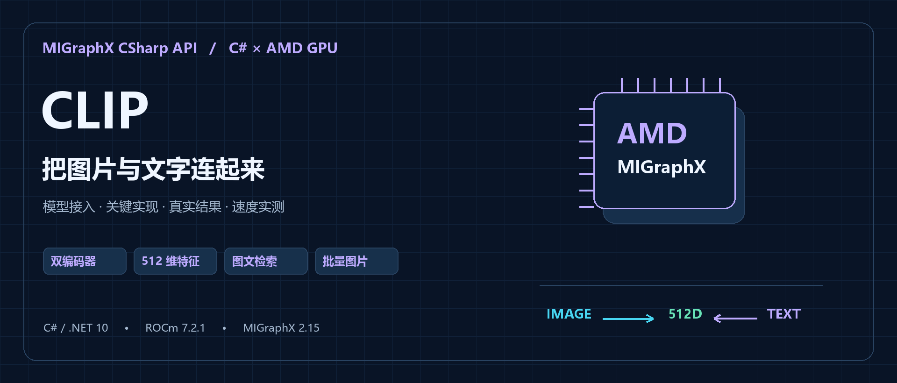
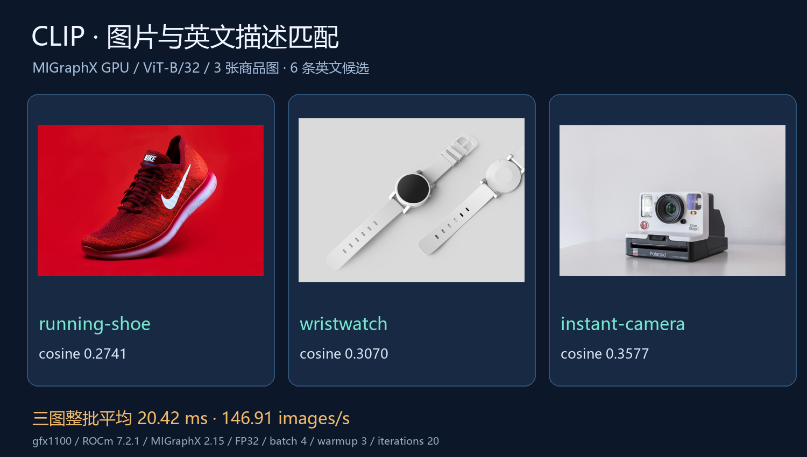
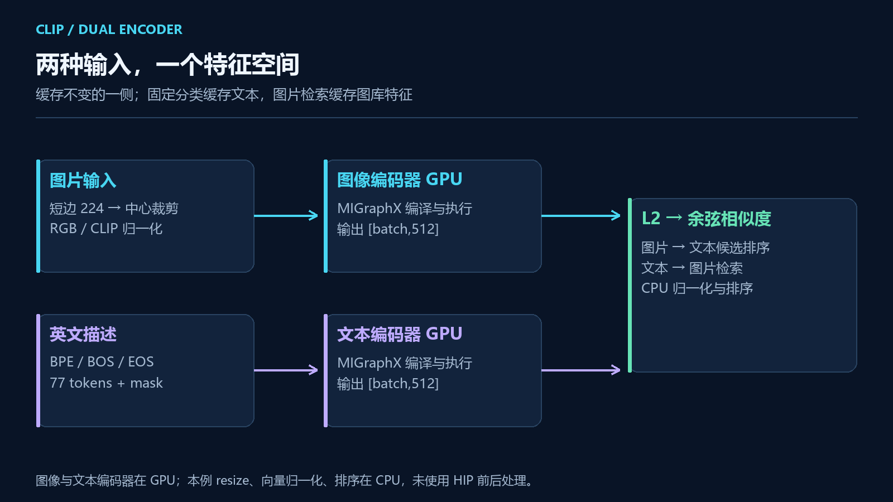
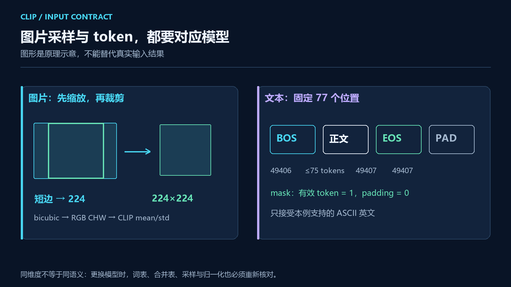

# 用 C# 在 AMD GPU 上部署 CLIP：从商品图片分类到图文双向检索



## 一、MIGraphX CSharp API 项目简介

**MIGraphX CSharp API** 是一个面向 **C# / .NET 开发者**的 AMD MIGraphX 接口库，由「椒颜皮皮虾」（Guojin Yan）开发，项目源码遵循 **Apache License 2.0**。它通过 MIGraphX C ABI 调用 AMD 原生推理引擎，提供 ONNX 解析、GPU 编译、张量输入输出和资源管理接口，方便将模型接入自己的 .NET 应用。

项目提供类型化数组、形状检查、`IDisposable`、动态输入和模型缓存。普通模型调用使用核心包，需要与自己编写的 HIP kernel 配合时，再使用可选 HIP 适配包连接设备内存与 stream。

目前随项目提供 **YOLO26 五任务、PaddleOCR v4/v5/v6、PP-Structure 文档处理和 CLIP 图文检索**四类独立案例。除了单个模型，也可以在 C# 中组织多模型流程，保留每个阶段的结果和业务数据。

**项目源码与 NuGet：**

```text
项目地址：https://github.com/guojin-yan/MIGraphX-CSharp-API
核心包：https://www.nuget.org/packages/JYPPX.ROCm.MIGraphX.CSharp.API/0.0.2
HIP 适配包：JYPPX.ROCm.MIGraphX.CSharp.API.HIP.Interop 0.0.2
```

当前原生 GPU 路径已在 Linux、ROCm 7.2.1、MIGraphX 2.15.0、gfx1100 上验证。托管包兼容多个 .NET 目标框架，实际运行仍需单独准备匹配的 AMD 驱动与原生运行库。

## 二、从商品图片到图文检索

### 2.1 换一组描述，能不能换一组分类

整理商品图片时，经常会遇到一个问题：图片很多，类别还在变。今天按鞋、手表、相机分，明天又想找“带红色元素的商品”或“适合户外的背包”。如果每改一次条件都重新训练分类模型，工程成本会比较高。

CLIP 提供了另一种处理方式。把图片和文字分别编码成向量，比较相似度，就可以尝试按文字描述筛选图片。它适合做图片检索、候选标签推荐和素材整理，也适合与已有的 OCR、检测流程配合使用。

本篇使用当前 main 的独立 `samples/Clip` 案例，核心 API 为 `0.0.2`，v0.0.2 发布标签尚不包含这个项目。图像处理、分词、模型会话、排序和展示都在同一个工程中。接下来用三张商品照片、六条英文描述，完成图片到文字的匹配，再反过来用文字检索图片，并展开关键代码和实际速度。

### 2.2 三张商品图匹配到了什么



候选共有六类：运动鞋、腕表、拍立得相机、背包、水瓶和耳机。图中使用实际照片与程序输出分数，前三张图片的第一候选如下：

| 图片 | 第一候选 key | 对应英文描述 | 余弦相似度 |
| --- | --- | --- | ---: |
| 运动鞋 | `running-shoe` | a product photo of a running shoe. | 0.2741 |
| 腕表 | `wristwatch` | a product photo of a wristwatch. | 0.3070 |
| 拍立得相机 | `instant-camera` | a product photo of an instant camera. | 0.3577 |

这三张图都匹配到预期类别。不过这里只是功能演示，没有人工标注的数据集，也没有“不属于六类中任何一类”的负样本，不能据此写成分类准确率 100%。后面做业务拒识时，还需要补充这些样本。

### 2.3 为什么图片可以和文字比较

CLIP 的图像编码器接收图片，文本编码器接收 token。两者输出同一特征空间的向量。本文使用的 OpenAI CLIP ViT-B/32，每条特征都是 512 维。



这张图里有两种实际用法。固定类别分类时，启动时先计算六条描述的特征，再让后续图片与这六个向量比较；图片检索时，先把图库特征保存起来，用户输入一条描述后，只计算文本特征并搜索已有图片向量。

两种用法复用了同一组编码器。区别在于哪一侧提前计算、哪一侧作为查询，并不需要额外训练一个六分类头。

## 三、环境与模型文件

### 3.1 本文运行环境

本例通过 MIGraphX CSharp API 设置 ONNX 输入尺寸、编译 GPU program、传入 float32/int64 张量并读取输出，使用以下原生与托管环境：

| 项目 | 本文配置 |
| --- | --- |
| 系统 | Linux x64 |
| CPU | AMD EPYC 9334 |
| GPU | `gfx1100`，48 GiB 显存 |
| 原生运行时 | ROCm 7.2.1、MIGraphX 2.15.0 |
| 托管环境 | .NET SDK 10.0.300，`net10.0` |
| 模型 | OpenAI CLIP ViT-B/32，FP32 |

两个编码器由 MIGraphX GPU 执行，图像前处理、特征归一化和排序目前在 CPU。这与 YOLO26/OCR 的 HIP 前后处理路径不同，后面的性能数据也按实际实现说明。

### 3.2 五个模型相关文件

模型下载来源：`https://github.com/guojin-yan/DeploySharp/releases/tag/models-visual.1`。

| 文件 | 用途 |
| --- | --- |
| `clip-vit-b-32.image-encoder.onnx` | 图片 → `[batch,512]` |
| `clip-vit-b-32.text-encoder.onnx` | token/mask → `[prompts,512]` |
| `clip-vit-b-32.vocab.json` | BPE 词表 |
| `clip-vit-b-32.merges.txt` | BPE 合并规则 |
| `clip-vit-b-32.LICENSE` | 模型许可 |

在仓库根目录运行下载脚本，会同时准备模型、词表、许可、三张照片和输入清单：

```bash
bash samples/Clip/fetch-assets.sh /data/clip
dotnet build samples/Clip/Clip.csproj -c Release \
  -p:JYPPXManagedTargetFrameworks=net10.0
```

演示照片来自 Unsplash，具体照片地址保留在脚本中，使用条件见 `https://unsplash.com/license`。模型许可与照片使用条件分别适用，不因示例开源而合并成同一个许可。

## 四、前处理和分词，要与模型一一对应

### 4.1 图片先缩放短边，再中心裁剪

CLIP 图像输入为 `[batch,3,224,224]`。本例先把短边缩放到 224，使用 bicubic 插值，再取中心 224×224，最后转换为 RGB、CHW float32。

归一化参数为：

```text
mean = [0.48145466, 0.4578275, 0.40821073]
std  = [0.26862954, 0.26130258, 0.27577711]
value = (channel / 255 - mean[channel]) / std[channel]
```

不能把 YOLO 的 letterbox 直接拿来用，也不能先从原图裁一块再缩放，认为与“先缩放再裁剪”完全一样。插值采样位置会发生变化。相关代码集中在 `ClipProcessing.Prepare`。

本例按整图编码，没有目标检测和抠图。如果主体很小、背景很复杂，可以先准备 ROI，再用自己的样本比较效果。ROI 处理需要另外计时，不能悄悄加进原来的性能结论。

### 4.2 文本经过 BPE，输出长度固定为 77

BPE（Byte Pair Encoding）按词表和合并规则把文本转换成 token ID。输入不是英文单词的自定义编号，更不是把字符的 Unicode 编码直接交给模型。



本例按配套编码器使用以下约定：

| 项目 | 约定 |
| --- | --- |
| 输入名 | `input_ids`、`attention_mask` |
| 输入类型与形状 | int64，`[描述数量,77]` |
| BOS / EOS | 49406 / 49407 |
| 正文上限 | 75 个 token，剩余位置留给 BOS/EOS |
| padding | 填 EOS ID，mask 只标记有效 token |

tokenizer 接受可打印 ASCII 英文，进行两次 HTML 反转义、空白合并和小写化。超过 75 个正文 token 会报错，交给调用方显式缩短描述，避免无提示截断重要内容。

当前实现没有任意 Unicode 的完整清洗，也不适用于中文 CLIP。需要中文检索时，应该选择配套的中文图文模型和 tokenizer，不能只把 prompt 字符串改成中文。

## 五、用 C# 完成一次图文匹配

### 5.1 先看能够串起流程的代码

下面代码可以替换 `samples/Clip/Program.cs`，保留项目内其余文件。`ModelSession`、`ClipTokenizer`、`ClipProcessing` 是案例中的封装，底层调用的才是 MIGraphX CSharp API 核心 API。

```csharp
using MIGraphXSharp.Samples.Clip;
using SixLabors.ImageSharp;
using SixLabors.ImageSharp.PixelFormats;
using SixLabors.ImageSharp.Processing;

var native = "/opt/rocm/lib/libmigraphx_c.so.3";
var models = "/data/clip/models";
Prompt[] prompts =
[
    new("running-shoe", "a product photo of a running shoe."),
    new("wristwatch", "a product photo of a wristwatch."),
    new("instant-camera", "a product photo of an instant camera."),
    new("backpack", "a product photo of a backpack."),
    new("water-bottle", "a product photo of a water bottle."),
    new("headphones", "a product photo of headphones.")
];

var tokens = new ClipTokenizer(models)
    .Encode(prompts.Select(p => p.Text).ToArray());
using var textEncoder = new ModelSession(native,
    Path.Combine(models, "clip-vit-b-32.text-encoder.onnx"),
    new Dictionary<string, long[]>
    {
        { "input_ids", [prompts.Length, 77] },
        { "attention_mask", [prompts.Length, 77] }
    });
var textOutput = textEncoder.Run(new Dictionary<string, Array>
{
    { "input_ids", tokens.Ids },
    { "attention_mask", tokens.Mask }
});
var textFeatures = ClipProcessing.Normalize(
    textOutput[0].Floats, prompts.Length);

// 固定候选集只需计算一次文本特征，之后复用。
using var imageEncoder = new ModelSession(native,
    Path.Combine(models, "clip-vit-b-32.image-encoder.onnx"),
    new Dictionary<string, long[]> { { "pixel_values", [1, 3, 224, 224] } });
using var image = Image.Load<Rgb24>("/data/clip/demo-inputs/running-shoe.jpg");
image.Mutate(c => c.AutoOrient());
var imageOutput = imageEncoder.Run(new Dictionary<string, Array>
{
    { "pixel_values", ClipProcessing.Prepare(image) }
});
var imageFeature = ClipProcessing.Normalize(imageOutput[0].Floats, 1)[0];
var matches = ClipProcessing.Rank(imageFeature, textFeatures, prompts);

foreach (var match in matches)
    Console.WriteLine($"{match.Key}: cosine={match.Cosine:F4}, " +
                      $"candidateScore={match.CandidateScore:F4}");
```

代码里文本是六条一批，图片是单张。两套模型的 batch 可以分别配置；不是文本有六条，图片也必须凑成六张。初始化只做一次，后续图片复用图像 encoder 与文本特征。

这段入口用于理解调用关系，不包含仓库原版的批量清单、统计和 HTML 导出。单图代码的 batch=1 也不同于后面实测的 image batch=4，不能直接套用那个速度数字。

### 5.2 归一化后，点积就是余弦相似度

编码器输出先逐行做 L2 归一化，再求图像向量与每条文本向量的点积：

```text
image = image / ||image||₂
text  = text  / ||text||₂
cosine(image, text) = Σ image[i] × text[i]，i = 0..511
```

`ClipProcessing.Normalize` 会检查形状、有限值与零向量，`Rank` 返回按余弦相似度排序的候选。保存特征时，建议同时保存模型 hash、维度和前处理配置，避免把不同版本生成的向量混进一个索引。

### 5.3 候选分数并不等于业务概率

示例还会把相似度乘以模型 logit scale，约为 100，再做 Softmax，得到 `CandidateScore`。它回答的是“在当前候选集合里，更接近哪条描述”。

如果把一张不相关图片交进来，六个候选里仍然会有第一名；删掉相近候选或增加很多相似描述，Softmax 分数也会变化。因此结果保留 `Cosine` 与 `CandidateScore` 两个字段，业务拒识阈值要用自己的正负样本确定。

## 六、批量图片和双向检索

### 6.1 输入清单把数据与代码分开

原版程序读取 `inputs.json`，下面是格式示意，可根据需要增加描述与图片：

```json
{
  "prompts": [
    { "key": "running-shoe", "text": "a product photo of a running shoe." },
    { "key": "wristwatch", "text": "a product photo of a wristwatch." }
  ],
  "images": [
    { "id": "shoe", "path": "demo-inputs/running-shoe.jpg" },
    { "id": "watch", "path": "demo-inputs/wristwatch.jpg" }
  ]
}
```

图片路径相对清单目录解析。prompt key 和 image ID 各自唯一，允许 1–64 条描述、1–1000 张图片，image batch 为 1–16。最后一批不足时补零，只把真实图片行放入业务结果。

使用下载脚本准备的完整六类、三图清单运行：

```bash
dotnet run --project samples/Clip -c Release --no-build -- \
  --native /opt/rocm/lib/libmigraphx_c.so.3 \
  --models /data/clip/models --manifest /data/clip/inputs.json \
  --output /results/clip --batch 4 --warmup 3 --iterations 20
```

### 6.2 反向检索不需要第三个模型

原版程序已经保存所有图片 embedding。做文字到图片检索时，把文本特征作为 query、图片特征作为 candidates 即可，核心仍然是同一个 `Rank`。

`result.json` 的 `results` 是逐图匹配结果，`textQueries` 则是每条文本对应的图片排序。两者都来自同一组 512 维向量，不需要为反向检索再训练模型。

| 输出 | 后续怎样使用 |
| --- | --- |
| `index.html` | 浏览三图、全部候选分数和反向检索排序 |
| `result.json` | 接口返回、保存 embedding、建立检索索引 |
| 模型 hash 与初始化信息 | 定位模型版本，区分冷启动与稳定执行 |
| 可选输入输出张量 | 使用 `--dump-tensors true` 时进行数值检查 |

固定分类可以缓存文本特征；图库搜索可以缓存图片特征。候选改变时只更新文本侧，图片改变时只更新图片侧。大图库再引入向量索引，本文小清单使用 CPU 直接遍历排序。

## 七、AMD GPU 上的速度实测

2026-11-01，在前面列出的设备上，使用三张商品图、六条描述、image batch=4，预热 3 次、测量 20 次：

| 指标 | 结果 |
| --- | ---: |
| 三图整批平均 | 20.42 ms |
| 整批 P50 | 20.30 ms |
| 整批 P95 | 21.16 ms |
| 按三张有效图片换算吞吐 | 146.91 张/秒 |

虽然固定 batch=4，本次只有三张有效图片，吞吐分子使用 3，不把补齐行算成处理量。这里的 20.42 ms 也是**三张图完成的整批流水线时间**，不能写成单图模型推理延迟。

计时包含 CPU 图像缩放和归一化、GPU 图像编码、主机与设备复制、CPU 特征归一化和匹配排序；排除文件解码、文本特征初始化、模型编译和 HTML/JSON 导出。文本编码是本次固定候选集的一次性准备，单独记录在结果中。

原版程序在计时循环后生成 `textQueries`，所以反向检索排序和页面导出没有计入上述图片流水线。若业务每个请求都输入新文本，应把文本编码和查询时间另外计入响应时间。

我还用同一实际输入张量与 ONNX Runtime CPU 做了对照：图像特征最大绝对误差约 `6.63e-7`，文本约 `3.58e-7`；六条描述的 BPE ID 和 mask 与独立分词实现逐项一致。这用于核对实现，并不是分类质量评测。

## 八、怎样接到自己的素材系统

做商品素材整理，可以先把图片 embedding 和模型 hash 入库，再把分类建议交给业务人员确认。多个相近类别要特别检查描述，像“watch”和“a product photo of a wristwatch.”表达的信息不同，描述模板本身也属于模型输入配置。

做图片搜索，建议保留 Top-K 和原始余弦相似度，再用业务样本建立阈值。整图主体太小时，先解决 ROI 或背景干扰；需要读取包装文字，则把原图交给 OCR，CLIP 向量不会替代具体文字字段。

本例已经完成 C# 下的双编码器调用、批量图片、双向检索和结果导出。它仍是英文 ViT-B/32 案例，图像前后处理在 CPU，也没有加入大规模向量数据库。大家可以先用这套清楚的输入输出接通业务，再根据真实图库规模和检索效果扩展。
