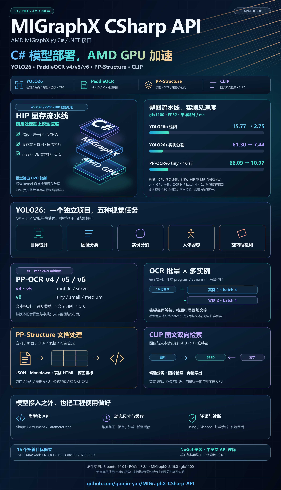
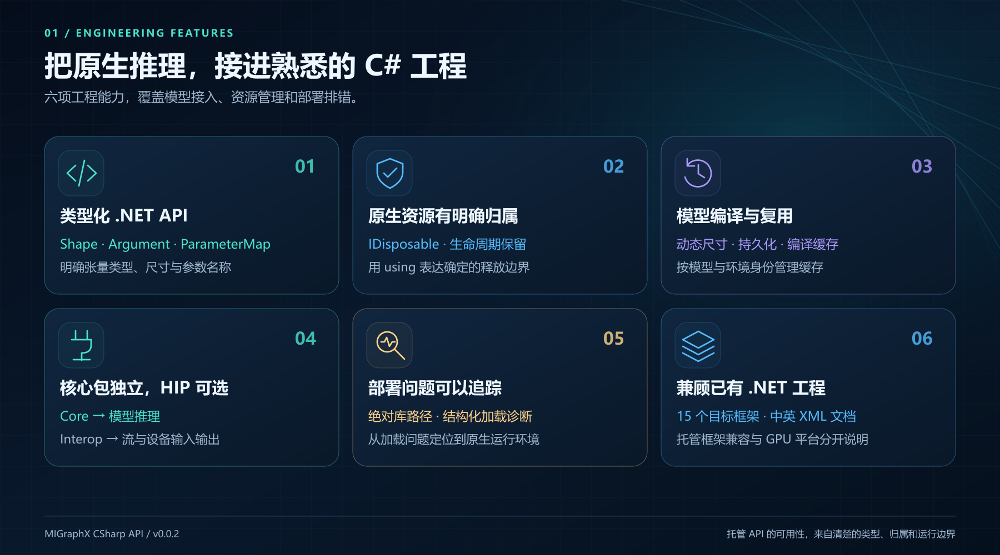
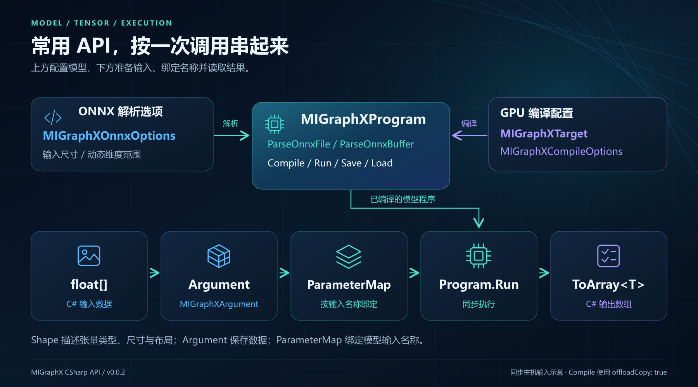
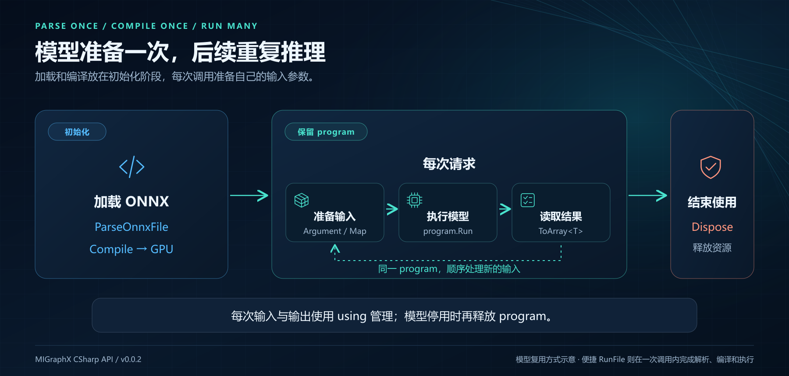
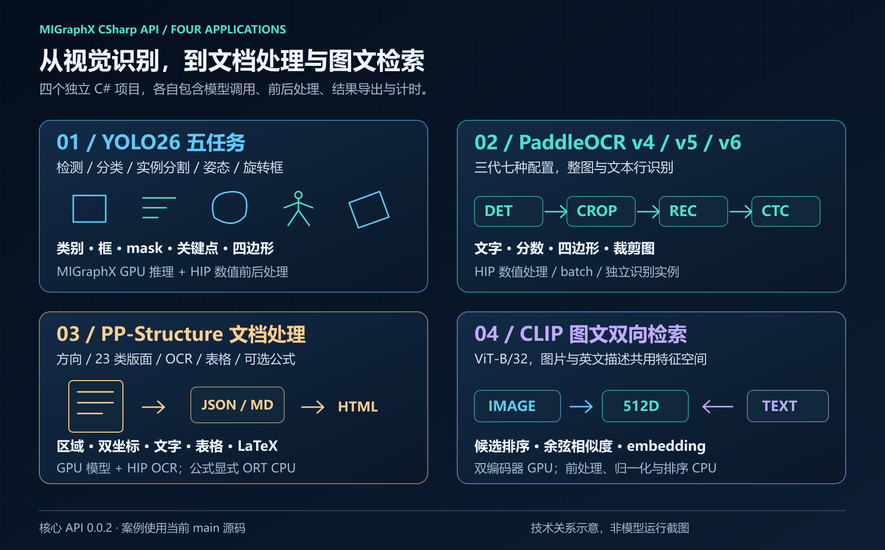
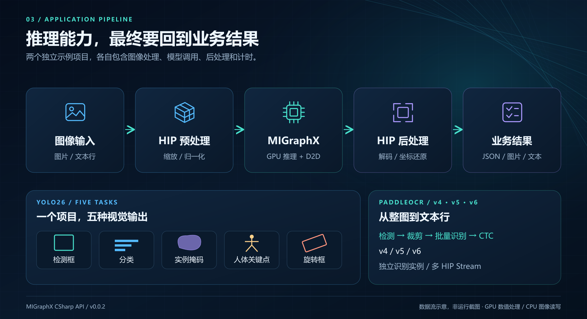
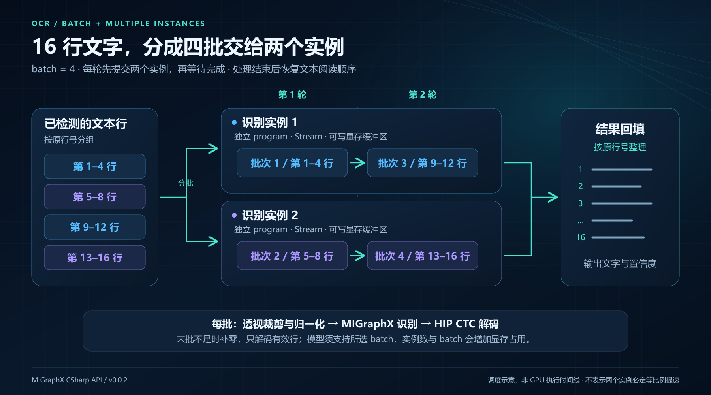
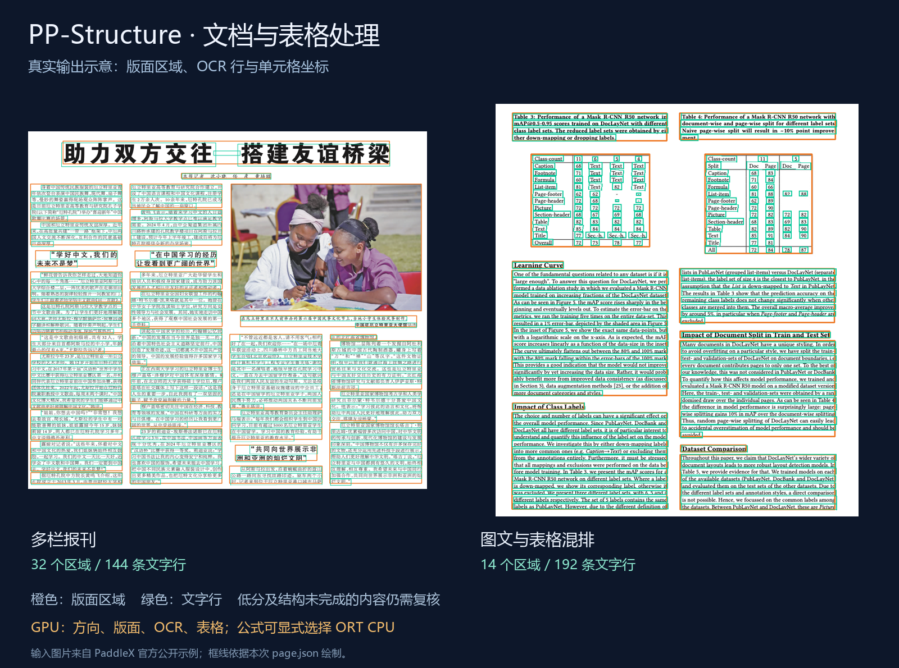
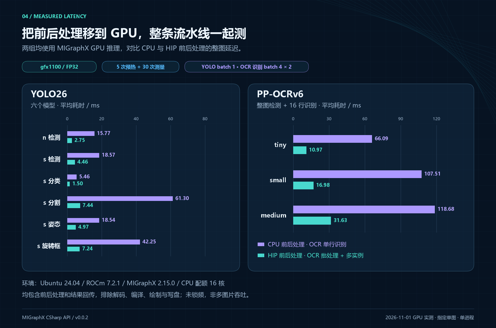

# MIGraphX CSharp API 发布：让 C# 接入 AMD GPU 原生推理



作者：Guojin Yan · 核心包版本：0.0.2 · 本文案例以仓库当前 main 源码为准

## 前言

之前和大家分享过 OpenVINO、TensorRT 的 C# 接口，这次带来一个新的开源项目：**MIGraphX CSharp API**。

做模型部署时，大家通常先看模型，再根据设备选择推理引擎。到了 AMD GPU，模型在 Python 中跑通之后，怎样接进自己的 C# 项目，又成了一个需要单独解决的问题。原生接口怎么声明，张量怎么传，模型和显存什么时候释放，这些都要处理。

我在做 HIP 的 C# 接口时，就想把模型推理这部分一起补上：图像和张量计算使用 HIP，已有 ONNX 模型交给 MIGraphX，应用继续放在熟悉的 .NET 工程中。

现在，**MIGraphX CSharp API 0.0.2 已经发布到 NuGet 和 GitHub。** 模型解析、GPU 编译、张量输入输出、动态尺寸和程序缓存，都可以在 C# 中完成。配合 HIP，还可以让前处理、模型推理和后处理连续在 GPU 上执行。

配套案例也从视觉检测和文字识别，扩展到了文档处理和图文检索。**YOLO26 覆盖五类任务，PaddleOCR 在一个项目中支持 v4、v5、v6；当前 main 还提供 PP-Structure 文档处理与 CLIP 图文双向检索。** 四个案例各自包含完整代码，后面会分别介绍用途、结果和实际耗时。

这篇文章先给大家介绍这个库的特点和主要 API，再用几段代码看看怎么调用模型。四篇配套实战文章会分别展开模型准备、前后处理、C# 代码和业务接入。

## 一、什么是 MIGraphX CSharp API

**MIGraphX CSharp API 是 AMD MIGraphX 的 C# / .NET 封装库。** MIGraphX 是 AMD ROCm 生态中的模型推理引擎，负责模型计算图的优化、编译和执行；MIGraphX CSharp API 将这些能力封装成 C# 接口，供 .NET 应用调用。

简单说，就是把 ONNX 模型交给 MIGraphX 编译，在 C# 中准备输入，再拿到模型输出。模型运算由 AMD 原生引擎执行，应用层继续使用 .NET 的工程、日志、配置和服务组件。

对于已有的 C# 项目，可以直接引用 NuGet 包，逐步接入模型调用，不必再为每个模型单独维护一套原生导出接口。对于需要自己写 GPU 前后处理的项目，模型也能接到已有的 HIP Stream 和显存缓冲区中。


对于正在使用 AMD GPU 的朋友，这个库可以用在以下场景：

- **视觉检测：** 在 C# 中完成图像预处理、目标检测、分割或姿态结果处理。
- **OCR 与图像分析：** 把文本检测、文字识别、图像分类等模型接入现有程序。
- **文档内容提取：** 组合方向校正、版面和表格模型，保留页面区域、文字与结构化结果。
- **图片检索与素材整理：** 用 CLIP 编码图片和描述，完成候选分类与图文双向检索。
- **服务端推理：** 在 Linux 上通过 ASP.NET Core、Worker 或控制台程序调用模型。

之前做 OpenVINO、TensorRT 的 C# 接口，是为了方便大家在 .NET 中部署模型。这次把 AMD MIGraphX 也加进来，目的还是一样：设备选型时多一个可以实际使用的方案，已有的设备通信、业务处理和数据管理代码也能继续复用。几个库的底层引擎和 API 各有特点，需要根据部署设备选择。

## 二、核心特性

### 2.1 按 C# 的习惯使用模型和张量

MIGraphX CSharp API 将模型程序、输入参数、张量和编译选项分别封装成对象。输入使用类型化数组，输出可以通过 `ToArray<T>()` 读取；张量形状、元素类型和数据长度也有对应的检查。接入模型时，可以先查询实际输入信息，再准备数据。

持有原生资源的对象实现了 `IDisposable`，可以直接配合 `using` 使用。调用代码里能看清对象在哪创建、在哪释放，比较适合放进已有的 C# 项目。



### 2.2 模型编译、动态输入和缓存

模型可以从文件或内存加载，输入尺寸可以在解析时设置，也可以用范围描述动态维度。对于需要重复推理的程序，模型编译后可以保留 program，持续提交新的输入。

库还提供程序保存、加载和模型缓存功能。缓存会区分模型、编译选项和运行环境，便于在服务启动、模型切换等场景中复用已有产物。对于持续运行的应用，可以把解析和编译放在初始化阶段，后续只更新输入并执行。

### 2.3 前后处理也可以留在 GPU 上

一般的 ONNX 推理只需要核心包，**不依赖 HipSharp**。如果已经在使用 HIP 管理 Stream 或显存，再安装可选的 `HIP.Interop` 包，就可以使用流提交和设备输入输出接口。

比如，图片上传后在 GPU 上缩放和归一化，交给 MIGraphX 推理，再直接计算检测框、分割 mask 或 OCR 解码。最后按需要取回检测框、掩码或文字索引等结果，减少完整中间张量在 CPU 和 GPU 之间来回搬运。

这对视觉应用很实用。模型本身可能只用几毫秒，但缩放、mask 计算、文本框提取和文字解码仍然要花时间。把这些部分一起放到 GPU，才能降低从一张图片到可用结果的实际等待时间。

### 2.4 多目标框架与中英文 API 注释

核心包和 HIP 适配包均提供 **15 个目标框架**的程序集，覆盖 `.NET Framework 4.6—4.8.1`、`.NET Core 3.1` 和 `.NET 5—10`，并附带中英文 XML API 注释，便于在 IDE 中直接查看方法说明。

这里的目标框架表示托管程序集兼容范围。实际 GPU 推理仍需要匹配的原生环境，目前的实测平台是 Linux。

## 三、核心架构

从应用到 GPU，调用关系如下：


核心包提供模型和张量 API，下面调用 AMD MIGraphX 的 C 接口；可选适配包再与 HipSharp 对接。项目本身使用 C# 编写，模型优化和 GPU 运算由原生 MIGraphX 完成。

| 软件包 | 版本 | 用途 |
| --- | --- | --- |
| `JYPPX.ROCm.MIGraphX.CSharp.API` | 0.0.2 | 模型解析、编译、执行与资源管理 |
| `JYPPX.ROCm.MIGraphX.CSharp.API.HIP.Interop` | 0.0.2 | 可选的 HIP Stream、显存输入输出与同流执行 |
| `JYPPX.ROCm.HIP.CSharp.API` | 0.10.0 | HipSharp，提供 HIP 显存、Stream 和 kernel API，由适配包依赖 |

普通同步推理只安装核心包即可。需要 HIP 集成时再安装适配包，NuGet 会恢复它所依赖的核心包和 HipSharp。NuGet 提供托管程序集，AMD 驱动、ROCm 和 MIGraphX 需要在主机上单独安装。

HIP 适配包仍按实验性扩展提供，本文介绍的是已经在下述环境中验证的设备输入输出与同流处理方式。

> 本文原生实测环境为 Ubuntu 24.04 x86-64、ROCm 7.2.1、MIGraphX 2.15.0、gfx1100。Windows 可以进行托管开发和构建，当前没有提供官方 Windows MIGraphX 原生运行库。其他设备和版本需要在实际部署环境中确认。

## 四、主要类与 API

使用时主要接触下面几个类。先了解它们各自负责什么，后面的代码就比较容易看懂。



| 类 | 主要用途 | 常用入口 |
| --- | --- | --- |
| `MIGraphXProgram` | 管理模型程序，解析、编译和执行 | `ParseOnnxFile`、`Compile`、`Run` |
| `MIGraphXOnnxOptions` | 设置 ONNX 解析参数与输入尺寸 | `SetInputParameterShape`、`SetDynamicInputParameterShape` |
| `MIGraphXTarget` | 选择编译目标 | 使用 `"gpu"` 创建目标 |
| `MIGraphXCompileOptions` | 设置模型编译选项 | `offloadCopy` 等选项 |
| `MIGraphXShape` | 描述张量的数据类型、尺寸与布局 | `DataType`、`Lengths`、`ElementCount` |
| `MIGraphXArgument` | 创建或读取张量数据 | `Create<T>`、`ToArray<T>` |
| `MIGraphXParameterMap` | 按模型输入名称绑定参数 | `Add` |
| `MIGraphXOnnxWorkflow` | 完成一次简单 ONNX 推理 | `RunFile`、`RunBuffer` |
| `MIGraphXHipExecution` | 将模型接到 HIP 显存流水线 | `RunHostAsync`、`RunDeviceAsync`、`RunDeviceIntoAsync` |

其中，`MIGraphXProgram` 是主要的模型对象。模型加载后，可以查询输入输出，选择 GPU 编译，再使用 `Run` 执行。`MIGraphXArgument` 保存数据，`MIGraphXParameterMap` 则负责把数据和输入名称对应起来。

除了表中的常用推理接口，库还提供 program 内的计算图构建、类型化算子属性、TensorFlow 解析和量化相关 API。首次接入可以先从 ONNX 和张量调用开始，高级功能再按模型及原生版本选择，具体范围放在使用文档中说明。

## 五、安装与简单使用

### 5.1 几行代码调用 ONNX 模型

在 .NET 项目中安装核心包：

```bash
dotnet add package JYPPX.ROCm.MIGraphX.CSharp.API --version 0.0.2
```

对于单输入、单输出的静态 float32 模型，可以直接使用便捷接口。下面假定已经有一个输入输出均为 `float32[1,4]` 的 Identity ONNX，原生环境也已配置完成：

```csharp
using JYPPX.ROCm.MIGraphXSharp;

var result = MIGraphXOnnxWorkflow.RunFile(
    "/opt/rocm/lib/libmigraphx_c.so.3",
    "/models/identity.onnx",
    new[] { 1f, 2f, 3f, 4f });

Console.WriteLine(string.Join(", ", result.Output));
// Identity 模型的预期输出：1, 2, 3, 4
```

`RunFile` 内部完成模型解析、GPU 编译、同步执行和资源释放，返回的数据已经复制到托管数组。这个入口适合先了解调用方式；它要求标准布局的静态 float32 输入输出。

### 5.2 自己控制模型加载、编译和执行

需要复用模型，或者使用多输入、多输出时，可以直接使用对象 API。仍以上面的 Identity 模型为例，假定输入名称为 `input`：

```csharp
using JYPPX.ROCm.MIGraphXSharp;

string nativePath = "/opt/rocm/lib/libmigraphx_c.so.3";

// 1. 加载 ONNX 模型
using var onnxOptions = new MIGraphXOnnxOptions(nativePath);
using var program = MIGraphXProgram.ParseOnnxFile(
    "/models/identity.onnx", onnxOptions);

// 2. 为 GPU 编译，使用主机输入和输出
using var target = new MIGraphXTarget(nativePath, "gpu");
using var compileOptions = new MIGraphXCompileOptions(
    nativePath, offloadCopy: true);
program.Compile(target, compileOptions);

// 3. 根据模型尺寸准备输入，并绑定输入名称
var inputShape = program.GetParameterShapes()["input"];
using var input = MIGraphXArgument.Create(
    nativePath, inputShape, new[] { 1f, 2f, 3f, 4f });
using var parameters = new MIGraphXParameterMap(nativePath);
parameters.Add("input", input);

// 4. 同步执行，读取 float32 输出
using var outputs = program.Run(parameters);
float[] values = outputs[0].ToArray<float>();

Console.WriteLine(string.Join(", ", values));
```

主要就是**加载、编译、准备输入、执行**这几步。持有原生资源的对象放在 `using` 作用域中，输出读取后得到普通的 `float[]`，可以继续交给后处理或业务代码。

实际应用中，可以把 program 的加载和编译放在初始化阶段，后面反复创建输入参数并调用 `Run`。换成其他模型时，需要使用它实际的输入名称、尺寸和数据类型。



### 5.3 设置输入尺寸

图像模型经常会用到输入尺寸设置。下面是一个独立的配置片段，假定模型输入名为 `images`，支持 `1×3×640×640`：

```csharp
using var options = new MIGraphXOnnxOptions(nativePath);
options.SetInputParameterShape("images", new long[] { 1, 3, 640, 640 });

using var imageProgram = MIGraphXProgram.ParseOnnxFile(
    "/models/vision.onnx", options);
```

如果模型使用动态 batch，也可以给每个维度设置范围。下面的片段与上一段二选一，假定模型支持 batch 为 1—4、其他维度固定：

```csharp
using var options = new MIGraphXOnnxOptions(nativePath);
options.SetDynamicInputParameterShape("images", new[]
{
    MIGraphXDynamicDimension.Range(1, 4),
    MIGraphXDynamicDimension.Fixed(3),
    MIGraphXDynamicDimension.Fixed(640),
    MIGraphXDynamicDimension.Fixed(640)
});

using var imageProgram = MIGraphXProgram.ParseOnnxFile(
    "/models/vision.onnx", options);
```

这两段沿用上一例中的 `nativePath`。尺寸配置放在解析之前，之后再编译、执行；动态模型运行时，需要提供范围内的具体输入形状。

### 5.4 保存与加载模型程序

编译好的模型程序也可以保存下来，下次启动时再加载。接着 5.2 的示例，在 program 释放前可以这样使用：

```csharp
using var fileOptions = new MIGraphXFileOptions(nativePath, "msgpack");
program.Save("/models/program.msgpack", fileOptions);

using var restored = MIGraphXProgram.Load(
    "/models/program.msgpack", fileOptions);
```

如果还需要根据模型、环境和选项管理缓存，可以使用 `MIGraphXModelCache`。保存的程序与原生版本、编译上下文有关，部署环境变化时需要重新检查或构建。

### 5.5 让输出留在显存中继续处理

如果前后处理已经使用 HIP，再安装适配包：

```bash
dotnet add package JYPPX.ROCm.MIGraphX.CSharp.API.HIP.Interop --version 0.0.2
```

0.0.2 提供了 `RunDeviceIntoAsync`，用于把模型输出接到自己的显存缓冲区。下面是提交部分的代码：假定 program 已使用 `offloadCopy: false` 编译，`deviceInputs` 绑定了编译后全部参数，`deviceOutputs` 按模型输出形状分配，`stream` 是前后处理共用的 HIP Stream：

```csharp
using JYPPX.ROCm.MIGraphX.CSharp.API.HIP.Interop;

using var run = program.RunDeviceIntoAsync(
    deviceInputs, deviceOutputs, stream);

// 在这里向同一个 stream 提交自己的 HIP 后处理 kernel，
// 直接使用 deviceOutputs 中的显存数据。
run.Synchronize();
```

模型输出会在这条流上通过 D2D（Device to Device，设备内复制）送到自己的缓冲区，随后就可以计算 mask、检测框或字符序列，无需先生成主机张量副本。这仍然有显存内复制开销。

`run` 会保留模型执行所需的资源。自定义后处理也要在完成后再复用或释放相关缓冲区；使用同一条 stream 时，可以先依次提交推理和后处理，最后统一等待。下面的 YOLO26 和 PaddleOCR 就使用这种方式衔接数值前后处理。

## 六、四类应用案例：视觉、文字、文档与图文检索

### 6.1 从模型接口到可用结果

只有模型加载接口，离实际使用还差图像处理、解码和结果组织。因此我把四类常见应用整理成独立案例，大家可以先查看输入输出，再按自己的业务调整。



| 案例 | 已实现的任务 | 可以拿到的结果 |
| --- | --- | --- |
| YOLO26 | 检测、分类、实例分割、人体姿态、旋转框 | 类别、框、mask、关键点、旋转四边形 |
| PaddleOCR v4/v5/v6 | 三代七种配置，整图检测识别、单独识别 | 文字、置信度、文本四边形与裁剪图 |
| PP-Structure | 页面方向、23 类版面、OCR、表格与可选公式 | 区域、原图坐标、JSON、Markdown、表格 HTML、LaTeX |
| CLIP ViT-B/32 | 图片到描述匹配、文字到图片检索 | 候选排序、余弦相似度、512 维向量与 HTML 图册 |

四个项目分别位于 `samples/Yolo26`、`samples/PaddleOcr`、`samples/PPStructure` 和 `samples/Clip`，都使用 .NET 10。模型会话、前后处理、导出和计时代码包含在各自目录中，不依赖另一个 sample 项目。模型与素材另行准备，图像读写由 ImageSharp 完成。

核心包与 HIP 适配包已经发布为 `0.0.2`；统一三代 OCR、新增 PP-Structure 和 CLIP 使用当前 main 示例源码。NuGet 的推理 API 与这些应用代码分开维护，下载案例时要选择对应源码，而不是只安装核心包就能得到所有模型业务类。

### 6.2 YOLO26 与 OCR：前后处理也跟上模型速度

YOLO26 与 PaddleOCR 默认使用 HIP 数值前后处理，把模型前后的计算接到同一条设备流水线：



| 阶段 | GPU 上完成的工作 |
| --- | --- |
| 图像输入 | 缩放、填充、归一化、张量布局转换 |
| YOLO26 输出 | 检测结果解码、坐标还原、分类结果、分割 mask、关键点和旋转框处理 |
| OCR 文本检测 | DB（可微分二值化）检测后处理，包括连通区域、文本框几何处理与排序 |
| OCR 文本识别 | 透视裁剪、批量输入、识别推理、CTC（连接时序分类）字符索引解码 |

CPU 负责图片解码、文件读写、少量调度信息，以及将字符索引映射为最终文字。图中的 GPU 流水线指的是数值处理部分，最终显示、标注和导出仍由应用完成。两个案例也保留了 C# CPU 前后处理，便于阅读和对照。

OCR 三代模型共用图像、显存和识别调度代码。v4/v5 提供 mobile、server，v6 提供 tiny、small、medium，按版本选择模型与配套字典即可。识别字典严格对应输出索引，不能跨版本混用。

### 6.3 OCR：按批处理，多实例提交

OCR 一张图片往往会检测出多行文字。如果每次只识别一行，16 行就要逐行调用 16 次。这里把文本行先组成 batch，再交给多个独立识别实例处理。

下面以 16 行文字、batch=4、2 个识别实例说明调度方式。每一轮先提交两个实例的任务，再等待本轮完成；下一轮继续处理剩余文本行：



每个实例持有自己的 MIGraphX program、非阻塞 HIP Stream 和可写缓冲区，初始化时编译，后续重复使用。最后不足一个 batch 的部分补零，只解码有效行，识别结果按原行号回填。

整图 HIP 案例默认使用 batch=4、2 个识别实例；模型需要支持所选 batch。文本很少时，可以减小 batch 或实例数，避免额外显存和编译成本。三代模型的预处理、字典、CTC 与调度代码，在配套 OCR 实战文章中分别展开。

### 6.4 PP-Structure：把文字组织成文档

OCR 读出文字以后，文档还需要保留标题、正文、图片和表格之间的关系。PP-Structure 案例先校正页面方向，再用 PP-DocLayout-L 找到 23 类区域，对整页运行一次 OCR，并按文字框中心关联到区域。表格继续执行分类、格子检测和 SLANeXt 结构识别，对齐通过后再填入文字。



上面的报刊得到 32 个区域、144 条文字行；混排页得到 14 个区域、192 条文字行。费用表案例还检测到 13 个格子，并导出填字 HTML。区域和文字同时保留校正页与原始方向页的坐标，接到文档归档或复核界面时，可以从结果回到原图。

方向、版面、OCR 和表格子模型使用 MIGraphX GPU，OCR 数值前后处理使用 HIP；表格结构由 C# 调度解码步骤，状态仍经过主机数组。公式需要显式启用 `ort-cpu`，当前 FormulaNet 动态循环不能由 MIGraphX 2.15 直接解析，默认保留公式区域供复核。结果会注明实际后端。

因此，这个案例可以作为文档内容提取的起点，输出 JSON、Markdown、表格 HTML 和可选 LaTeX。遇到表格格数不符、结构不完整或低分文字，会保留原因，便于继续复核。当前还不包含 PDF 渲染、多栏阅读顺序恢复和跨页表格合并。

### 6.5 CLIP：用描述检索图片

图片素材多了以后，除了固定类别检测，也会有“按内容找图”的需求。CLIP 案例分别用图像编码器与文本编码器生成 512 维特征，再通过余弦相似度排序。固定分类时可以预先计算候选描述，图片检索时则可以提前计算图库特征。


这次演示中，运动鞋、腕表和拍立得相机都匹配到了对应描述，余弦相似度分别为 0.2741、0.3070 和 0.3577。程序同时保存图到文分类、文到图检索和 embedding，既可以浏览 HTML 图册，也可以把向量交给后续检索索引。

本例采用英文 OpenAI CLIP ViT-B/32，两个编码器在 MIGraphX GPU 执行，图像前处理、向量归一化和排序当前在 CPU。tokenizer 使用配套 BPE，长度固定 77，接受本例支持的 ASCII 英文；中文模型需要对应的编码器和分词配置。候选组 Softmax 分数也不等于业务概率，实际应用要用自己的数据确定拒识阈值。

## 七、性能实测

### 7.1 从图片到结果，实际需要多久

模型在 GPU 上跑得快，前后处理也要跟上。这次对同一组模型和图片，分别使用 CPU 和 HIP 数值前后处理，比较包含这些处理的整图耗时。**两条路径都使用 MIGraphX GPU 推理**；OCR 的 HIP 路径还使用了批量和双实例识别，因此这里比较的是两套完整应用配置：



YOLO26 n 检测从 **15.77 ms** 降到 **2.75 ms**；实例分割包含 mask 计算，从 **61.30 ms** 降到 **7.44 ms**。PP-OCRv6 tiny 完成整图检测和 16 行识别，从 **66.09 ms** 降到 **10.97 ms**。

测试环境为 Ubuntu 24.04 x86-64、ROCm 7.2.1、MIGraphX 2.15.0，GPU 架构 gfx1100，CPU 配额 16 核。使用 FP32，同一图片预热 5 次后测量 30 次，取平均值，未锁定 GPU 频率和功耗。YOLO batch=1；OCR 检测 batch=1、输入 512×512，识别输入高宽为 48×320，HIP 识别 batch=4、2 个实例，CPU 对照为逐行识别。

计时从已解码图片开始，到得到最终结果结束。HIP 路径包含图片上传、GPU 前后处理、模型推理、D2D 输出复制和所需结果回传；CPU 路径包含 C# 前后处理、GPU 推理和完整输出张量回读。两者都排除图片解码、模型与 kernel 编译、绘制和写盘。

### 7.2 batch 和多实例分别带来多少收益

为了看清 OCR 识别调度的影响，再固定同一条 HIP 检测与前后处理路径，只调整识别 batch 和实例数。PP-OCRv6 tiny 处理同一张 16 行图片，整图平均耗时如下，环境和计时范围与上面一致：

| 识别配置 | 整图平均耗时 |
| --- | ---: |
| batch=1，1 个识别实例 | 17.77 ms |
| batch=4，1 个识别实例 | 11.50 ms |
| batch=4，2 个识别实例 | 10.97 ms |

这组数据中，合并 batch 带来的收益比较明显；在 batch=4 的基础上增加到两个实例，又缩短了一部分耗时。实例数继续增大是否更快，需要结合文本行数、模型和显存来判断。

上面都是整图墙钟时间。多个 Stream 的 GPU 分项可能重叠，不能相加后当作整图延迟；这些数值也只代表本次模型、图片和设备的结果。

### 7.3 v4、v5 的整图耗时

除了 v6，我也在相同的原生环境下测试了 v4、v5 的 mobile 和 server 模型。使用同一张 500×500 图片，四种配置都检测并识别出 16 行文字；检测输入为 512×512，识别输入为 48×320，识别 batch=4、2 个独立实例，预热 5 次后测量 30 次。

| 模型 | 整图平均耗时 | 整图 P95 |
| --- | ---: | ---: |
| PP-OCRv4 mobile | 17.32 ms | 17.42 ms |
| PP-OCRv4 server | 55.42 ms | 55.93 ms |
| PP-OCRv5 mobile | 16.64 ms | 16.78 ms |
| PP-OCRv5 server | 43.37 ms | 44.25 ms |

这里同样包含 HIP 数值前后处理、GPU 推理和最终文字生成，排除图片解码、编译、绘图和写盘。三代模型共七种规格，还使用相同的实际输入与独立 CPU 推理结果做了对照，检测和识别输出均在设定误差范围内，16 行文字的 CTC 解码结果一致。这是同一张图片上的运行和数值检查，模型选型仍要结合自己的图片质量、文字类型和准确率要求。

### 7.4 文档与图文检索的实际耗时

新增案例也记录了完整流程时间。环境为 Linux x64、AMD EPYC 9334、gfx1100（48 GiB）、ROCm 7.2.1、MIGraphX 2.15.0、.NET 10.0.300，模型为 FP32：

| 场景 | 平均耗时 | P95 | 本次处理内容 |
| --- | ---: | ---: | --- |
| CLIP 三图整批 | 20.42 ms | 21.16 ms | 三张商品图与六条已编码描述匹配，image batch=4 |
| PP-Structure 费用表 | 88.22 ms | 120.84 ms | 12 条 OCR 行、13 格检测、结构解码与填字 |
| PP-Structure 报刊 | 129.22 ms | 149.11 ms | 方向、版面、144 条文字行 |
| PP-Structure 论文 | 1323.54 ms | 1590.69 ms | 版面、115 条文字行和 7 处 CPU 公式 |

CLIP 预热 3 次、测量 20 次，三张有效图片换算约 **146.91 张/秒**。这个时间包含 CPU 图像前处理、GPU 图像编码、复制和候选排序，排除文件解码、文本特征初始化、模型编译及导出；它表示三图整批时间，不是单图模型延迟，反向检索排序也在计时循环外生成。

文档每页预热 1 次、测量 10 次，OCR batch=4、2 个实例，公式显式使用 ORT CPU 4 线程。页面时间包含方向、前处理、GPU 模型、OCR、表格循环与关联，以及启用的 CPU 公式；排除解码、编译、绘图和写盘。四行处理量不同，应按自己的场景选择，不能直接作为模型快慢排名。

## 八、总结与项目地址

MIGraphX CSharp API 现在提供了从 ONNX 解析、GPU 编译、张量输入输出，到 HIP 数值前后处理的 C# 使用方式。普通模型调用可以从核心包开始，需要减少中间张量回传时，再接入 HIP 适配包。

对于手上已经有 AMD GPU、又希望继续使用 C# 开发的朋友，可以先看看库的对象 API，再根据任务选择 YOLO26、PaddleOCR、PP-Structure 或 CLIP。四篇配套文章已放在 `docs/blog/`：视觉任务看输出解码，OCR 看字典与批量调度，文档看区域与表格组织，图文检索看双编码器和特征复用。

详细版本记录放在 `docs/release-notes/`。`0.0.2` 已发布的包和对应源码可以从 GitHub Release 获取，新增案例使用当前 main；实际后端与性能范围在各篇文章中注明。

如果你也在用 C# 做视觉或 AI 应用，欢迎下载使用，也欢迎 Star 支持。有模型兼容问题或者希望增加的功能，可以在 GitHub 中反馈。

**GitHub：**

```text
https://github.com/guojin-yan/MIGraphX-CSharp-API
```

**NuGet：**

```text
https://www.nuget.org/packages/JYPPX.ROCm.MIGraphX.CSharp.API/0.0.2
```

HIP 适配包可按前面的安装命令获取。环境部署、API 文档、四个完整示例和对应实战文章都放在仓库中，可以按需要选择阅读。

项目采用 Apache-2.0 开源协议，AMD 运行库、ImageSharp 和模型等第三方内容适用各自许可证。本文写作与配图使用了 AI 辅助，示意图与实测数据图分别制作。

Copyright 2026 Guojin Yan.
