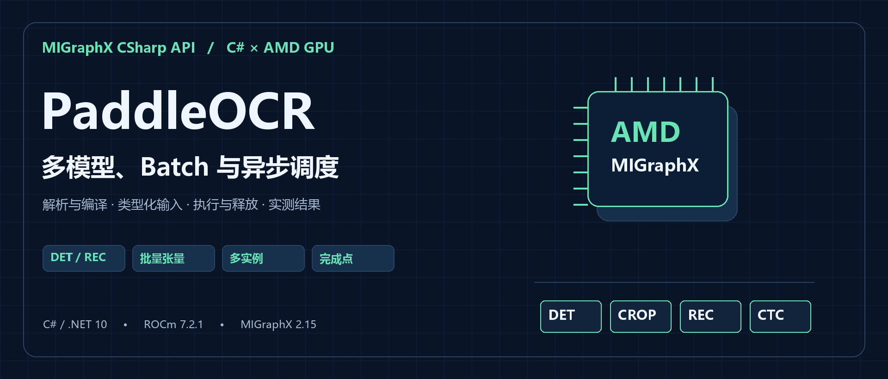
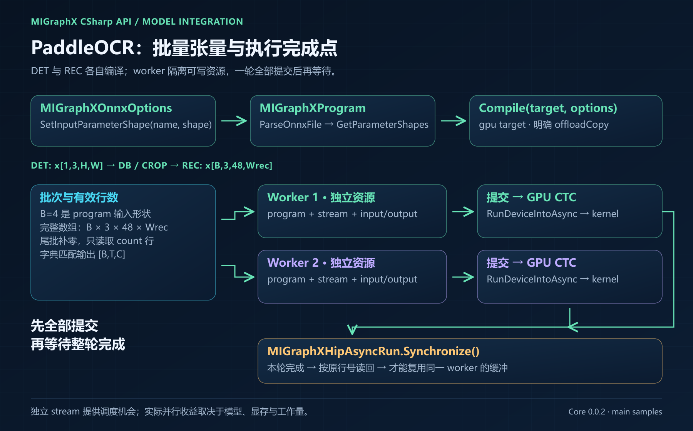
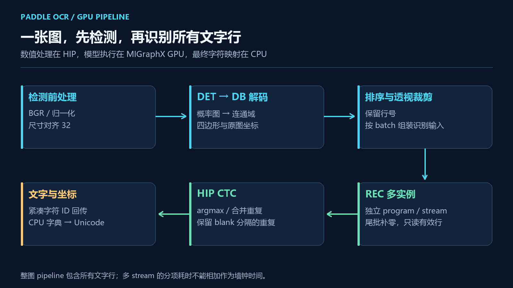
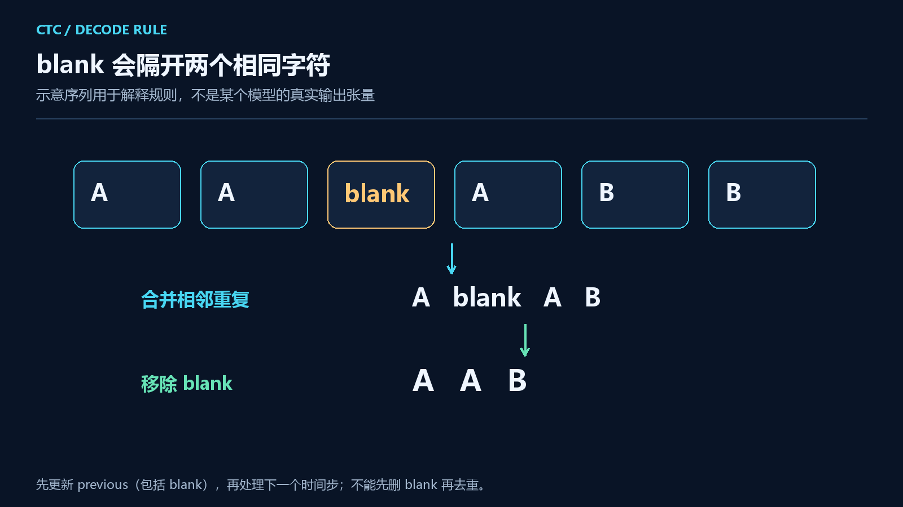
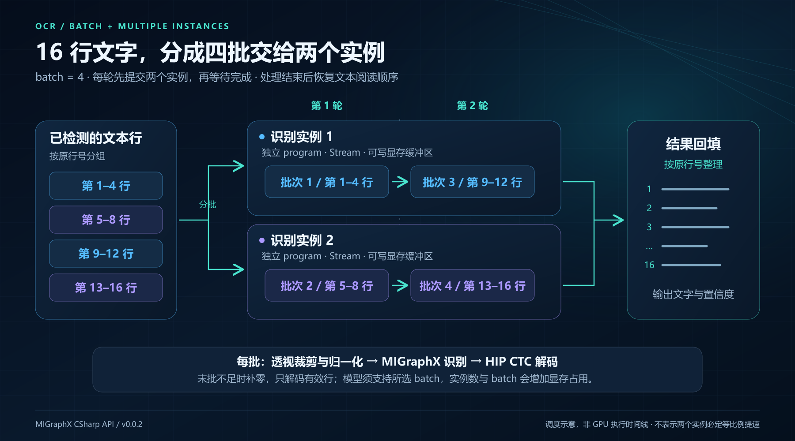
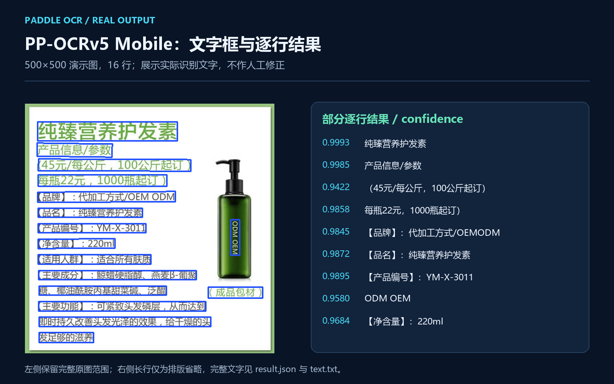
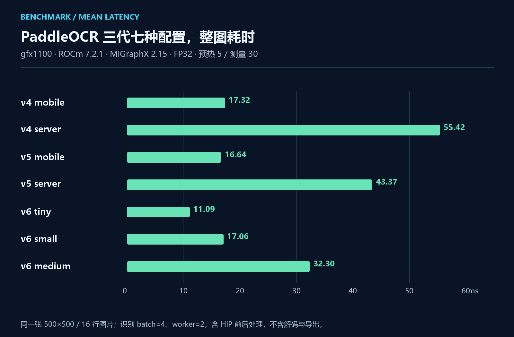

# MIGraphX CSharp API 实战：PaddleOCR 多模型调用、Batch 张量与多实例调度



## 一、MIGraphX CSharp API 项目简介

**MIGraphX CSharp API** 是一个面向 **C# / .NET 开发者**的 AMD MIGraphX 接口库，由「椒颜皮皮虾」（Guojin Yan）开发，项目源码遵循 **Apache License 2.0**。它通过 MIGraphX C ABI 调用 AMD 原生推理引擎，提供 ONNX 模型解析、GPU 编译、张量输入输出和资源管理接口，方便大家将模型接入已有的 .NET 应用。

项目提供类型化数组、形状检查、`IDisposable`、动态输入和模型缓存等接口。普通同步推理使用核心包即可；需要图像预处理、裁剪和输出解码也在 GPU 上执行时，再通过 HIP 适配包连接设备内存与 stream。

目前随项目提供 **YOLO26 五任务、PaddleOCR v4/v5/v6、PP-Structure 文档处理和 CLIP 图文检索**四类独立案例。库负责模型与张量，各案例提供对应的前后处理和结果展示代码，便于大家直接查看实现并接到自己的业务中。

**项目源码与 NuGet：**

```text
项目地址：https://github.com/guojin-yan/MIGraphX-CSharp-API
核心包：https://www.nuget.org/packages/JYPPX.ROCm.MIGraphX.CSharp.API/0.0.2
HIP 适配包：JYPPX.ROCm.MIGraphX.CSharp.API.HIP.Interop 0.0.2
```

当前原生 GPU 路径已在 Linux、ROCm 7.2.1、MIGraphX 2.15.0、gfx1100 上验证。托管包兼容多个 .NET 目标框架，实际运行仍需单独准备匹配的 AMD 驱动与原生运行库。

## 二、PaddleOCR 三代模型与本篇实战

OCR 与单次图像分类不太一样。一张图片先经过文字检测，得到十几条、几十条文字行；每一行还要裁剪、缩放、识别和解码。识别模型本身即使很小，逐行串起来，整图耗时也可能明显增加。

这次把 **PP-OCRv4、v5、v6 放到同一个案例项目**，统一模型选择、字典检查、结果格式和计时方式。检测与识别的数值前后处理使用 HIP，文字行支持 batch 和多个独立推理实例。本文先直接调用库完成一批文字行识别，再解释检测与识别为什么需要两个 program、Batch 怎样体现在 shape 中，以及多 stream 下怎样提交和回收执行。DB、裁剪和 CTC 用于说明张量之间的衔接。

代码位于当前 main 的 `samples/PaddleOcr`，图像、检测、裁剪、识别、HIP kernel、导出和计时都在一个自包含项目中。已发布的 v0.0.2 标签中原项目名为 `PaddleOcrV6`，三代统一后的案例需要使用当前 main；核心 API 无需因此更换版本。

这个项目完成图片文本检测与识别，输出文字、置信度和四边形。它不包含页面内容方向分类、文档去畸变和表格重建；需要标题、段落、表格等文档信息，可以继续使用 `samples/PPStructure`。



| 本篇要解决的问题 | 对应的库用法 |
| --- | --- |
| DET、REC 输入尺寸不同 | 分别创建 `MIGraphXOnnxOptions` 和 `MIGraphXProgram` |
| 一次识别多行 | 解析时固定 `[B,3,48,W]`，创建同形状 argument |
| 检查字典和输出 | `GetOutputShapes()`、`Shape.Lengths`、`ToArray<float>()` |
| 输出概率太大 | `RunDeviceIntoAsync` 后在 GPU 做 CTC，回传紧凑 ID |
| 多实例处理 | 每个实例独立 program、stream 和可写缓冲，完成后复用 |

## 三、三代模型放在一起，怎样选择

### 3.1 支持的七种配置

| 版本 | `--variant` | 配套字典 | 输出类别数，含 blank 与空格 |
| --- | --- | --- | ---: |
| v4 | `mobile` / `server` | `ppocrv4_keys.txt` | 6625 |
| v5 | `mobile` / `server` | `ppocrv5_dict.txt` | 18385 |
| v6 | `tiny` | `PP-OCRv6_tiny_rec_dict.txt` | 6906 |
| v6 | `small` / `medium` | 对应规格的 `PP-OCRv6_*_rec_dict.txt` | 18710 |

如果已有 v4/v5 模型和业务样本，可以先保留原组合接入 MIGraphX；如果准备新项目，可以把 v5 mobile、v6 tiny 等配置放到同一批实际资料上比较。规格更大，通常意味着更多显存和计算开销，但本文这张演示图不足以证明哪一代的准确率更高。

**检测模型、识别模型和字典要作为一组准备。** 字典顺序与模型输出索引对应。类别数一样也不意味着字典可以互换，更不能为了凑输出维度随意删字。

### 3.2 模型目录怎样放

`--model-dir` 指向某一代的目录，不是所有模型的公共父目录。例如：

```text
/data/ocr/models/
├── PP-OCRv4/
│   ├── PP-OCRv4_mobile_det.onnx
│   ├── PP-OCRv4_mobile_rec.onnx
│   └── ppocrv4_keys.txt
├── PP-OCRv5/
│   ├── PP-OCRv5_mobile_det.onnx
│   ├── PP-OCRv5_mobile_rec.onnx
│   └── ppocrv5_dict.txt
└── PP-OCRv6/
    └── tiny/
        ├── PP-OCRv6_tiny_det_inference.onnx
        ├── PP-OCRv6_tiny_rec_inference.onnx
        └── PP-OCRv6_tiny_rec_dict.txt
```

server、small、medium 按相同规则补齐对应文件。文件名与本地导出不同，可以用 `--det-model`、`--rec-model`、`--dictionary` 显式指定，不必为了目录约定重新导出模型。

## 四、环境与工程准备

| 项目 | 本文已验证配置 |
| --- | --- |
| 系统 | Ubuntu 24.04 x86-64 |
| 托管工程 | .NET 10，`net10.0` |
| 原生运行时 | ROCm 7.2.1、MIGraphX 2.15.0 |
| GPU / 精度 | `gfx1100` / FP32 |
| 检测输入 | 按图片长边限制并对齐到 32 的倍数 |
| 识别输入 | 默认 `[4,3,48,320]`，2 个独立实例 |

先准备匹配的 ROCm/MIGraphX 和设备访问权限，再编译案例。NuGet 是托管接口，不包含完整 AMD 驱动与原生运行时；Windows 上能编译项目，也不能据此认为本文 Linux GPU 配置可直接搬过去运行。

```bash
git clone https://github.com/guojin-yan/MIGraphX-CSharp-API.git
cd MIGraphX-CSharp-API
dotnet build samples/PaddleOcr/PaddleOcr.csproj -c Release \
  -p:JYPPXManagedTargetFrameworks=net10.0
```

独立应用先安装核心包和显存适配包：

```bash
dotnet add package JYPPX.ROCm.MIGraphX.CSharp.API --version 0.0.2
dotnet add package JYPPX.ROCm.MIGraphX.CSharp.API.HIP.Interop --version 0.0.2
```

下面使用的 `JYPPX.ROCm.MIGraphXSharp` 是核心包现有命名空间，`Recognition`、`Images`、`HipOcrPipeline` 都属于案例源码。模型与图片单独准备，输出放在仓库外。`--native` 指向 `libmigraphx_c`，`--gpu-architecture` 对应实际设备。案例默认在初始化时用 HIPRTC 编译 kernel，也可通过 `--hip-module` 指向预编译模块。

## 五、直接用库完成一批文字行识别

### 5.1 把四张行图组织成一个输入张量

先单独使用 REC，可以把检测质量与推理调用分开排查。下面代码可以替换 `samples/PaddleOcr/Program.cs`：`Recognition.Prepare` 只负责把已裁好的行图变成 BGR、CHW 数据，模型操作直接使用库接口。

```csharp
using System.Text;
using JYPPX.ROCm.MIGraphXSharp;
using MIGraphXSharp.Samples.PaddleOcr;

var native = "/opt/rocm/lib/libmigraphx_c.so.3";
var model = "/data/ocr/models/PP-OCRv5/PP-OCRv5_mobile_rec.onnx";
var dictionary = Recognition.LoadDictionary(
    "/data/ocr/models/PP-OCRv5/ppocrv5_dict.txt");
string[] lines = ["/data/ocr/line-0.png", "/data/ocr/line-1.png"];
const int batch = 4, height = 48, width = 320;

using var options = new MIGraphXOnnxOptions(native);
options.SetInputParameterShape("x", new long[] { batch, 3, height, width });
using var program = MIGraphXProgram.ParseOnnxFile(model, options);
var inputShape = program.GetParameterShapes()["x"];
var expected = new MIGraphXShape(MIGraphXShapeDataType.Float32,
    new long[] { batch, 3, height, width });
if (!inputShape.HasSameNativeContent(expected))
    throw new InvalidDataException("REC 输入与配置不一致。");
using var target = new MIGraphXTarget(native, "gpu");
using var compile = new MIGraphXCompileOptions(native, offloadCopy: true);
program.Compile(target, compile);

var outputShape = program.GetOutputShapes().Single();
if (outputShape.IsDynamic || outputShape.Rank != 3
    || outputShape.DataType != MIGraphXShapeDataType.Float32
    || outputShape.Lengths[0] != batch
    || outputShape.Lengths[2] != dictionary.Length)
    throw new InvalidDataException("REC 需要 [batch,time,字典类别数]。");
var steps = checked((int)outputShape.Lengths[1]);
var classes = dictionary.Length;
var rowElements = 3 * height * width;

for (var first = 0; first < lines.Length; first += batch)
{
    var count = Math.Min(batch, lines.Length - first);
    var input = new float[batch * rowElements];
    for (var slot = 0; slot < count; slot++)
    {
        using var crop = Images.Load(lines[first + slot]);
        Recognition.Prepare(crop, width, height).CopyTo(input, slot * rowElements);
    }
    using var argument = MIGraphXArgument.Create(native, inputShape, input);
    using var parameters = new MIGraphXParameterMap(native);
    parameters.Add("x", argument);
    using var outputs = program.Run(parameters);
    var probabilities = outputs[0].ToArray<float>();

    // 固定 batch 的补齐行没有对应原图，只读取 count 行。
    for (var slot = 0; slot < count; slot++)
    {
        var text = new StringBuilder();
        var previous = -1;
        for (var t = 0; t < steps; t++)
        {
            var offset = (slot * steps + t) * classes;
            var best = 0;
            for (var c = 1; c < classes; c++)
                if (probabilities[offset + c] > probabilities[offset + best]) best = c;
            if (best != 0 && best != previous) text.Append(dictionary[best]);
            previous = best;
        }
        Console.WriteLine($"{lines[first + slot]}: {text}");
    }
}
```

这里初始化了一套 batch=4 的模型，实际只有两张行图，因此尾部两行是补齐数据。输入数组仍然必须有 `4×3×48×320` 个元素，不能因为有效行少，就给同一个 program 传更短的数组。

Batch 不是一个“运行时加速开关”。它首先是模型输入形状的一部分，导出图内部的 reshape 等节点也要支持该尺寸。`SetInputParameterShape` 确定解析配置，`MIGraphXArgument.Create` 检查实际数据，`Run` 才提交执行。

上面的 CPU 解码为了便于理解，读取了整个概率张量。仓库完整实现额外检查有限值、置信度并返回坐标，HIP 版本则在显存中完成 CTC。

### 5.2 检测和识别各持有自己的 program

DET 输入是 `[1,3,H,W]`，REC 是 `[B,3,48,Wrec]`。检测得到文字框之后，才能确定需要组多少识别批次。两个模型应分别解析、编译和复用，不要对同一个 program 轮流设置检测与识别参数。

两个模型使用相同的调用方式：创建 ONNX options，设置参数 `x`，解析，查询形状，编译，然后绑定 argument 执行。差别在于前处理数组和输出解释：DET 返回 `[1,1,H,W]` 概率图，REC 返回 `[B,T,C]`。

当前案例依据整图尺寸计算 DET 的具体 H/W。处理新的尺寸时需要对应的新流水线；这套实现没有对每个请求启用任意动态 shape。想控制冷启动和显存，可以固定检测画布或按有限尺寸管理会话，但需要同步调整坐标还原，不能只缓存一个错误尺寸的 program。

### 5.3 主机与设备两种执行方式怎样选择

| 环节 | 主机张量路径 | 完整 HIP 路径 |
| --- | --- | --- |
| 编译选项 | `offloadCopy: true` | `offloadCopy: false` |
| 输入绑定 | `MIGraphXArgument` + `MIGraphXParameterMap` | `MIGraphXHipDeviceInput` |
| 执行方法 | `program.Run(parameters)` | `program.RunDeviceIntoAsync(...)` |
| 输出位置 | 主机输出集合，`ToArray<float>()` | 调用方设备缓冲，经 D2D 复制写入 |
| CTC | C# 读取全部 `[B,T,C]` | kernel 解码，主机只读字符 ID 与分数 |

两种方式的模型都在 GPU 上执行。先用主机张量路径确认输入、字典和输出，再接入显存路径，可以把模型问题与 stream、kernel 问题分别定位。

## 六、从张量到文字：衔接前后处理



### 6.1 检测阶段找到文字区域

检测先按 `--det-limit` 限制长边，默认 960，宽高取 32 的倍数。输入使用 BGR 通道，按 `(value/255 - mean)/std` 归一化，mean 为 `[0.485,0.456,0.406]`，std 为 `[0.229,0.224,0.225]`。

DB 模型返回每个像素属于文字区域的概率。后处理要完成阈值、8 邻域连通域、轮廓、凸包、最小面积矩形和外扩，再恢复原图坐标。本例默认像素阈值 0.2、框分数 0.4、unclip ratio 1.4。

这些步骤已在 HIP 中实现。当前外扩使用矩形 unclip，与官方对任意轮廓做多边形 offset 的结果可能有差异。调整检测效果时，先看框是否覆盖完整文字，再判断识别模型，不要只盯着最后的字符串。

### 6.2 文字行裁剪与识别前处理

每个四边形通过透视变换裁出文字行；竖长区域会旋转 90°。随后按高度 48 保持比例缩放，放入固定宽度 320 的识别输入。BGR `/255` 后按 mean/std=`0.5` 归一化，右侧在**归一化后补 0**。

这里补 0 与先补黑边再归一化不是一回事。长文本超过固定宽度时会压缩，可以通过 `--rec-width` 选择更宽的静态输入，但当前代码没有自动长行切片。

### 6.3 CTC 怎样还原字符

识别模型输出 `[batch,time,classes]`。CTC（Connectionist Temporal Classification）解码按时间步选择类别，合并连续重复项，去掉 blank，再按字典映射为文字。



例如 `A A blank A B B` 应得到 `AAB`。如果先移除 blank 再去重，就会错误地丢掉第二个 A。下面是 CPU 对照实现中的核心逻辑，HIP 解码也遵守同样规则：

```csharp
// best 为当前时间步的最大分数类别；0 是 blank。
if (best != 0 && best != previous)
{
    text.Append(dictionary[best]);
    confidence += score;
    ++count;
}
previous = best;  // blank 也必须更新 previous
```

字典由 `Recognition.LoadDictionary` 加载：索引 0 增加 blank，末尾追加空格，并严格检查识别输出类别数。HIP 回传字符 ID 和分数，CPU 最后映射成 Unicode 字符串，无需把整个识别概率张量搬回主机。

## 七、用异步执行对象管理多实例



### 7.1 Batch 处理文字行，worker 提供独立执行资源

假设检测得到 16 行文字。batch=1、worker=1 时，需要逐次处理 16 行；batch=4 时分成 4 批。worker=2 时，一轮先向两个独立实例各提交一批，再等待这一轮结束。

每个 worker 都持有自己的 MIGraphX program、非阻塞 HIP stream、输入输出和裁剪缓冲区。不能为了省一个实例，让多个线程同时改写同一个 program 的缓冲区。只读原图和几何信息可以共享，结果按原始行号回填。

末批不足 batch 时补零，但只解码有效行。模型必须支持所选 batch；示例不会在失败后悄悄退回 batch=1。参数范围为 `--rec-batch 1..32`、`--rec-workers 1..4`。

### 7.2 先提交，再等待，最后复用

`RecognitionWorker` 保存一个 `MIGraphXHipAsyncRun`。下面是它在源码中的提交与完成逻辑；`Session.Enqueue()` 内部直接调用 `program.RunDeviceIntoAsync(inputs, Outputs, Gpu.Stream)`：

```csharp
// 摘自 HipOcrPipeline.RecognitionWorker，成员 Session 已完成初始化。
private MIGraphXHipAsyncRun? pending;

public void Enqueue() => pending = Session.Enqueue();

public void Complete()
{
    if (pending is null) return;
    pending.Synchronize();
    pending.Dispose();
    pending = null;
}
```

调度顺序是：为每个活跃 worker 准备本批输入，提交模型，再向它自己的 stream 提交 `ctc_argmax` 和 `ctc_compact`；所有 worker 都提交完，才逐个调用 `Complete()`。因为后处理与模型在同一 stream，完成时本批 CTC 也已经执行。

如果每提交一个 worker 就立即等待，再提交下一个，主机就把两条流串行化了。反过来，只提交不等待就写入下一批，也会覆盖仍在使用的输入和输出。源码按 wave 组织：一轮最多给每个 worker 一批，整轮结束后复用资源。

原图和已完成的检测几何可以共享，但识别输入、输出、裁剪 scratch 属于各自 worker。多个 worker 写最终紧凑结果时，使用互不重叠的原始行号区间，不能都从槽位 0 开始覆盖同一结果。

异常退出也要完成已提交工作。源码在 `finally` 中对所有 worker 调用 `Complete()`，然后才允许释放 program、kernel 和显存；单纯捕获异常并清空集合，无法取消已经提交到 GPU 的执行。

### 7.3 用实测选择配置

在 `0.0.2` 发布基准中，PP-OCRv6 tiny 使用同一张 500×500 图片、16 行文字、512×512 检测输入，预热 5 次、测量 30 次：

| 识别 batch | 独立实例 | 整图平均 ms | P95 ms |
| ---: | ---: | ---: | ---: |
| 1 | 1 | 17.77 | 18.99 |
| 4 | 1 | 11.50 | 11.63 |
| 4 | 2 | 10.97 | 11.08 |

这组数据中，先组 batch 的收益比较明显，增加第二个实例还有小幅改善。它并不能证明 worker 越多越快：图片只有一两行时，多实例可能用不上，却仍需要编译并占用显存。实际应用建议从 batch=4、worker=1 开始，再根据行数和整图耗时决定是否增加实例。

## 八、把库调用接回完整 OCR

### 8.1 按源码定位每一层

| 文件 | 本文对应的实现 |
| --- | --- |
| `OcrModels.cs` | 解析 v4/v5/v6 的模型和字典组合 |
| `InferenceSession.cs` | 核心 API 的同步主机张量调用 |
| `HipRuntimeContext.cs` | 编译后设备参数、输出缓冲与 `RunDeviceIntoAsync` |
| `HipOcrPipeline.cs` | DET → DB → 裁剪 → REC worker → CTC |
| `Recognition.cs` | CPU 对照前处理、字典与 CTC |

业务入口最终得到 `Lines` 与 `AcceptedText`：前者保留逐行文字、坐标和置信度，后者按 `--text-threshold` 过滤，默认 0.5。建议同时保留原始行结果，让低分行能够回到原图复核。

### 8.2 这张图片识别出了什么



图中使用 v5 mobile 的实际输出，前几行包括“纯臻营养护发素”等商品说明，共检测识别到 16 行。旁边的文字与分数读取自结果 JSON，没有人工改成标准答案。

换成自己的图片时，可以同时查看 `crop-xxx.png`。框位置正确但裁剪截断，和裁剪正常但字典不匹配，是两类不同问题。保留裁剪图能让排查更直接。

### 8.3 保留原版入口，运行与切换模型

```bash
dotnet run --project samples/PaddleOcr -c Release --no-build -- \
  --native /opt/rocm/lib/libmigraphx_c.so.3 \
  --backend hip --gpu-architecture gfx1100 \
  --ocr-version v5 --variant mobile \
  --model-dir /data/ocr/models/PP-OCRv5 \
  --image /data/ocr/images/document.jpg --output /results/ocr-v5 \
  --rec-batch 4 --rec-workers 2 --warmup 5 --iterations 30
```

切 v4 用 `--ocr-version v4 --variant mobile --model-dir /data/ocr/models/PP-OCRv4`；切 v6 tiny 用 `--ocr-version v6 --variant tiny --model-dir /data/ocr/models/PP-OCRv6`。其余输入、输出和计时参数不变。

只识别一张已经裁好的文本行，可以增加 `--recognition-only true` 并把输入换成行图。这个模式默认 batch=1、worker=1；不需要先伪造一个检测模型。

结果中，`text.txt` 方便复制，`result.json` 保留结构化数据和速度，`annotated.svg` 展示中文文字与坐标，`preview.png` 和裁剪图便于复核。输出路径请放在源码仓库外。

## 九、三代模型的整图速度

下面七种配置使用同一张 500×500 图片，均得到 16 行文字。环境为 Ubuntu 24.04 x86-64、gfx1100、ROCm 7.2.1、MIGraphX 2.15.0、FP32，检测输入 512×512，识别输入 48×320、batch=4、worker=2。每项预热 5 次、测量 30 次，未锁频。

| 模型 | 整图平均 ms | P95 ms |
| --- | ---: | ---: |
| PP-OCRv4 mobile | 17.32 | 17.42 |
| PP-OCRv4 server | 55.42 | 55.93 |
| PP-OCRv5 mobile | 16.64 | 16.78 |
| PP-OCRv5 server | 43.37 | 44.25 |
| PP-OCRv6 tiny | 11.09 | 10.93 |
| PP-OCRv6 small | 17.06 | 17.46 |
| PP-OCRv6 medium | 32.30 | 33.58 |



这里计时从已解码图片上传开始，包含 HIP 检测前处理、模型执行、DB、裁剪、所有文字行的识别、CTC 和最终文字回传；排除文件解码、模型/kernel 编译、绘图与写盘。

v6 tiny 的平均值略高于 P95，是少量较大耗时样本拉高了平均值；P95 按 nearest-rank 计算。前面调度对比中的 10.97 ms 来自发布基准，本表 11.09 ms 来自三代统一案例的另一轮运行，两次记录应分别看，不能混成同一轮数据。

七种配置的真实输入张量与 ONNX Runtime CPU 做了数值对照，逐行 CTC 文本一致；这说明同一输入在两套执行路径上的对应关系，并不等于与人工标注完全一致。只有一张图，也不适合用来评价数据集识别准确率。

## 十、扩展和排查时，沿着 API 找问题

如果关注速度，先检查整图时间，再决定模型规格、识别宽度和调度。文本少时减小 batch/worker；长文本优先检查裁剪和 `--rec-width`；小字多时再考虑增大检测输入，尺寸增加也会带来更多计算和显存开销。

默认 HIP 路径已经覆盖数值前后处理，但图片文件解码、绘图和 Unicode 映射仍在 CPU；少量计数、裁剪尺寸也要回主机用于调度。多个 stream 的 event 分项可能重叠，不能把所有分项相加冒充整图墙钟耗时。

当前 DB 最多处理 3000 个连通域，裁剪边长上限 8192；超出会明确报错。读取图片时会按 EXIF 统一像素方向，但这不等于识别了页面内容的正倒方向。没有 EXIF 的倒置文档，仍要先做方向校正。

遇到错误可以按顺序检查：解析阶段确认模型支持 batch 与尺寸；argument 阶段核对 float32 和元素数；输出阶段核对 `[B,T,C]` 与配套字典；文字重复或丢字时检查 blank 更新规则；只有多实例时异常，则优先检查缓冲隔离、行号偏移和完成点。

这篇用 OCR 展开了同一套库接口如何组织两个模型、固定批量张量和多 stream 执行。新增一代识别模型时，模型、字典与前后处理要重新核对，而解析、编译、绑定和异步完成的使用方法可以继续复用。
