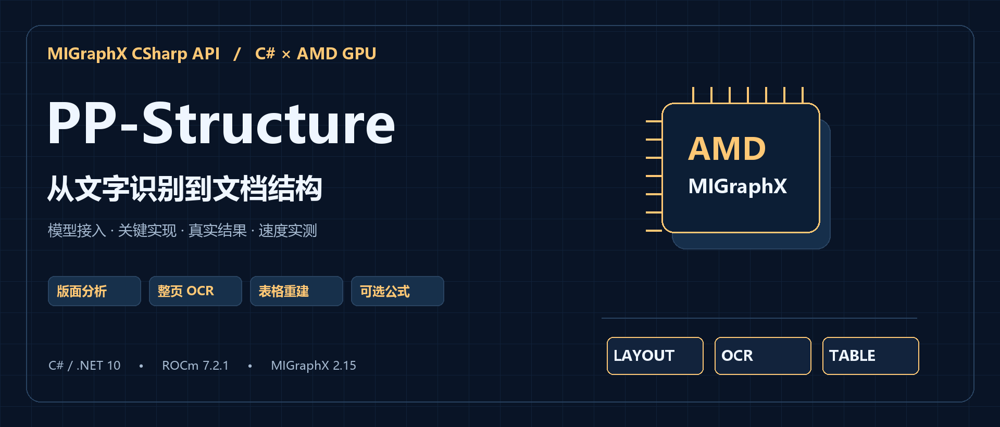
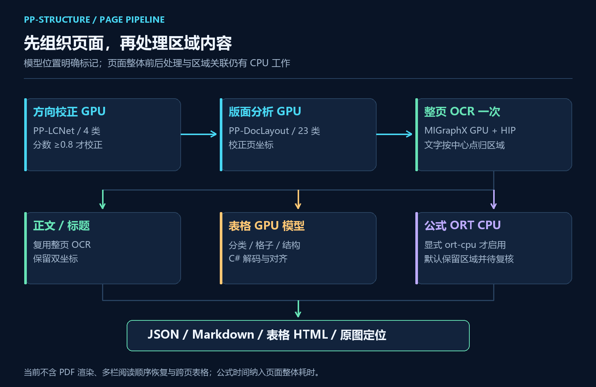
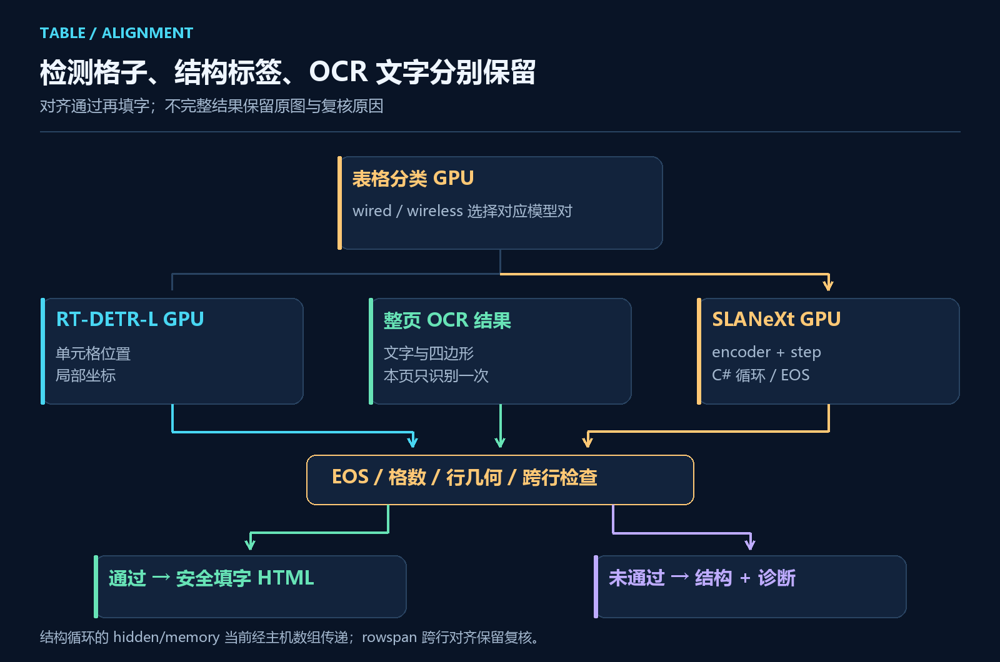
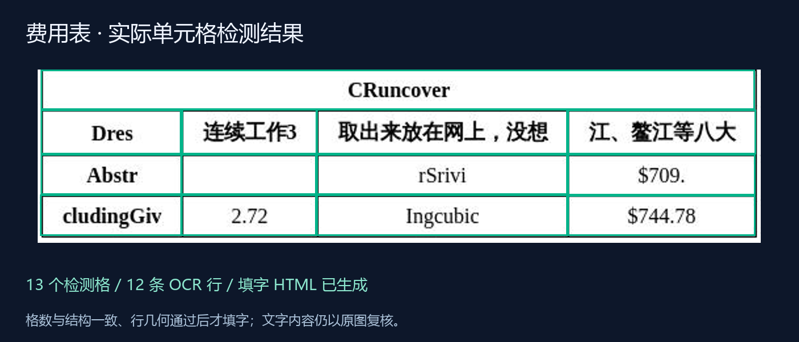

# 用 C# 在 AMD GPU 上组合 PP-Structure：版面分析、OCR、表格重建与公式处理



## 一、MIGraphX CSharp API 项目简介

**MIGraphX CSharp API** 是一个面向 **C# / .NET 开发者**的 AMD MIGraphX 接口库，由「椒颜皮皮虾」（Guojin Yan）开发，项目源码遵循 **Apache License 2.0**。它通过 MIGraphX C ABI 调用 AMD 原生推理引擎，提供 ONNX 解析、GPU 编译、张量输入输出和资源管理接口，方便在现有 .NET 工程中组织模型调用。

项目提供类型化数组、形状检查、`IDisposable`、动态输入和模型缓存，也可以通过可选 HIP 适配包连接自己的显存与 stream。对于文档这种多模型任务，可以复用已经编译的模型，在 C# 中组织各阶段和业务结果。

目前随项目提供 **YOLO26 五任务、PaddleOCR v4/v5/v6、PP-Structure 文档处理和 CLIP 图文检索**四类独立案例。图像处理、模型解码和文档导出放在案例层，核心库没有引入 OCR、ImageSharp 或 ONNX Runtime 依赖。

**项目源码与 NuGet：**

```text
项目地址：https://github.com/guojin-yan/MIGraphX-CSharp-API
核心包：https://www.nuget.org/packages/JYPPX.ROCm.MIGraphX.CSharp.API/0.0.2
HIP 适配包：JYPPX.ROCm.MIGraphX.CSharp.API.HIP.Interop 0.0.2
```

当前原生 GPU 路径已在 Linux、ROCm 7.2.1、MIGraphX 2.15.0、gfx1100 上验证。托管包兼容多个 .NET 目标框架，实际运行仍需单独准备匹配的 AMD 驱动与原生运行库。

## 二、从文字识别到文档结构

### 2.1 文字读出来以后，文档还缺什么

PaddleOCR 可以完成文字检测与识别，读出图片里的内容。但换成报纸、论文、费用表，直接把所有行拼成一段文本，很多信息就丢了：哪一块是标题，哪一块是正文，哪些文字属于同一个表格，公式应该放在哪里？

文档处理需要在 OCR 上面再加一层结构。我这次将 Paddle 文档模型组合成一个独立 C# 案例，接入页面方向、版面、整页 OCR、表格分类、单元格检测、结构解码，并导出 JSON、Markdown、HTML 和原图定位。

代码位于当前 main 的 `samples/PPStructure`，v0.0.2 发布标签尚不包含这个新项目，核心 API 沿用 `0.0.2`。本文按页面处理顺序介绍代码，再单独拆开表格路径；演示包含报刊、混排、论文、公式、费用表和倒置页六种输入，最后给出逐页耗时。

执行范围也分别说明：**方向、版面、OCR 和表格模型使用 MIGraphX GPU，OCR 数值前后处理使用 HIP；公式识别是显式选择的 ONNX Runtime CPU 路径。** FormulaNet 的动态图在当前 MIGraphX 2.15 下不能直接解析，因此这不是全 GPU 的公式方案。

### 2.2 先看两张复杂页面


报刊页得到 32 个区域、144 条文字行；混排页得到 14 个区域、192 条文字行。图中的框根据实际输出坐标绘制，低分文字也保留，没有手工调整成理想结果。

这里返回的已经不只是文字列表。每个区域包含类别、位置、所属文字，以及可选的表格或公式；每条文字还保留校正页和原始方向页的两套坐标，方便在业务界面定位原文。

## 三、一页文档需要哪些模型



| 阶段 | 模型与输入 | 主要输出 | 执行位置 |
| --- | --- | --- | --- |
| 页面方向 | PP-LCNet，224×224 | 0/90/180/270 度 | MIGraphX GPU |
| 版面分析 | PP-DocLayout-L，640×640 | 23 类区域 | MIGraphX GPU |
| 整页文字 | PP-OCRv5 Mobile DET/REC | 文字、分数、四边形 | MIGraphX GPU + HIP |
| 表格分类 | PP-LCNet，224×224 | wired / wireless | MIGraphX GPU |
| 单元格位置 | RT-DETR-L，640×640 | 格子坐标 | MIGraphX GPU |
| 表格结构 | SLANeXt，512×512 | 行列和合并标签 | MIGraphX GPU，C# 调度循环 |
| 可选公式 | PP-FormulaNet_plus-S，384×384 灰度 | LaTeX | 显式 ORT CPU |

这些模型不是把同一个 resize 参数改来改去就能通用。方向分类使用 RGB、ImageNet 归一化；版面使用 RGB `/255`，并传入 `im_shape`、`scale_factor`；SLANeXt 使用自己的 BGR、归一化和补边规则。前处理配置集中在 `DocumentProcessing.cs`。

### 3.1 方向先校正，文字和坐标再统一

方向模型输出四类概率，置信度达到 0.8 才旋转。之后的版面、OCR 和表格都在校正页上处理，避免每个模块各转一次图。

`DocumentLine.Polygon` 对应校正页，`SourcePolygon` 对应输出的 `source.png`。原图带 EXIF 时先统一像素方向，再记录这里的原始方向页。倒置页测试中，模型给出 180° 校正，校正后识别出 5 行文字。

### 3.2 整页 OCR 只运行一次

版面区域有正文、标题、图片、表格等。当前实现先对整页跑一次 OCR，再按文字框中心点，把行归入区域；表格内文字也从这一份结果复用。

这样不用为每个区域重复运行 DET/REC。代价是中心点归属比较简单，重叠区域可能共享文字，也还没有恢复多栏阅读顺序。输出 Markdown 可以作为后续整理的起点，不能直接当作排版完全还原的文档。

## 四、准备环境、模型与六张演示图片

### 4.1 本文配置

| 项目 | 实际环境 |
| --- | --- |
| 系统 | Linux x64 |
| CPU | AMD EPYC 9334 |
| GPU | `gfx1100`，48 GiB 显存 |
| 原生运行时 | ROCm 7.2.1、MIGraphX 2.15.0 |
| .NET | SDK 10.0.300，`net10.0` |
| 模型精度 | FP32 |
| OCR 调度 | batch=4，worker=2 |
| 可选公式 | ONNX Runtime CPU，4 线程 |

模型下载来源：`https://github.com/guojin-yan/DeploySharp/releases/tag/models-paddleocr`。

在仓库根目录准备文件。Python 只用于一次性改写兼容 ONNX，后续页面处理入口是 C#：

```bash
bash samples/PPStructure/fetch-assets.sh /data/document
python3 -m venv /data/document/model-tools
/data/document/model-tools/bin/pip install onnx==1.20.1 numpy==2.2.6
/data/document/model-tools/bin/python \
  samples/PPStructure/prepare-models.py /data/document/models
dotnet build samples/PPStructure/PPStructure.csproj -c Release \
  -p:JYPPXManagedTargetFrameworks=net10.0
```

脚本保留原模型，另外生成 `.migraphx.onnx`、表格 `.encoder.onnx` 和 `.step.onnx`，在模型目录写入 `prepared-models.json`。后续升级模型时，需要重新准备匹配文件，不要拿旧的 step 与新的 encoder 混用。

### 4.2 为什么要准备兼容图

当前 MIGraphX 2.15 无法直接执行这些原始导出图中的部分动态循环与数组写入。版面、单元格模型对 scalar reshape 做等价 Squeeze 改写；SLANeXt 则把循环移到 C#，保留编码器和单步解码器。

这一步改变的是模型执行组织，不是重新训练参数。两类表格拆分图已与原始完整模型比较到 EOS，后文会解释 C# 如何管理解码步骤。

### 4.3 页面清单与输入范围

默认清单来自 PaddleX 官方公开演示图，报刊原名 `pp_structure_v3_demo.png`，费用表原名 `table_recognition.jpg`，其他图片也在下载脚本中保留来源。

```text
图片来源：https://paddle-model-ecology.bj.bcebos.com/paddlex/imgs/demo_image/
公式 tokenizer：https://huggingface.co/PaddlePaddle/PP-FormulaNet_plus-S
```

`documents.json` 使用页面数组，`kind` 可选 `auto/text/table/formula`：

```json
[
  { "id": "news", "path": "demo-inputs/news-page.png", "kind": "auto" },
  { "id": "expenses", "path": "demo-inputs/expense-table.jpg",
    "kind": "table", "autoOrient": false }
]
```

`auto` 使用版面模型，明确写 `table` 或 `formula` 时将整张输入当作对应区域。路径相对清单目录解析，允许 1–100 页。ID 唯一，使用小写字母、数字、短横线，最多 64 字符。

## 五、C# 如何得到结构化页面

### 5.1 先跑通一张页面

下面入口可以替换 `samples/PPStructure/Program.cs`，保留同项目的其他源文件。`DocumentPipeline` 是案例层封装，不是核心包内置的文档 API。

```csharp
using System.Text.Json;
using MIGraphXSharp.Samples.PPStructure;
using Images = MIGraphXSharp.Samples.PPStructure.Ocr.Images;

var native = "/opt/rocm/lib/libmigraphx_c.so.3";
var models = "/data/document/models";
var imagePath = "/data/document/demo-inputs/news-page.png";
string[] options =
[
    "--native", native,
    "--gpu-architecture", "gfx1100",
    "--rec-batch", "4",
    "--rec-workers", "2",
    "--formula-backend", "disabled"
];

using var source = Images.Load(imagePath);
using var pipeline = new DocumentPipeline(native, models, options);
var page = pipeline.Run(new DocumentInput("news", imagePath), source);

Console.WriteLine($"校正角度：{page.CorrectionCounterClockwise}°");
Console.WriteLine($"区域：{page.Regions.Length}，文字行：{page.Lines.Length}");
foreach (var region in page.Regions)
{
    Console.WriteLine($"[{region.Layout.Category}]");
    foreach (var line in region.Lines)
        Console.WriteLine($"  {line.Confidence:F3}  {line.Text}");
    if (region.Table is { } table)
        Console.WriteLine($"  表格：{table.Style}，填字完成：{table.FilledHtml is not null}");
}

Directory.CreateDirectory("/results/document-single");
File.WriteAllText("/results/document-single/page.json",
    JsonSerializer.Serialize(page, new JsonSerializerOptions { WriteIndented = true }));
```

第一次调用会初始化实际用到的模型，不能拿这一次总时间当稳定页面时延。原版入口在预热之后再测量，并增加了 HTML、Markdown、图片与汇总导出。

模型会在进程内复用。OCR 保存当前尺寸的一套流水线，页面尺寸变化时释放旧的再创建新的，避免把每种页尺寸的模型都一直缓存到显存里；它没有承诺任意尺寸页面都不需要重新编译。

### 5.2 业务接口应该读取哪些字段

| 字段 | 适合的用途 |
| --- | --- |
| `Regions[].Layout` | 标题、正文、图片、表格等区域类别和框 |
| `Regions[].Lines` | 该区域关联的文字行 |
| `Lines[].Polygon / SourcePolygon` | 校正页展示 / 原始方向页定位 |
| `Regions[].Table` | 单元格、结构、可选填字 HTML、诊断 |
| `Regions[].Formula` | 后端、LaTeX、是否完整 |
| `Diagnostics` | 低分、缺失 EOS、未启用公式等复核原因 |

前端可以按区域高亮原图，后端可以保存结构化 JSON 与索引文字。低置信度或结构不完整的内容单独进入复核，保留原因，便于用户知道哪里需要处理。

## 六、表格重建：位置、结构和文字要对得上

### 6.1 三类信息各自解决什么



表格分类选择 wired 或 wireless 的模型组合；RT-DETR 给出单元格位置；SLANeXt 输出 `<table>`、`<tr>`、`<td>` 和合并标签；OCR 给出文字。只有把这些信息对应起来，才能生成可使用的表格。

不能把检测框从左到右排一下，就认为得到了完整 HTML。合并单元格、漏检、重复框都会破坏这种简单假设。

### 6.2 SLANeXt 循环放在 C#，子模型仍在 GPU

编码器输出 memory，单步解码器接收 `hidden`、`token`、`memory0`，返回下一步状态与 token。`TableStructureSession.Run` 每次传入上一步结果，最多执行 501 步，token=49 即 EOS，随后停止。

两个子模型都使用 MIGraphX GPU。但当前 hidden 和 encoder memory 经主机数组传递，不能把这条结构解码写成“显存全程常驻”。长表格需要更多解码步，主机调度与复制也会进入页面耗时。

这就是图中单独标出 C# 调度循环的原因：执行模型的位置和整个系统的数据流，是两个需要分别说明的问题。

### 6.3 对齐通过，才把文字填入 HTML

下面从 `DocumentPipeline` 摘出对齐与填字的关键部分，省略了模型执行和诊断收集。`text` 是表格区域关联的整页 OCR 行，`rect` 是该表格在校正页上的裁剪矩形，`cells` 使用表格裁剪图坐标：

```csharp
var aligned = DocumentPipeline.AlignCells(decoded.Markup, cells, diagnostics);
if (aligned is not null)
{
    var cellText = aligned.Select(cell => string.Join(" ",
        text.Where(line => cell.Bounds.Contains(
                line.Polygon.Average(p => p.X) - rect.X,
                line.Polygon.Average(p => p.Y) - rect.Y))
            .Select(line => line.Text))).ToArray();
    html = DocumentProcessing.FillTable(decoded.Markup, cellText);
}
```

这段之前还会检查结构 EOS 和分类置信度。`AlignCells` 再检查结构槽位数、检测格数和行几何；当前尚不支持 `rowspan` 跨行对齐，遇到它会保留诊断。填字会转义 HTML 特殊字符，不能让识别到的文本直接变成 HTML 标签。

### 6.4 费用表实际得到了什么



这张费用表检测出 13 个单元格、12 条 OCR 行，对齐后生成填字 HTML。没有文字的格子可以保留为空，不要求每个框都必须有一条文本。

六页中共遇到三处表格，两处生成填字 HTML，另一处缺失 EOS，保留结构与诊断。原图自身存在中英文混排与不完整单词，文章配图也保留原始预测，不把它改成“完全正确”的展示结果。

## 七、公式：明确选择 CPU 路径

FormulaNet 原始图中的动态 Loop 当前无法由 MIGraphX 2.15 解析，案例默认 `--formula-backend disabled`。检测到公式区域时，保留区域，并返回 `formula-recognition-disabled` 复核提示。

需要公式时，显式设置 `--formula-backend ort-cpu`，通过 ONNX Runtime CPU 得到 LaTeX。结果保存 `Backend=ort-cpu`，阶段记录 `formula-ort-cpu`，时间也纳入整页墙钟。程序不会在 GPU 失败后无提示地切到 CPU。

前处理使用 ImageSharp 去白边、灰度、缩放和补边，其插值不与官方 Pillow 逐像素一致。公式转写即使包含 EOS，也仍要与原图比对，尤其是上下标、括号和分式。

## 八、运行完整六页案例并查看输出

保留原版 `Program.cs` 时执行：

```bash
dotnet run --project samples/PPStructure -c Release --no-build -- \
  --native /opt/rocm/lib/libmigraphx_c.so.3 --gpu-architecture gfx1100 \
  --models /data/document/models --manifest /data/document/documents.json \
  --output /results/document --formula-backend ort-cpu \
  --rec-batch 4 --rec-workers 2 --warmup 1 --iterations 10
```

初次需要编译多套模型，可能花几分钟。输出使用一个新的仓库外目录，避免把上次文件当成这次结果。

| 文件 | 内容与用途 |
| --- | --- |
| `index.html` | 统一浏览六页、文字、表格和公式 |
| `summary.json` | 实际后端、页状态、性能与错误 |
| `<id>/page.json` | 区域、文字、双坐标、模型 hash 与阶段信息 |
| `<id>/document.md`、`text.txt` | 后续归档与文字索引 |
| `<id>/source.png`、`preview.png`、`annotated.svg` | 原始方向页、校正页与标注 |
| `<id>/table-*.json/.html` | 表格结构；对齐成功才有填字 HTML |
| `<id>/formula-*.tex` | 显式启用公式后的 LaTeX |

退出码 `0` 表示流程完成，`3` 表示有待复核内容，`1` 表示至少一页失败。批量作业应结合 `summary.json` 判断，不要把有复核提示的页面直接当作程序崩溃，也不要将其标为内容全部正确。

## 九、六种页面的速度与结果

以下数据来自 2026-11-01，环境见第四节。每页预热 1 次，测量 10 次，FP32，OCR batch=4、worker=2，显式启用 ORT CPU 公式，CPU 公式 4 线程：

| 页面 | 区域 / OCR 行 | 平均 ms | P95 ms | 本页工作量 |
| --- | ---: | ---: | ---: | --- |
| 多栏报刊 | 32 / 144 | 129.22 | 149.11 | 方向、版面与整页 OCR |
| 图文混排 | 14 / 192 | 802.58 | 896.57 | 方向、版面、OCR、2 处表格 |
| 论文页 | 23 / 115 | 1323.54 | 1590.69 | 方向、版面、OCR、7 处 CPU 公式 |
| 公式专页 | 1 / 0 | 263.90 | 268.43 | CPU 公式与前处理 |
| 费用表 | 1 / 12 | 88.22 | 120.84 | OCR、表格分类、格子、结构与填字 |
| 倒置页 | 1 / 5 | 15.53 | 17.15 | 方向校正与 OCR |

这六页共得到 72 个区域、468 条 OCR 行、8 处公式，没有失败页，3 页带复核提示。它说明这组资料完成了端到端流程，不代表人工标注意义上的识别准确率。

页面越复杂，时间也越长。混排页包含两处表格，需要循环结构解码；论文页还有七处 CPU 公式。因此不能看到论文 1323.54 ms，就把它说成“AMD GPU 一次推理要一秒多”。表中的每一行是不同工作量的页面流程。

计时从已解码图片开始，包含方向、前处理、GPU 模型、HIP OCR、结构循环、文字关联及可选 CPU 公式。文件解码、模型编译、预热、绘图和写盘排除。模型分项包含主机复制，OCR 分项又包含整条 OCR 流水线，不能当作同一口径的纯 kernel 时间。

真实张量对照覆盖方向、版面、表格分类、wired/wireless 格子检测、编码器及实际解码步，638 份捕获通过 GPU/ORT CPU 数值检查；表格 token 另与原始完整模型对照到 EOS。这些检查用于确认执行路径，文字、表格与公式的业务正确性仍需要结合原图复核。

## 十、怎样接到文档归档应用

比较实用的接法是先保存 `page.json`、原图和文字索引，再按 `Diagnostics` 进入人工复核。用户点击搜索结果，可以通过 `SourcePolygon` 回到原始方向页；表格有 `FilledHtml` 时展示表格，没有时展示区域与原因。

当前输入是页面图片，不含 PDF 渲染、多栏阅读顺序恢复、跨页表格合并或人工结果回写。PDF 可以在业务外层先渲染成页图，但转换耗时、页码和分辨率需要自己记录；Markdown 导出也只是结构化内容的起点。

对 .NET 开发者而言，这个案例把多模型组合的代码放在同一个可阅读工程里：方向和版面先组织页面，OCR 提供文字，表格对齐后生成结构，可选公式明确记录 CPU 后端。先把这些结果接到自己的页面与复核流程中，再根据真实资料扩展，比只保留一段拼接后的文字更容易继续维护。
