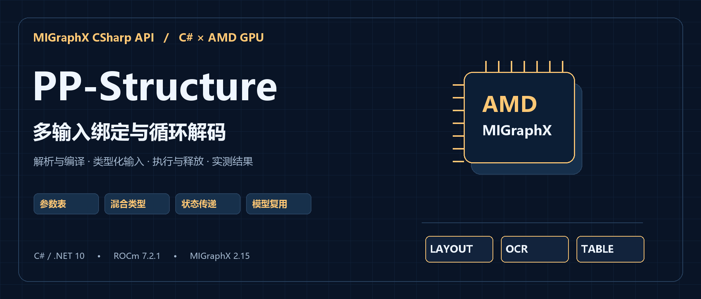
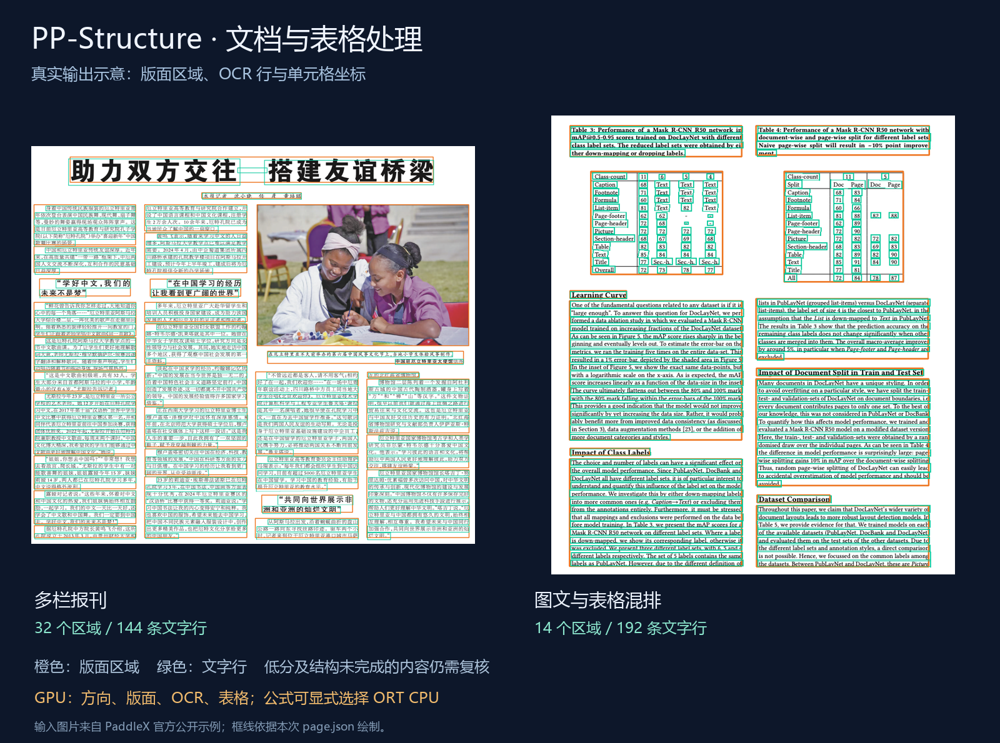
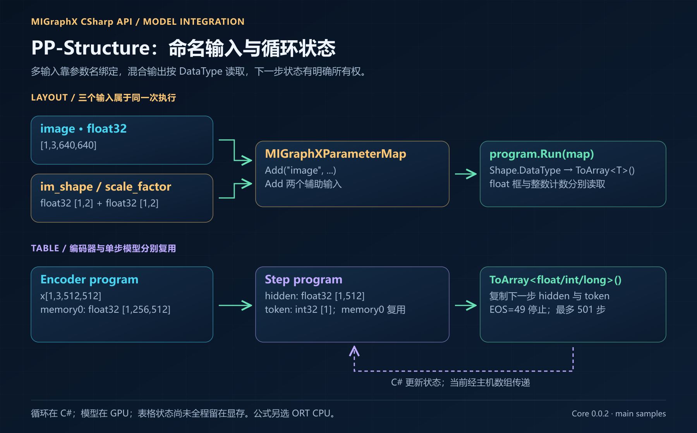
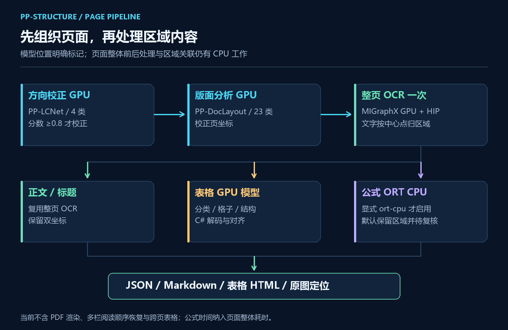
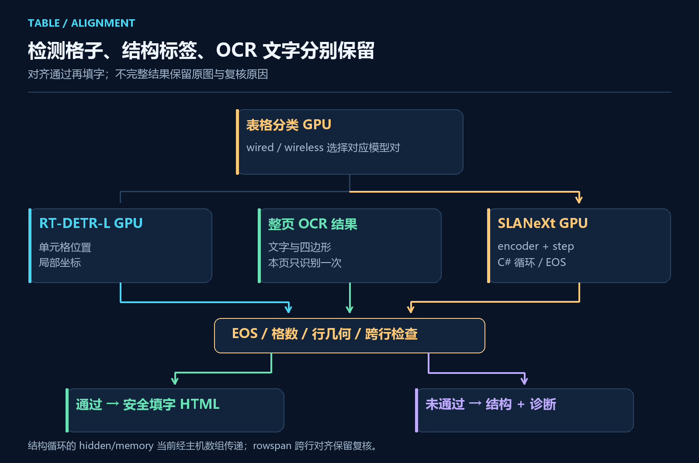
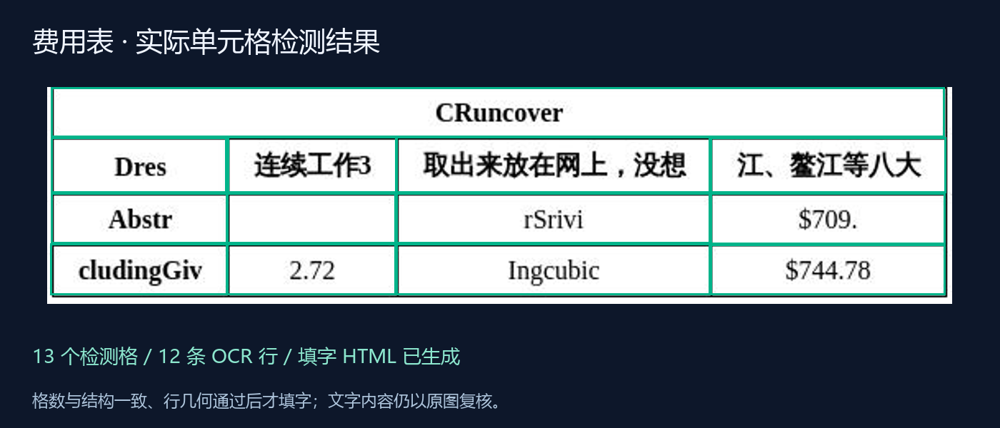

# MIGraphX CSharp API 实战：用 PP-Structure 组织多输入模型与循环解码



## 一、MIGraphX CSharp API 项目简介

**MIGraphX CSharp API** 是一个面向 **C# / .NET 开发者**的 AMD MIGraphX 接口库，由「椒颜皮皮虾」（Guojin Yan）开发，项目源码遵循 **Apache License 2.0**。它通过 MIGraphX C ABI 调用 AMD 原生推理引擎，提供 ONNX 解析、GPU 编译、张量输入输出和资源管理接口，方便在现有 .NET 工程中组织模型调用。

项目提供类型化数组、形状检查、`IDisposable`、动态输入和模型缓存，也可以通过可选 HIP 适配包连接自己的显存与 stream。对于文档这种多模型任务，可以复用已经编译的模型，在 C# 中组织各阶段和业务结果。

目前随项目提供 **YOLO26 五任务、PaddleOCR v4/v5/v6、PP-Structure 文档处理和 CLIP 图文检索**四类独立案例。图像处理、模型解码和文档导出放在案例层，核心库没有引入 OCR、ImageSharp 或 ONNX Runtime 依赖。

**项目源码与 NuGet：**

```text
项目地址：https://github.com/guojin-yan/MIGraphX-CSharp-API
核心包：https://www.nuget.org/packages/JYPPX.ROCm.MIGraphX.CSharp.API/0.0.2
HIP 适配包：JYPPX.ROCm.MIGraphX.CSharp.API.HIP.Interop 0.0.2
```

当前原生 GPU 路径已在 Linux、ROCm 7.2.1、MIGraphX 2.15.0、gfx1100 上验证。托管包兼容多个 .NET 目标框架，实际运行仍需单独准备匹配的 AMD 驱动与原生运行库。

## 二、从文字识别到文档结构

### 2.1 文字读出来以后，文档还缺什么

PaddleOCR 可以完成文字检测与识别，读出图片里的内容。但换成报纸、论文、费用表，直接把所有行拼成一段文本，很多信息就丢了：哪一块是标题，哪一块是正文，哪些文字属于同一个表格，公式应该放在哪里？

文档处理需要在 OCR 上面再加一层结构。我这次将 Paddle 文档模型组合成一个独立 C# 案例，接入页面方向、版面、整页 OCR、表格分类、单元格检测、结构解码，并导出 JSON、Markdown、HTML 和原图定位。

代码位于当前 main 的 `samples/PPStructure`，v0.0.2 发布标签尚不包含这个新项目，核心 API 沿用 `0.0.2`。本文重点展开两个接口问题：版面模型怎样一次绑定图片与辅助张量，表格单步模型怎样在 C# 循环中传递 float32 状态和整数 token。页面处理用于串起这些调用，六页演示结果用于检查最后的组合效果。

执行范围也分别说明：**方向、版面、OCR 和表格模型使用 MIGraphX GPU，OCR 数值前后处理使用 HIP；公式识别是显式选择的 ONNX Runtime CPU 路径。** FormulaNet 的动态图在当前 MIGraphX 2.15 下不能直接解析，因此这不是全 GPU 的公式方案。

### 2.2 先看两张复杂页面



报刊页得到 32 个区域、144 条文字行；混排页得到 14 个区域、192 条文字行。图中的框根据实际输出坐标绘制，低分文字也保留，没有手工调整成理想结果。

这里返回的已经不只是文字列表。每个区域包含类别、位置、所属文字，以及可选的表格或公式；每条文字还保留校正页和原始方向页的两套坐标，方便在业务界面定位原文。



| 任务中的问题 | 需要的库能力 |
| --- | --- |
| 版面模型有图片和两个辅助输入 | `GetParameterShapes()` + 多次 `MIGraphXParameterMap.Add` |
| 一个模型返回浮点框和整数计数 | 查询输出 `DataType`，使用对应的 `ToArray<T>()` |
| 表格模型需要逐步执行 | 复用两个 `MIGraphXProgram`，每步构造新的参数表 |
| 下一步依赖本步 hidden/token | 在输出集合释放前复制类型化结果 |
| 一页中包含多个模型 | 在应用层管理 program 生命周期、尺寸与执行阶段 |

## 三、一页文档需要哪些模型



| 阶段 | 模型与输入 | 主要输出 | 执行位置 |
| --- | --- | --- | --- |
| 页面方向 | PP-LCNet，224×224 | 0/90/180/270 度 | MIGraphX GPU |
| 版面分析 | PP-DocLayout-L，640×640 | 23 类区域 | MIGraphX GPU |
| 整页文字 | PP-OCRv5 Mobile DET/REC | 文字、分数、四边形 | MIGraphX GPU + HIP |
| 表格分类 | PP-LCNet，224×224 | wired / wireless | MIGraphX GPU |
| 单元格位置 | RT-DETR-L，640×640 | 格子坐标 | MIGraphX GPU |
| 表格结构 | SLANeXt，512×512 | 行列和合并标签 | MIGraphX GPU，C# 调度循环 |
| 可选公式 | PP-FormulaNet_plus-S，384×384 灰度 | LaTeX | 显式 ORT CPU |

这些模型不是把同一个 resize 参数改来改去就能通用。方向分类使用 RGB、ImageNet 归一化；版面使用 RGB `/255`，并传入 `im_shape`、`scale_factor`；SLANeXt 使用自己的 BGR、归一化和补边规则。前处理配置集中在 `DocumentProcessing.cs`。

### 3.1 方向先校正，文字和坐标再统一

方向模型输出四类概率，置信度达到 0.8 才旋转。之后的版面、OCR 和表格都在校正页上处理，避免每个模块各转一次图。

`DocumentLine.Polygon` 对应校正页，`SourcePolygon` 对应输出的 `source.png`。原图带 EXIF 时先统一像素方向，再记录这里的原始方向页。倒置页测试中，模型给出 180° 校正，校正后识别出 5 行文字。

### 3.2 整页 OCR 只运行一次

版面区域有正文、标题、图片、表格等。当前实现先对整页跑一次 OCR，再按文字框中心点，把行归入区域；表格内文字也从这一份结果复用。

这样不用为每个区域重复运行 DET/REC。代价是中心点归属比较简单，重叠区域可能共享文字，也还没有恢复多栏阅读顺序。输出 Markdown 可以作为后续整理的起点，不能直接当作排版完全还原的文档。

## 四、准备环境、模型与六张演示图片

### 4.1 本文配置

| 项目 | 实际环境 |
| --- | --- |
| 系统 | Linux x64 |
| CPU | AMD EPYC 9334 |
| GPU | `gfx1100`，48 GiB 显存 |
| 原生运行时 | ROCm 7.2.1、MIGraphX 2.15.0 |
| .NET | SDK 10.0.300，`net10.0` |
| 模型精度 | FP32 |
| OCR 调度 | batch=4，worker=2 |
| 可选公式 | ONNX Runtime CPU，4 线程 |

模型下载来源：`https://github.com/guojin-yan/DeploySharp/releases/tag/models-paddleocr`。

在仓库根目录准备文件。Python 只用于一次性改写兼容 ONNX，后续页面处理入口是 C#：

```bash
bash samples/PPStructure/fetch-assets.sh /data/document
python3 -m venv /data/document/model-tools
/data/document/model-tools/bin/pip install onnx==1.20.1 numpy==2.2.6
/data/document/model-tools/bin/python \
  samples/PPStructure/prepare-models.py /data/document/models
dotnet build samples/PPStructure/PPStructure.csproj -c Release \
  -p:JYPPXManagedTargetFrameworks=net10.0
```

脚本保留原模型，另外生成 `.migraphx.onnx`、表格 `.encoder.onnx` 和 `.step.onnx`，在模型目录写入 `prepared-models.json`。后续升级模型时，需要重新准备匹配文件，不要拿旧的 step 与新的 encoder 混用。

独立项目调用 MIGraphX 时安装 `JYPPX.ROCm.MIGraphX.CSharp.API 0.0.2`；接入本文整页 HIP OCR 时再安装同版本 `.HIP.Interop`，它依赖 HipSharp `0.10.0`。ImageSharp、YAML、公式 tokenizer 和 ONNX Runtime 由案例按需引用，均不属于核心推理库的内置功能。

### 4.2 为什么要准备兼容图

当前 MIGraphX 2.15 无法直接执行这些原始导出图中的部分动态循环与数组写入。版面、单元格模型对 scalar reshape 做等价 Squeeze 改写；SLANeXt 则把循环移到 C#，保留编码器和单步解码器。

这一步改变的是模型执行组织，不是重新训练参数。两类表格拆分图已与原始完整模型比较到 EOS，后文会解释 C# 如何管理解码步骤。

### 4.3 页面清单与输入范围

默认清单来自 PaddleX 官方公开演示图，报刊原名 `pp_structure_v3_demo.png`，费用表原名 `table_recognition.jpg`，其他图片也在下载脚本中保留来源。

```text
图片来源：https://paddle-model-ecology.bj.bcebos.com/paddlex/imgs/demo_image/
公式 tokenizer：https://huggingface.co/PaddlePaddle/PP-FormulaNet_plus-S
```

`documents.json` 使用页面数组，`kind` 可选 `auto/text/table/formula`：

```json
[
  { "id": "news", "path": "demo-inputs/news-page.png", "kind": "auto" },
  { "id": "expenses", "path": "demo-inputs/expense-table.jpg",
    "kind": "table", "autoOrient": false }
]
```

`auto` 使用版面模型，明确写 `table` 或 `formula` 时将整张输入当作对应区域。路径相对清单目录解析，允许 1–100 页。ID 唯一，使用小写字母、数字、短横线，最多 64 字符。

## 五、用核心 API 绑定版面模型的三个输入

### 5.1 不要把模型输入简化成一张图片

当前兼容版 PP-DocLayout-L 使用以下输入。它们属于同一次模型执行，应加入同一张参数表：

| 输入名 | 类型与形状 | 本例实际内容 |
| --- | --- | --- |
| `image` | float32 `[1,3,640,640]` | 校正页缩放到 640×640，RGB `/255` |
| `im_shape` | float32 `[1,2]` | `[640,640]` |
| `scale_factor` | float32 `[1,2]` | `[1,1]` |

这里将模型坐标保留在 640 画布，之后由 `DecodeRegions` 按原图宽高恢复。辅助张量的值和后处理坐标公式必须配套；若改成原图 scale factor，再照旧乘一次宽高比例，坐标就会重复缩放。

### 5.2 解析、校验、编译，再绑定三个 argument

下面可替换 `samples/PPStructure/Program.cs`，单独执行版面分析。只借用 `DocumentProcessing` 做图片数组准备和区域解析，模型调用直接使用 MIGraphX CSharp API，不经过 `ModelSession`。

```csharp
using JYPPX.ROCm.MIGraphXSharp;
using MIGraphXSharp.Samples.PPStructure;
using SixLabors.ImageSharp;
using SixLabors.ImageSharp.PixelFormats;
using SixLabors.ImageSharp.Processing;

var native = "/opt/rocm/lib/libmigraphx_c.so.3";
using var source = Image.Load<Rgb24>("/data/document/demo-inputs/news-page.png");
source.Mutate(c => c.AutoOrient());
var dimensions = new Dictionary<string, long[]>
{
    ["image"] = [1, 3, 640, 640],
    ["im_shape"] = [1, 2],
    ["scale_factor"] = [1, 2]
};
using var options = new MIGraphXOnnxOptions(native);
foreach (var (name, lengths) in dimensions)
    options.SetInputParameterShape(name, lengths);
using var program = MIGraphXProgram.ParseOnnxFile(
    "/data/document/models/pp-doclayout-l.migraphx.onnx", options);
var shapes = program.GetParameterShapes();
if (shapes.Count != dimensions.Count || dimensions.Keys.Except(shapes.Keys).Any())
    throw new InvalidDataException("模型输入名不匹配。");
foreach (var (name, lengths) in dimensions)
    if (!shapes[name].HasSameNativeContent(
        new MIGraphXShape(MIGraphXShapeDataType.Float32, lengths)))
        throw new InvalidDataException("输入类型或尺寸不匹配：" + name);
using var target = new MIGraphXTarget(native, "gpu");
using var compile = new MIGraphXCompileOptions(native, offloadCopy: true);
program.Compile(target, compile);

using var image = MIGraphXArgument.Create(native, shapes["image"],
    DocumentProcessing.Tensor(source, 640, 640));
using var imShape = MIGraphXArgument.Create(native, shapes["im_shape"],
    new float[] { 640, 640 });
using var scale = MIGraphXArgument.Create(native, shapes["scale_factor"],
    new float[] { 1, 1 });
using var parameters = new MIGraphXParameterMap(native);
parameters.Add("image", image);
parameters.Add("im_shape", imShape);
parameters.Add("scale_factor", scale);
using var outputs = program.Run(parameters);

// 输出并非全是 float；按照实际元素类型复制。
var tensors = outputs.Select(value => new ModelTensor(
    value.Shape.Lengths.ToArray(), value.Shape.DataType switch
    {
        MIGraphXShapeDataType.Float32 => (Array)value.ToArray<float>(),
        MIGraphXShapeDataType.Int64 => value.ToArray<long>(),
        MIGraphXShapeDataType.Int32 => value.ToArray<int>(),
        _ => throw new InvalidDataException("未处理的输出类型。")
    })).ToArray();
var regions = DocumentProcessing.DecodeRegions(tensors,
    DocumentProcessing.Labels, source.Width, source.Height, .35f);
foreach (var region in regions)
    Console.WriteLine($"{region.Category}: {region.Score:F3}, {region.Bounds}");
```

`ModelTensor` 是案例中保存托管数组和形状的简单 record，不负责推理。它保存了 `ToArray<T>()` 的结果，所以可以在原生输出集合释放之后，继续做区域筛选、坐标恢复和 JSON 序列化。

### 5.3 参数名与类型比加入顺序更重要

`parameters.Add` 的名称来自 `GetParameterShapes()`。参数表不会因为第一个参数是图片，就自动补全另外两个输入。辅助数组虽然只有两个数，也必须给出 float32；把 `new int[] { 640,640 }` 传给 float32 shape 会被类型检查拒绝。

同样，输出中的整数计数需要 `ToArray<int>()` 或 `ToArray<long>()`，不能因为后处理方便就统一读成 float。保留 dtype 可以避免索引、计数和 token 的语义在模型之间丢失。

### 5.4 多模型复用怎样落到源码

`DocumentPipeline.Session` 按模型名保存 `ModelSession`，第一次用到时解析并编译，后续页面复用。`ModelSession` 内部就是上面的 options、program、argument 和参数表，只是把重复代码收进了一个案例类。

方向模型和表格分类模型是单输入，版面与单元格模型是三输入，它们可以复用同一套绑定方法，但不能复用错误的输入配置。整页 OCR 另外保留当前页面尺寸的一套 HIP 流水线，页面尺寸改变时释放旧实例再创建。

各会话当前按顺序调用。若准备增加页面并发，需要给每个并发任务安排独立可写状态和缓冲，不能把一个保存当前尺寸的流水线直接交给多个线程同时改写。

## 六、表格重建：位置、结构和文字要对得上

### 6.1 三类信息各自解决什么



表格分类选择 wired 或 wireless 的模型组合；RT-DETR 给出单元格位置；SLANeXt 输出 `<table>`、`<tr>`、`<td>` 和合并标签；OCR 给出文字。只有把这些信息对应起来，才能生成可使用的表格。

不能把检测框从左到右排一下，就认为得到了完整 HTML。合并单元格、漏检、重复框都会破坏这种简单假设。

### 6.2 把循环状态变成明确的输入和输出

SLANeXt 的编码器输入为 `x[1,3,512,512]`。单步模型接收 `hidden[1,512]`、`token[1]` 和 `memory0[1,256,512]`；其中 hidden/memory 是 float32，输入 token 是 int32。

先按这些形状分别解析并用 `offloadCopy: true` 编译 encoder 和 step，服务启动后复用两个 program。下面的辅助类只依赖核心库，展示它们怎样实际传递状态。它可以作为应用中的独立 `.cs` 文件；`encoder`、`step` 是调用方已经编译好的 program，`image` 是按 SLANeXt 规则准备的 float32 张量。

```csharp
using JYPPX.ROCm.MIGraphXSharp;

public static class TableApi
{
    public static (int[] Tokens, bool Complete) Decode(string native,
        MIGraphXProgram encoder, MIGraphXProgram step, float[] image)
    {
        var encoderShapes = encoder.GetParameterShapes();
        float[] memory;
        using (var input = MIGraphXArgument.Create(native, encoderShapes["x"], image))
        using (var map = new MIGraphXParameterMap(native))
        {
            map.Add("x", input);
            using var output = encoder.Run(map);
            if (!output[0].Shape.Lengths.SequenceEqual(new long[] { 1, 256, 512 }))
                throw new InvalidDataException("编码器 memory 尺寸不匹配。");
            memory = output[0].ToArray<float>();
        }

        var shapes = step.GetParameterShapes();
        var hidden = new float[512];
        var token = new int[] { 0 }; // SOS
        var decoded = new List<int>();
        // memory 不变，主机 argument 可以跨步骤复用。
        using var memoryArg = MIGraphXArgument.Create(native, shapes["memory0"], memory);
        for (var iteration = 0; iteration < 501; iteration++)
        {
            using var hiddenArg = MIGraphXArgument.Create(native, shapes["hidden"], hidden);
            using var tokenArg = MIGraphXArgument.Create(native, shapes["token"], token);
            using var map = new MIGraphXParameterMap(native);
            map.Add("hidden", hiddenArg);
            map.Add("token", tokenArg);
            map.Add("memory0", memoryArg);
            using var output = step.Run(map);
            if (output.Count != 4 || output[0].Shape.ElementCount != 512
                || output[3].Shape.ElementCount != 50)
                throw new InvalidDataException("单步模型输出不匹配。");

            // 在 output 释放前复制，交给下一步新建的 argument。
            hidden = output[0].ToArray<float>();
            var next = output[1].Shape.DataType switch
            {
                MIGraphXShapeDataType.Int32 => output[1].ToArray<int>().Single(),
                MIGraphXShapeDataType.Int64 => checked((int)output[1].ToArray<long>().Single()),
                _ => throw new InvalidDataException("下一 token 应为整数。")
            };
            if (next is < 0 or >= 50) throw new InvalidDataException("无效 token。");
            if (next == 49) return (decoded.ToArray(), true); // EOS
            decoded.Add(next);
            token[0] = next;
        }
        return (decoded.ToArray(), false);
    }
}
```

这个版本只返回结构 token 与是否结束，便于看清库调用；源码 `TableStructureSession.Run` 还读取每步 logits、计算概率并交给结构解码。两者都把循环次数限制为 501，遇到 EOS=49 停止，不能用没有上限的 `while(true)` 处理异常输出。

这里把不变的 memory 主机 argument 放在循环外，减少每步在托管数组与 argument 之间的重复创建；当前案例源码的通用 `ModelSession` 每步仍重新创建全部 argument。这是文章中展示的局部组织方式，不是已有性能表测量的另一套优化结果。

**两个 program 都由 GPU 执行，hidden、token 和 memory 仍通过主机张量传递。** 主机 argument 复用也不等于显存常驻：模型执行所需的复制仍由 `offloadCopy` 路径处理。要进一步改成设备状态传递，需要重新设计缓冲、输出复制与停止条件，不能把这一段直接称为全 GPU 解码。

### 6.3 对齐通过，才把文字填入 HTML

下面从 `DocumentPipeline` 摘出对齐与填字的关键部分，省略了模型执行和诊断收集。`text` 是表格区域关联的整页 OCR 行，`rect` 是该表格在校正页上的裁剪矩形，`cells` 使用表格裁剪图坐标：

```csharp
var aligned = DocumentPipeline.AlignCells(decoded.Markup, cells, diagnostics);
if (aligned is not null)
{
    var cellText = aligned.Select(cell => string.Join(" ",
        text.Where(line => cell.Bounds.Contains(
                line.Polygon.Average(p => p.X) - rect.X,
                line.Polygon.Average(p => p.Y) - rect.Y))
            .Select(line => line.Text))).ToArray();
    html = DocumentProcessing.FillTable(decoded.Markup, cellText);
}
```

这段之前还会检查结构 EOS 和分类置信度。`AlignCells` 再检查结构槽位数、检测格数和行几何；当前尚不支持 `rowspan` 跨行对齐，遇到它会保留诊断。填字会转义 HTML 特殊字符，不能让识别到的文本直接变成 HTML 标签。

### 6.4 费用表实际得到了什么



这张费用表检测出 13 个单元格、12 条 OCR 行，对齐后生成填字 HTML。没有文字的格子可以保留为空，不要求每个框都必须有一条文本。

六页中共遇到三处表格，两处生成填字 HTML，另一处缺失 EOS，保留结构与诊断。原图自身存在中英文混排与不完整单词，文章配图也保留原始预测，不把它改成“完全正确”的展示结果。

## 七、公式：明确选择 CPU 路径

FormulaNet 原始图中的动态 Loop 当前无法由 MIGraphX 2.15 解析，案例默认 `--formula-backend disabled`。检测到公式区域时，保留区域，并返回 `formula-recognition-disabled` 复核提示。

需要公式时，显式设置 `--formula-backend ort-cpu`，通过 ONNX Runtime CPU 得到 LaTeX。结果保存 `Backend=ort-cpu`，阶段记录 `formula-ort-cpu`，时间也纳入整页墙钟。程序不会在 GPU 失败后无提示地切到 CPU。

前处理使用 ImageSharp 去白边、灰度、缩放和补边，其插值不与官方 Pillow 逐像素一致。公式转写即使包含 EOS，也仍要与原图比对，尤其是上下标、括号和分式。

## 八、运行完整六页案例并查看输出

保留原版 `Program.cs` 时执行：

```bash
dotnet run --project samples/PPStructure -c Release --no-build -- \
  --native /opt/rocm/lib/libmigraphx_c.so.3 --gpu-architecture gfx1100 \
  --models /data/document/models --manifest /data/document/documents.json \
  --output /results/document --formula-backend ort-cpu \
  --rec-batch 4 --rec-workers 2 --warmup 1 --iterations 10
```

初次需要编译多套模型，可能花几分钟。输出使用一个新的仓库外目录，避免把上次文件当成这次结果。

| 文件 | 内容与用途 |
| --- | --- |
| `index.html` | 统一浏览六页、文字、表格和公式 |
| `summary.json` | 实际后端、页状态、性能与错误 |
| `<id>/page.json` | 区域、文字、双坐标、模型 hash 与阶段信息 |
| `<id>/document.md`、`text.txt` | 后续归档与文字索引 |
| `<id>/source.png`、`preview.png`、`annotated.svg` | 原始方向页、校正页与标注 |
| `<id>/table-*.json/.html` | 表格结构；对齐成功才有填字 HTML |
| `<id>/formula-*.tex` | 显式启用公式后的 LaTeX |

退出码 `0` 表示流程完成，`3` 表示有待复核内容，`1` 表示至少一页失败。批量作业应结合 `summary.json` 判断，不要把有复核提示的页面直接当作程序崩溃，也不要将其标为内容全部正确。

## 九、六种页面的速度与结果

以下数据来自 2026-11-01，环境见第四节。表中使用仓库原版 `ModelSession` 和 `TableStructureSession`，不包含上面单独示范的 memory argument 复用改写。每页预热 1 次，测量 10 次，FP32，OCR batch=4、worker=2，显式启用 ORT CPU 公式，CPU 公式 4 线程：

| 页面 | 区域 / OCR 行 | 平均 ms | P95 ms | 本页工作量 |
| --- | ---: | ---: | ---: | --- |
| 多栏报刊 | 32 / 144 | 129.22 | 149.11 | 方向、版面与整页 OCR |
| 图文混排 | 14 / 192 | 802.58 | 896.57 | 方向、版面、OCR、2 处表格 |
| 论文页 | 23 / 115 | 1323.54 | 1590.69 | 方向、版面、OCR、7 处 CPU 公式 |
| 公式专页 | 1 / 0 | 263.90 | 268.43 | CPU 公式与前处理 |
| 费用表 | 1 / 12 | 88.22 | 120.84 | OCR、表格分类、格子、结构与填字 |
| 倒置页 | 1 / 5 | 15.53 | 17.15 | 方向校正与 OCR |

这六页共得到 72 个区域、468 条 OCR 行、8 处公式，没有失败页，3 页带复核提示。它说明这组资料完成了端到端流程，不代表人工标注意义上的识别准确率。

页面越复杂，时间也越长。混排页包含两处表格，需要循环结构解码；论文页还有七处 CPU 公式。因此不能看到论文 1323.54 ms，就把它说成“AMD GPU 一次推理要一秒多”。表中的每一行是不同工作量的页面流程。

计时从已解码图片开始，包含方向、前处理、GPU 模型、HIP OCR、结构循环、文字关联及可选 CPU 公式。文件解码、模型编译、预热、绘图和写盘排除。模型分项包含主机复制，OCR 分项又包含整条 OCR 流水线，不能当作同一口径的纯 kernel 时间。

真实张量对照覆盖方向、版面、表格分类、wired/wireless 格子检测、编码器及实际解码步，638 份捕获通过 GPU/ORT CPU 数值检查；表格 token 另与原始完整模型对照到 EOS。这些检查用于确认执行路径，文字、表格与公式的业务正确性仍需要结合原图复核。

## 十、怎样接到文档归档应用

比较实用的接法是先保存 `page.json`、原图和文字索引，再按 `Diagnostics` 进入人工复核。用户点击搜索结果，可以通过 `SourcePolygon` 回到原始方向页；表格有 `FilledHtml` 时展示表格，没有时展示区域与原因。

当前输入是页面图片，不含 PDF 渲染、多栏阅读顺序恢复、跨页表格合并或人工结果回写。PDF 可以在业务外层先渲染成页图，但转换耗时、页码和分辨率需要自己记录；Markdown 导出也只是结构化内容的起点。

读这套实现，可以按三个层次查找代码：`ModelSession.cs` 管理核心库的 program、类型化 argument 和输出复制；`TableStructureSession.cs` 管理解码状态；`DocumentPipeline.cs` 决定页面与区域调用哪些模型。前处理和坐标公式在 `DocumentProcessing.cs`。

如果参数绑定失败，先查询输入名和 dtype；如果只有表格失败，检查 encoder/step 是否成套、hidden 维度与 token 类型是否对应；如果 HTML 内容错位，检查裁剪坐标、单元格结构与文字归属。这三种问题分别属于推理绑定、循环状态和文档后处理，需要在对应位置解决。
