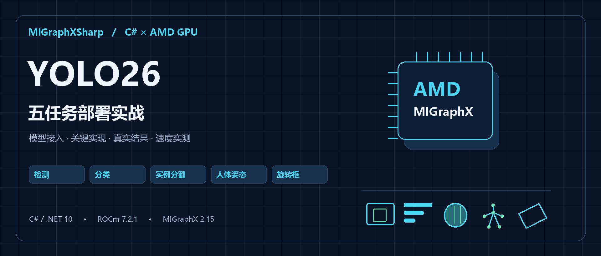
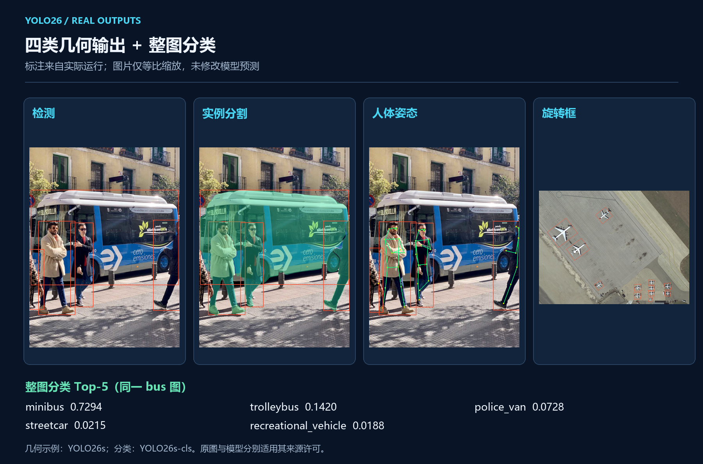
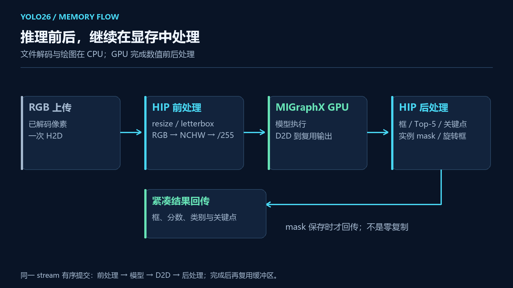
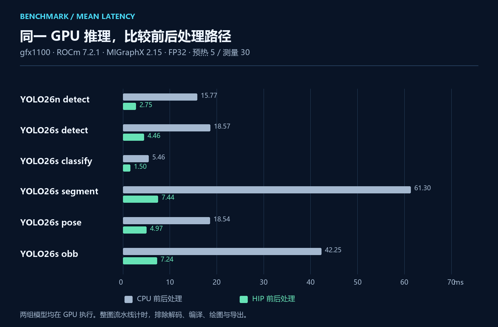

# 用 C# 在 AMD GPU 上部署 YOLO26：检测、分类、分割、姿态与旋转框实战



## 一、前言：模型跑得快，整个程序也要跟上

做过 YOLO 部署的小伙伴应该遇到过这种情况：模型推理只需要几毫秒，图片从读进来到拿到结果，却花了十几甚至几十毫秒。尤其是实例分割，模型后面还有 mask 计算、缩放和坐标恢复，单看一次推理时间，很容易低估整个程序的开销。

这次我把 YOLO26 的五类任务整理到 MIGraphXSharp 的同一个 C# 示例中。除了调用 AMD MIGraphX 执行模型，也把 resize、letterbox、输出解码和实例 mask 计算放到了 HIP 显存流水线中。这样，大家既可以看到五类模型怎样使用，也能看清楚前后处理究竟影响了多少时间。

本文从模型文件、输入输出、C# 调用一直讲到实际结果和速度。检测只是其中一条路径，分类、分割、姿态和旋转框都有对应代码和演示。

## 二、项目和本篇案例

### 2.1 MIGraphXSharp 负责什么

MIGraphXSharp 是我维护的 MIGraphX C# 接口库，通过 MIGraphX C ABI 连接 AMD 原生运行时。ONNX 解析、GPU 编译、张量输入输出和资源释放可以直接在 C# 中完成；需要自己写 HIP 前后处理时，再使用 HIP 适配包连接设备内存与 stream。

这里要区分两个层次：**NuGet 提供推理和显存互操作 API，YOLO 的图像处理、任务解码和绘图属于示例工程。** 安装核心包不会自动得到一个 YOLO 业务类，也不会安装 ROCm 驱动。

```text
项目地址：https://github.com/guojin-yan/MIGraphX-CSharp-API
核心包：JYPPX.ROCm.MIGraphX.CSharp.API 0.0.2
HIP 适配包：JYPPX.ROCm.MIGraphX.CSharp.API.HIP.Interop 0.0.2
案例目录：samples/Yolo26
```

本篇按当前 main 源码编写，核心 API 为 `0.0.2`。YOLO26 示例是一个独立项目，图像、HIP kernel、模型会话、解码和计时代码都在自己的目录中，便于直接阅读或移入现有工程。

### 2.2 五个任务，结果各不相同

| 任务 | 用途举例 | 示例返回什么 |
| --- | --- | --- |
| 目标检测 | 人车检测、物料定位 | 类别、分数、矩形框 |
| 图像分类 | 整图类别筛选 | Top-5 类别和分数 |
| 实例分割 | 区分每个目标的像素范围 | 每个实例的框、mask 和像素计数 |
| 姿态估计 | 人体关键点定位 | 人体框、17 个 COCO 关键点和骨架 |
| 旋转框检测 | 航拍、倾斜目标定位 | 中心、宽高、角度还原后的四边形 |

下面把四类几何任务的真实输出放在一起。检测框、分割 mask、关键点和旋转框来自已有 GPU 运行结果，未手工修改预测坐标；分类结果另外从 JSON 读取 Top-5。



同一张公交车图片交给分类模型时，Top-3 分别为 `minibus`（0.7294）、`trolleybus`（0.1420）、`police_van`（0.0728）。分类描述整张输入，检测则能同时定位图片中的车和人；两类任务应按业务需要分别选择。

## 三、环境与工程准备

### 3.1 本文的原生运行环境

| 项目 | 已验证配置 |
| --- | --- |
| 系统 | Ubuntu 24.04 x86-64 |
| .NET | .NET 10，案例目标 `net10.0` |
| AMD 原生运行时 | ROCm 7.2.1、MIGraphX 2.15.0 |
| GPU | `gfx1100` |
| 模型精度 | FP32，静态输入，batch=1 |
| 图像与前后处理 | ImageSharp 读写图像，HIP 处理数值流水线 |

Windows 可以编辑、编译托管代码，本文的 GPU 运行结果来自上面的 Linux 环境。托管包支持多个目标框架，并不表示这些系统都有对应的 MIGraphX 原生运行库。

获取源码后，在仓库根目录编译案例：

```bash
git clone https://github.com/guojin-yan/MIGraphX-CSharp-API.git
cd MIGraphX-CSharp-API
dotnet build samples/Yolo26/Yolo26.csproj -c Release \
  -p:JYPPXManagedTargetFrameworks=net10.0
```

工程通过项目引用使用库源码。自己创建应用时，再安装前面列出的两个 NuGet 包，并配置 ROCm、MIGraphX、HIP/HIPRTC。`--native` 指向实际的 `libmigraphx_c`，`--gpu-architecture` 必须与设备对应；`gfx1100` 只是本文设备参数。

### 3.2 准备正确的 YOLO26 导出

本示例读取 **Ultralytics YOLO26 端到端 ONNX 输出**。检测结果已经包含框、分数和类别，因此解码后不会再做一遍 NMS。不能把其他 YOLO 版本的原始检测头张量直接套进来。

| `--task` | 本文模型文件名 | 输入 | 输出约定 |
| --- | --- | --- | --- |
| `detect` | `yolo26n.onnx` / `yolo26s.onnx` | 640×640 | `[1,N,6]`：xyxy、score、class |
| `classify` | `yolo26s-cls.onnx` | 224×224 | `[1,classes]`，已归一化类别概率 |
| `segment` | `yolo26s-seg.onnx` | 640×640 | `[1,N,38]` 与 `[1,32,160,160]` |
| `pose` | `yolo26s-pose.onnx` | 640×640 | `[1,N,57]`：6 个基础字段与 17×3 关键点 |
| `obb` | `yolo26s-obb.onnx` | 1024×1024 | `[1,N,7]`：cxcywh、score、class、弧度角 |

模型、标签和图片由使用者准备，不随库包分发。标签文件采用 UTF-8，每行一个类别，索引顺序必须与模型一致。COCO、ImageNet、DOTA 三类任务不能共用同一个类别表。

下面约定模型放在 `/data/yolo26/models`，图片在 `/data/yolo26/images`，结果写到 `/results`。自己的路径不同，替换参数即可。模型适用 Ultralytics 自身许可，使用前也要核对对应条款。

## 四、一张图片怎样经过 GPU 流水线



### 4.1 前处理保留几何关系

检测、分割、姿态使用 640 画布，旋转框使用 1024 画布。图片按比例缩放，空白部分填 114，再转为 RGB、NCHW、`/255` 的 float32 张量。

这里必须同时保留缩放比例和 padding。解码时先减去 padding，再按比例映射回原图。如果只把横纵坐标各乘一个比例，画面看上去可能有框，但位置会偏。

分类走另一条前处理：从原图取中心方形区域，bicubic 缩放到 224，再做 RGB `/255`。它不使用检测任务的 letterbox。

### 4.2 推理输出继续留在显存

HIP 路径以 `offloadCopy: false` 编译模型，为输入、编译器附加参数和输出分配设备缓冲区。`RunDeviceIntoAsync` 将模型输出通过同一 stream 上的 D2D 复制写入可复用缓冲区，再接后处理 kernel。

这样不必先把完整输出张量搬回 CPU，解码后只读取类别、框、分数和关键点等紧凑结果。分割的完整 mask 在保存图片时再回传。**这条路径仍有 D2D 复制，也有最终结果回传，不能称为零复制。**

### 4.3 五类输出分别怎样处理

检测直接筛选端到端结果，恢复原图坐标；分类读取模型已经归一化的分数，取 Top-5，不额外叠加 Softmax。

分割先把每个实例的 32 个 mask coefficients 与 prototype 相乘，在 prototype 空间裁剪，再双线性上采样、去掉 letterbox padding。logit 大于 0 的像素作为前景，分别导出各实例 mask，避免把多个目标合成一张无法区分实例的图。

姿态读取 17 组 `(x,y,confidence)`，只绘制分数达到 0.5 的点和连接；OBB 则根据弧度角把中心、宽高变成四个顶点。做业务判断时，应使用四边形或关键点数据，绘图只负责展示。

## 五、C# 代码怎样调用

### 5.1 直接使用示例中的完整流水线

下面是精简后的调用入口，可替换 `samples/Yolo26/Program.cs` 体验。`Arguments`、`Images`、`HipYoloPipeline` 都是**本案例的源码类**，需要保留项目中其他文件；并非只安装 NuGet 就能使用的类。

```csharp
using MIGraphXSharp.Samples.Yolo26;

var options = new Arguments(new[]
{
    "--native", "/opt/rocm/lib/libmigraphx_c.so.3",
    "--gpu-architecture", "gfx1100",
    "--task", "detect",
    "--model", "/data/yolo26/models/yolo26n.onnx",
    "--image", "/data/yolo26/images/bus.jpg",
    "--labels", "/data/yolo26/models/coco-labels.txt"
});

using var image = Images.Load(options.Required("image"));
using var pipeline = new HipYoloPipeline(image, options);

// 模型与设备缓冲区已在构造阶段准备，后续复用。
var result = pipeline.Run().Value;
foreach (var item in result.Detections)
{
    Console.WriteLine($"{item.Label}: {item.Score:F3}");
    foreach (var point in item.Polygon)
        Console.WriteLine($"  ({point.X:F1}, {point.Y:F1})");
}
foreach (var item in result.Classes)
    Console.WriteLine($"{item.Label}: {item.Score:F3}");
```

切换任务时，修改 `--task`、模型与标签即可。`Detections` 保存几何任务结果，`Classes` 保存分类结果。上面只展示调用和读取结果；仓库原版入口还包括计时、图片保存、JSON 导出和错误处理。

### 5.2 往下看，核心推理 API 是这些

如果希望先理解 MIGraphX 的模型生命周期，可以看同目录的 `InferenceSession.cs`。它使用下面的方式设置输入、解析并编译 ONNX：

```csharp
using JYPPX.ROCm.MIGraphXSharp;

var native = "/opt/rocm/lib/libmigraphx_c.so.3";
using var options = new MIGraphXOnnxOptions(native);
options.SetInputParameterShape("images", new long[] { 1, 3, 640, 640 });
using var program = MIGraphXProgram.ParseOnnxFile(
    "/data/yolo26/models/yolo26n.onnx", options);
using var target = new MIGraphXTarget(native, "gpu");
using var compile = new MIGraphXCompileOptions(native, offloadCopy: true);
program.Compile(target, compile);
```

这一段只演示模型初始化，主机输入版的 `Run`、argument/map 和输出读取见 `InferenceSession`。HIP 显存输入版本在 `HipRuntimeContext.cs` 的 `HipInferenceSession` 中，它采用不同的 copy 配置，不能只把上面一个开关改掉就完成显存集成。

理解这两个层次后，扩展自己的模型也比较清楚：底层 API 负责模型与张量，任务代码负责图像和结果含义。

## 六、分别运行五个任务

保留仓库原版 `Program.cs` 时，可以直接使用命令行。先以检测为例，执行完整保存和计时：

```bash
dotnet run --project samples/Yolo26 -c Release --no-build -- \
  --native /opt/rocm/lib/libmigraphx_c.so.3 \
  --backend hip --gpu-architecture gfx1100 \
  --task detect --model /data/yolo26/models/yolo26n.onnx \
  --image /data/yolo26/images/bus.jpg \
  --labels /data/yolo26/models/coco-labels.txt \
  --output /results/yolo26-detect --warmup 5 --iterations 30
```

其他四项复用上面的公共参数，替换下表中的任务参数和输出目录。分割、姿态可以使用同一张人物图片；OBB 应使用匹配类别的航拍等输入。

| 任务参数 | 模型参数 | 标签参数示例 | 输出目录示例 |
| --- | --- | --- | --- |
| `--task classify` | `--model /data/yolo26/models/yolo26s-cls.onnx` | `--labels /data/yolo26/models/imagenet-labels.txt` | `/results/yolo26-cls` |
| `--task segment` | `--model /data/yolo26/models/yolo26s-seg.onnx` | `--labels /data/yolo26/models/coco-labels.txt` | `/results/yolo26-seg` |
| `--task pose` | `--model /data/yolo26/models/yolo26s-pose.onnx` | `--labels /data/yolo26/models/person-labels.txt` | `/results/yolo26-pose` |
| `--task obb` | `--model /data/yolo26/models/yolo26s-obb.onnx` | `--labels /data/yolo26/models/dota-labels.txt` | `/results/yolo26-obb` |

在本文 ROCm 7.2.1 / MIGraphX 2.15.0 环境中，姿态模型的默认 reduce fusion 会触发 GPU kernel 编译错误。运行姿态程序前需要设置：

```bash
export MIGRAPHX_DISABLE_REDUCE_FUSION=1
```

这是该原生版本组合的实际限制。升级 MIGraphX 后应重新核对，示例不会在失败后自动修改模型或更换执行方式。

输出文件各有用途：`result.json` 用于业务接入和性能读取，`preview.png` 展示几何与 mask，`annotated.svg` 带类别和分数，分割额外生成 `mask-xxx.png`。需要检查原始模型输入输出时，增加 `--dump-tensors true`；日常应用无需每张图导出完整张量。

## 七、速度实测：比较整条流水线

### 7.1 HIP 前后处理带来了多少变化

以下数据来自 `0.0.2` 发布实测：Ubuntu 24.04、ROCm 7.2.1、MIGraphX 2.15.0、gfx1100，CPU 配额 16 核，FP32、batch=1，每项预热 5 次、测量 30 次，未锁定 GPU 频率与功耗。

**两列都由 MIGraphX GPU 执行模型，区别是数值前后处理放在 C# CPU 还是 HIP GPU。** 因而这张表反映的是整条处理路径的变化，不能称为 CPU 模型与 GPU 模型的速度对比。

| 模型 / 任务 | CPU 前后处理流水线 ms | HIP 流水线 ms | HIP P95 ms |
| --- | ---: | ---: | ---: |
| YOLO26n 检测 | 15.77 | 2.75 | 2.83 |
| YOLO26s 检测 | 18.57 | 4.46 | 4.56 |
| YOLO26s 分类 | 5.46 | 1.50 | 1.53 |
| YOLO26s 实例分割 | 61.30 | 7.44 | 7.55 |
| YOLO26s 姿态 | 18.54 | 4.97 | 5.04 |
| YOLO26s 旋转框 | 42.25 | 7.24 | 7.29 |



分割从 61.30 ms 降到 7.44 ms，变化尤其明显，因为 mask 处理本身就有较大计算量。这里的收益也包括缓冲复用和减少完整输出回传，不能全部归因于某一个 kernel。

### 7.2 表中的时间包含什么

HIP pipeline 从已解码 RGB 上传开始，包含 GPU 前处理、模型执行、D2D 输出复制、后处理及紧凑结果回传。图片文件解码、模型和 kernel 编译、绘图、完整 mask/张量导出、写盘均排除。

所以，2.75 ms 不是“从磁盘打开图片直到保存标注图”的耗时，也不是纯模型推理时间。做接口服务时，排队、图片解码和结果序列化还要单独考虑。

JSON 同时保存 mean、P50、P95、首次执行和原始样本。先确认两次比较使用相同计时范围，再判断优化是否有效。只拿模型 event 时间与整图墙钟比较，通常会得到错误结论。

## 八、换成自己的模型时，先检查这些地方

自训练检测模型首先核对是否为本文支持的端到端输出、输入名是否为 `images`，再检查输入尺寸与类别表。`--size` 可以指定边长，但必须与导出合同一致；示例不会自动把任意静态模型改成其他尺寸。

`--threshold` 默认 0.25，`--max-detections` 默认 100，最多 300。目标多时可以调整，阈值应由业务数据确定。GPU 路径与 ImageSharp CPU resize 有浮点和字节舍入差异，结果检查要考虑这些差异，不能要求两个前处理逐像素完全相同。

当前案例处理静态图片，不包含摄像头采集、视频跟踪或训练。做视频时可以在此基础上接入帧输入，但还需要解决队列、缓冲复用和显示线程；单张图片的 `1000/mean` 也不能直接当作完整视频系统 FPS。

这套代码把 YOLO26 的五类任务连到了同一条 C# → MIGraphX → HIP 路径。大家可以先用对应图片确认结果，再将类别、坐标、mask 或关键点接入自己的业务。完整实现与参数说明就在 `samples/Yolo26`，无需另外寻找一套隐藏的前后处理代码。
