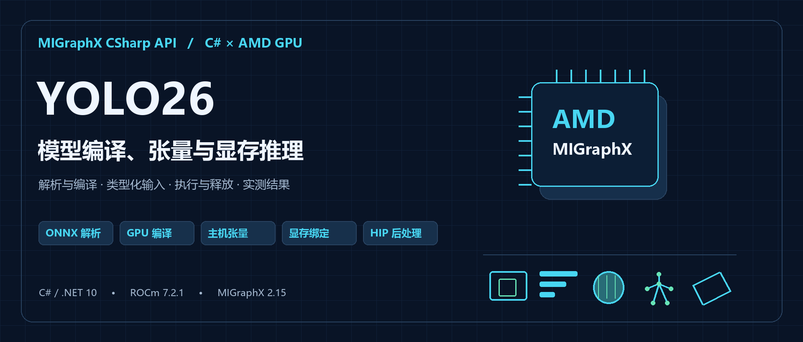
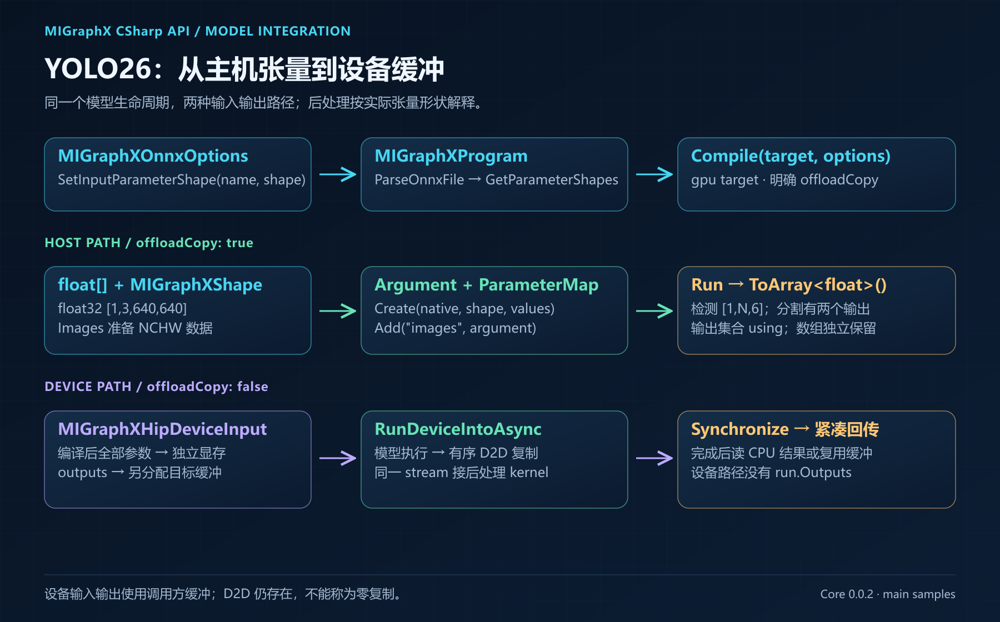
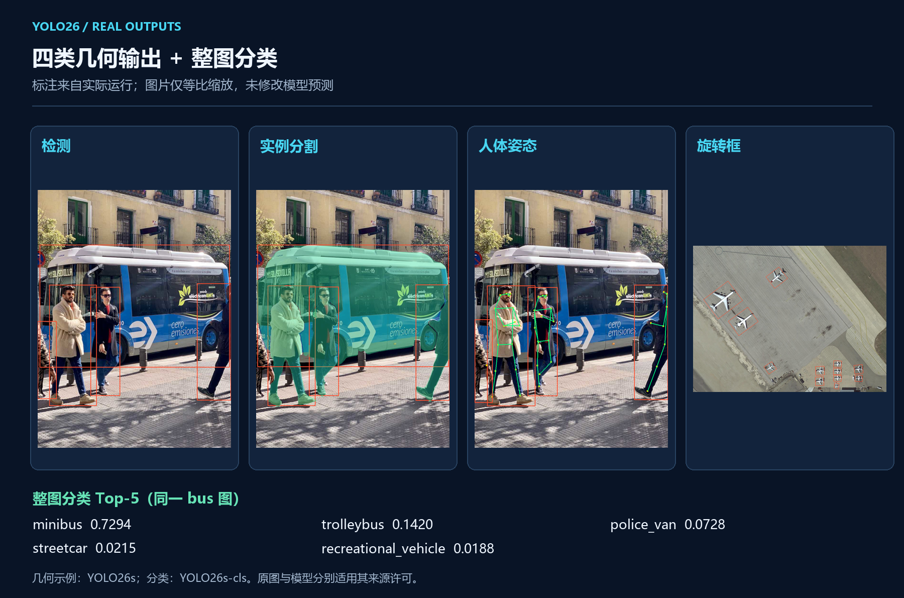
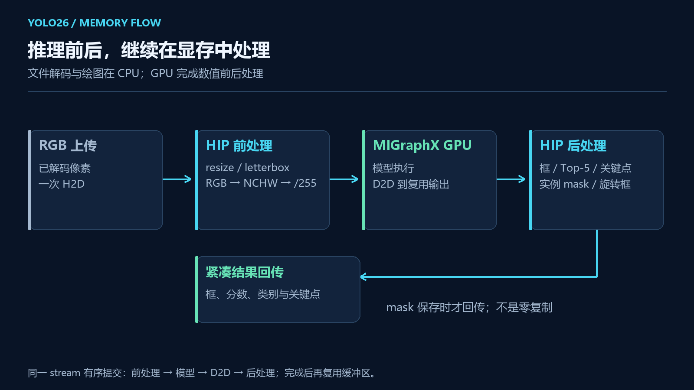
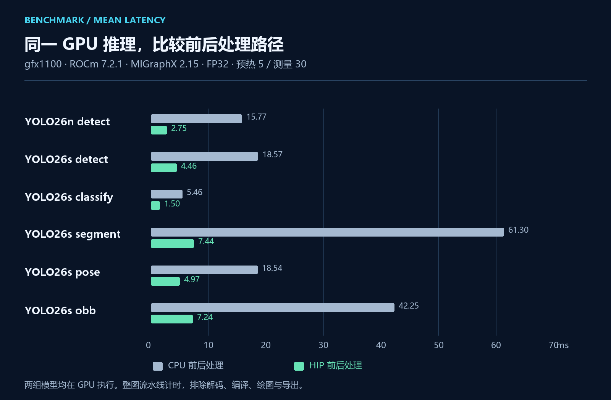

# MIGraphX CSharp API 实战：用 YOLO26 理解模型编译、张量与 HIP 显存推理



## 一、MIGraphX CSharp API 项目简介

**MIGraphX CSharp API** 是一个面向 **C# / .NET 开发者**的 AMD MIGraphX 接口库，由「椒颜皮皮虾」（Guojin Yan）开发，项目源码遵循 **Apache License 2.0**。它通过 MIGraphX C ABI 调用 AMD 原生推理引擎，提供 ONNX 模型解析、GPU 编译、张量输入输出和资源管理接口，方便大家在现有 .NET 工程中部署模型。

项目按 C# 的使用习惯提供类型化数组、形状检查和 `IDisposable` 资源管理，也支持动态输入、程序保存加载与模型缓存。需要自己写 GPU 前后处理时，可以通过可选的 HIP 适配包，把模型接入已有的设备缓冲区和 stream。

目前随项目提供 **YOLO26 五任务、PaddleOCR v4/v5/v6、PP-Structure 文档处理和 CLIP 图文检索**四类独立案例。NuGet 提供推理和显存互操作 API，各模型的图像处理、解码与展示代码保留在对应示例中，大家可以按任务直接查看和修改。

**项目源码与 NuGet：**

```text
项目地址：https://github.com/guojin-yan/MIGraphX-CSharp-API
核心包：https://www.nuget.org/packages/JYPPX.ROCm.MIGraphX.CSharp.API/0.0.2
HIP 适配包：JYPPX.ROCm.MIGraphX.CSharp.API.HIP.Interop 0.0.2
```

当前原生 GPU 路径已在 Linux、ROCm 7.2.1、MIGraphX 2.15.0、gfx1100 上验证。托管包兼容多个 .NET 目标框架，实际运行仍需单独准备匹配的 AMD 驱动与原生运行库。

## 二、YOLO26 五任务与本篇实战

### 2.1 模型跑得快，整个程序也要跟上

做过 YOLO 部署的小伙伴应该遇到过这种情况：模型推理只需要几毫秒，图片从读进来到拿到结果，却花了十几甚至几十毫秒。尤其是实例分割，模型后面还有 mask 计算、缩放和坐标恢复，单看一次推理时间，很容易低估整个程序的开销。

这篇就以 YOLO26 为例，从 MIGraphX CSharp API 的模型生命周期开始写：怎样给 ONNX 指定输入，怎样编译 GPU program，怎样将 C# 数组绑定成张量，以及怎样把主机输入换成显存输入。五种任务会用到不同的输出结构，正好可以把单输出、多输出和 GPU 后处理一起讲清楚。

本文按当前 main 的 `samples/Yolo26` 编写，核心 API 为 `0.0.2`。图像、HIP kernel、模型会话、解码和计时代码都在同一个项目中，便于直接阅读或移入现有工程。正文中的推理代码直接调用库接口，图片转换沿用案例中的辅助函数。掌握这条调用过程后，换成自己的 ONNX 时，主要改的是输入约定与输出解析。

### 2.2 先把库的调用过程对应起来



| 要完成的工作 | 使用的库接口 | 本例需要检查什么 |
| --- | --- | --- |
| 指定模型输入 | `MIGraphXOnnxOptions.SetInputParameterShape` | `images`、float32、NCHW、实际导出尺寸 |
| 解析计算图 | `MIGraphXProgram.ParseOnnxFile` | ONNX 算子及输入信息能否解析 |
| 为 GPU 编译 | `MIGraphXTarget`、`MIGraphXCompileOptions`、`Compile` | GPU target 与 copy 策略 |
| 绑定主机输入 | `MIGraphXArgument.Create`、`MIGraphXParameterMap.Add` | 名称、类型、长度与 shape 对应 |
| 同步推理 | `Run`、`ToArray<float>()` | 输出形状及端到端检测字段 |
| 接入显存 | `MIGraphXHipDeviceInput`、`RunDeviceIntoAsync` | 编译后全部参数、输出缓冲及 stream |

### 2.3 五个任务，结果各不相同

| 任务 | 用途举例 | 示例返回什么 |
| --- | --- | --- |
| 目标检测 | 人车检测、物料定位 | 类别、分数、矩形框 |
| 图像分类 | 整图类别筛选 | Top-5 类别和分数 |
| 实例分割 | 区分每个目标的像素范围 | 每个实例的框、mask 和像素计数 |
| 姿态估计 | 人体关键点定位 | 人体框、17 个 COCO 关键点和骨架 |
| 旋转框检测 | 航拍、倾斜目标定位 | 中心、宽高、角度还原后的四边形 |

下面把四类几何任务的真实输出放在一起。检测框、分割 mask、关键点和旋转框来自已有 GPU 运行结果，未手工修改预测坐标；分类结果另外从 JSON 读取 Top-5。



同一张公交车图片交给分类模型时，Top-3 分别为 `minibus`（0.7294）、`trolleybus`（0.1420）、`police_van`（0.0728）。分类描述整张输入，检测则能同时定位图片中的车和人；两类任务应按业务需要分别选择。

## 三、环境与工程准备

### 3.1 本文的原生运行环境

| 项目 | 已验证配置 |
| --- | --- |
| 系统 | Ubuntu 24.04 x86-64 |
| .NET | .NET 10，案例目标 `net10.0` |
| AMD 原生运行时 | ROCm 7.2.1、MIGraphX 2.15.0 |
| GPU | `gfx1100` |
| 模型精度 | FP32，静态输入，batch=1 |
| 图像与前后处理 | ImageSharp 读写图像，HIP 处理数值流水线 |

Windows 可以编辑、编译托管代码，本文的 GPU 运行结果来自上面的 Linux 环境。托管包支持多个目标框架，并不表示这些系统都有对应的 MIGraphX 原生运行库。

获取源码后，在仓库根目录编译案例：

```bash
git clone https://github.com/guojin-yan/MIGraphX-CSharp-API.git
cd MIGraphX-CSharp-API
dotnet build samples/Yolo26/Yolo26.csproj -c Release \
  -p:JYPPXManagedTargetFrameworks=net10.0
```

工程通过项目引用使用库源码。独立工程可以先安装：

```bash
dotnet add package JYPPX.ROCm.MIGraphX.CSharp.API --version 0.0.2
dotnet add package JYPPX.ROCm.MIGraphX.CSharp.API.HIP.Interop --version 0.0.2
```

核心包用于同步主机张量推理，第二个包用于 HIP 显存与 stream 集成，依赖的 HipSharp 为 `0.10.0`。下面代码中的 `JYPPX.ROCm.MIGraphXSharp` 是现有核心命名空间，项目展示名统一为 MIGraphX CSharp API。

安装托管包后，还要配置 ROCm、MIGraphX、HIP/HIPRTC。`--native` 指向实际的 `libmigraphx_c`，`--gpu-architecture` 必须与设备对应；`gfx1100` 只是本文设备参数。

### 3.2 准备正确的 YOLO26 导出

本示例读取 **Ultralytics YOLO26 端到端 ONNX 输出**。检测结果已经包含框、分数和类别，因此解码后不会再做一遍 NMS。不能把其他 YOLO 版本的原始检测头张量直接套进来。

| `--task` | 本文模型文件名 | 输入 | 输出约定 |
| --- | --- | --- | --- |
| `detect` | `yolo26n.onnx` / `yolo26s.onnx` | 640×640 | `[1,N,6]`：xyxy、score、class |
| `classify` | `yolo26s-cls.onnx` | 224×224 | `[1,classes]`，已归一化类别概率 |
| `segment` | `yolo26s-seg.onnx` | 640×640 | `[1,N,38]` 与 `[1,32,160,160]` |
| `pose` | `yolo26s-pose.onnx` | 640×640 | `[1,N,57]`：6 个基础字段与 17×3 关键点 |
| `obb` | `yolo26s-obb.onnx` | 1024×1024 | `[1,N,7]`：cxcywh、score、class、弧度角 |

模型、标签和图片由使用者准备，不随库包分发。标签文件采用 UTF-8，每行一个类别，索引顺序必须与模型一致。COCO、ImageNet、DOTA 三类任务不能共用同一个类别表。

下面约定模型放在 `/data/yolo26/models`，图片在 `/data/yolo26/images`，结果写到 `/results`。自己的路径不同，替换参数即可。模型适用 Ultralytics 自身许可，使用前也要核对对应条款。

## 四、一张图片怎样经过 GPU 流水线



### 4.1 前处理保留几何关系

检测、分割、姿态使用 640 画布，旋转框使用 1024 画布。图片按比例缩放，空白部分填 114，再转为 RGB、NCHW、`/255` 的 float32 张量。

这里必须同时保留缩放比例和 padding。解码时先减去 padding，再按比例映射回原图。如果只把横纵坐标各乘一个比例，画面看上去可能有框，但位置会偏。

分类走另一条前处理：从原图取中心方形区域，bicubic 缩放到 224，再做 RGB `/255`。它不使用检测任务的 letterbox。

### 4.2 推理输出继续留在显存

HIP 路径以 `offloadCopy: false` 编译模型，为输入、编译器附加参数和输出分配设备缓冲区。`RunDeviceIntoAsync` 将模型输出通过同一 stream 上的 D2D 复制写入可复用缓冲区，再接后处理 kernel。

这样不必先把完整输出张量搬回 CPU，解码后只读取类别、框、分数和关键点等紧凑结果。分割的完整 mask 在保存图片时再回传。**这条路径仍有 D2D 复制，也有最终结果回传，不能称为零复制。**

### 4.3 五类输出分别怎样处理

检测直接筛选端到端结果，恢复原图坐标；分类读取模型已经归一化的分数，取 Top-5，不额外叠加 Softmax。

分割先把每个实例的 32 个 mask coefficients 与 prototype 相乘，在 prototype 空间裁剪，再双线性上采样、去掉 letterbox padding。logit 大于 0 的像素作为前景，分别导出各实例 mask，避免把多个目标合成一张无法区分实例的图。

姿态读取 17 组 `(x,y,confidence)`，只绘制分数达到 0.5 的点和连接；OBB 则根据弧度角把中心、宽高变成四个顶点。做业务判断时，应使用四边形或关键点数据，绘图只负责展示。

## 五、先用核心 API 跑通一次检测

### 5.1 模型初始化与每次推理分开

下面可以替换 `samples/Yolo26/Program.cs`。只借用 `Images` 做图片读取和 letterbox，其余模型解析、编译、参数绑定和输出读取都直接调用库。`Images` 来自案例源码；只安装 NuGet 的工程需要自行准备同样的 NCHW 数组。

```csharp
using JYPPX.ROCm.MIGraphXSharp;
using MIGraphXSharp.Samples.Yolo26;

var native = "/opt/rocm/lib/libmigraphx_c.so.3";
var model = "/data/yolo26/models/yolo26n.onnx";

using var options = new MIGraphXOnnxOptions(native);
options.SetInputParameterShape("images", new long[] { 1, 3, 640, 640 });
using var program = MIGraphXProgram.ParseOnnxFile(model, options);

var expected = new MIGraphXShape(MIGraphXShapeDataType.Float32,
    new long[] { 1, 3, 640, 640 });
var declared = program.GetParameterShapes();
if (declared.Count != 1 || !declared.TryGetValue("images", out var inputShape)
    || !inputShape.HasSameNativeContent(expected))
    throw new InvalidDataException("需要 float32 images[1,3,640,640]。");

using var target = new MIGraphXTarget(native, "gpu");
using var compile = new MIGraphXCompileOptions(native, offloadCopy: true);
program.Compile(target, compile);

// 实际应用把初始化放在请求循环外，复用已编译的 program。
using var image = Images.Load("/data/yolo26/images/bus.jpg");
var prepared = Images.PrepareYolo(image, 640, 640, classification: false);
using var argument = MIGraphXArgument.Create(native, inputShape, prepared.Tensor);
using var parameters = new MIGraphXParameterMap(native);
parameters.Add("images", argument);
using var outputs = program.Run(parameters);

if (outputs.Count != 1) throw new InvalidDataException("检测模型应返回一个张量。");
var shape = outputs[0].Shape;
if (shape.DataType != MIGraphXShapeDataType.Float32 || shape.Rank != 3
    || shape.Lengths[0] != 1 || shape.Lengths[2] != 6)
    throw new InvalidDataException("需要端到端检测输出 [1,N,6]。");

float[] values = outputs[0].ToArray<float>();
for (var row = 0; row < shape.Lengths[1]; row++)
{
    var offset = checked((int)row * 6);
    if (values[offset + 4] < .25f) continue;
    var leftTop = prepared.Restore(values[offset], values[offset + 1]);
    var rightBottom = prepared.Restore(values[offset + 2], values[offset + 3]);
    Console.WriteLine($"class={values[offset + 5]}, score={values[offset + 4]:F3}, " +
        $"({leftTop.X:F1},{leftTop.Y:F1})-({rightBottom.X:F1},{rightBottom.Y:F1})");
}
```

这里的 `offloadCopy: true` 仍然使用 GPU 计算，只是输入输出以主机张量交给 MIGraphX 管理复制。不要把“主机输入”理解为 CPU 推理。

`SetInputParameterShape` 在解析前确定本次输入尺寸，不是图片缩放函数，也不能保证任意静态模型可以随意修改尺寸。解析后再通过 `GetParameterShapes()` 检查模型是否接受了这个配置。

### 5.2 Argument、参数表和输出分别做什么

`MIGraphXShape` 描述元素类型、长度和步幅，本身是托管形状信息。`MIGraphXArgument.Create` 按这个形状深拷贝数组，创建拥有独立主机缓冲的 argument；C# 数组长度和元素类型不匹配时，会在提交前被检查。它不是把数组临时固定后直接借给 GPU，创建之后修改原数组，也不会更新这个 argument。

float32 `[1,3,640,640]` 包含 1,228,800 个元素，对应 4,915,200 字节。图像宽高正确但用了交错 RGB 数据，元素数仍然可能一致；类型和 shape 检查无法代替 NCHW 排列，因此前处理和参数绑定需要分别核对。

`MIGraphXParameterMap` 将 argument 绑定到模型参数名。这里必须写实际的 `images`，库不会按加入顺序猜测输入。`program.Run(parameters)` 返回需要释放的输出集合；在它的作用域内读取 `Shape`，再用 `ToArray<float>()` 得到独立的托管结果。

因此，一个长时间运行的服务通常保留 `program`，每个请求创建自己的 argument、参数表和输出集合。上面用 `using` 展示释放顺序；不要在循环里反复解析并编译同一个模型，也不要把尚未复制出来的原生输出当成长期托管数据使用。

### 5.3 换任务时，先换输出解析

分类输出是 `[1,classes]`，直接读已归一化的分数；分割则有检测结果和 prototype 两个张量。先枚举 `program.GetOutputShapes()`，核对数量、类型和维度，再决定哪个输出交给哪段后处理。

分割的 `[1,N,38]` 中，前 6 项描述检测结果，后 32 项是 mask coefficients；另一个 `[1,32,160,160]` 是 prototype。两者一起才能重建实例 mask。姿态的最后一维是 57，旋转框为 7，不能把它们都按 6 列检测框读取。

案例的 `Decoder.cs` 集中处理这些含义。库负责保留张量信息，任务层负责解释其中每一列；这一分工也适用于自训练模型。

## 六、用 HIP 适配 API 接入自己的显存

### 6.1 显存输入需要完整的编译后参数

前一节先读回输出，适合核对模型。需要后处理继续在 GPU 上执行时，改用 `offloadCopy: false`，并提供自己的设备缓冲区。

下面同样可以替换案例入口。为了单独看清设备绑定，这段仍用 CPU 准备输入，并在最后读回首个张量；它演示适配 API，完整 HIP 前后处理在下一小节对应到源码。

```csharp
using System.Runtime.InteropServices;
using JYPPX.ROCm.HipSharp;
using JYPPX.ROCm.HipSharp.Memory;
using JYPPX.ROCm.MIGraphXSharp;
using JYPPX.ROCm.MIGraphX.CSharp.API.HIP.Interop;
using MIGraphXSharp.Samples.Yolo26;

var native = "/opt/rocm/lib/libmigraphx_c.so.3";
using var hip = new HipRuntime();
hip.GetDevice(0).MakeCurrent();
using var stream = hip.CreateStream();
using var options = new MIGraphXOnnxOptions(native);
options.SetInputParameterShape("images", new long[] { 1, 3, 640, 640 });
using var program = MIGraphXProgram.ParseOnnxFile(
    "/data/yolo26/models/yolo26n.onnx", options);
using var target = new MIGraphXTarget(native, "gpu");
using var compile = new MIGraphXCompileOptions(native, offloadCopy: false);
program.Compile(target, compile);

var owners = new List<HipDeviceMemory>();
HipDeviceMemory Allocate(long bytes)
{
    var memory = hip.Allocate(checked((ulong)bytes));
    owners.Add(memory);
    return memory;
}

try
{
    // Compile 之后枚举，包含编译器附加的输出或 scratch 参数。
    var inputs = program.GetParameterShapes().Select(p =>
        new MIGraphXHipDeviceInput(p.Key, p.Value, Allocate(p.Value.ByteCount)))
        .ToArray();
    var shapes = program.GetOutputShapes().ToArray();
    var destinations = shapes.Select(s => Allocate(s.ByteCount)).ToArray();
    using var image = Images.Load("/data/yolo26/images/bus.jpg");
    var prepared = Images.PrepareYolo(image, 640, 640, classification: false);
    var bytes = MemoryMarshal.AsBytes(prepared.Tensor.AsSpan()).ToArray();
    inputs.Single(p => p.Name == "images").Memory.CopyFromAsync(bytes, stream);

    using var run = program.RunDeviceIntoAsync(inputs, destinations, stream);
    // 此处可以在同一 stream 接后处理 kernel，读取 destinations。
    var rawOutput = new byte[checked((int)shapes[0].ByteCount)];
    destinations[0].CopyToAsync(rawOutput, stream);
    run.Synchronize();
    Console.WriteLine($"首个输出复制完成：{rawOutput.Length} bytes");
}
finally
{
    stream.Synchronize();
    for (var i = owners.Count - 1; i >= 0; i--) owners[i].Dispose();
}
```

这里有两组不同的缓冲：一组按编译后的参数表分配，供模型执行使用；另一组按 `GetOutputShapes()` 分配，接收模型输出。输出目标必须与输入、其他输出分开，不能把模型参数里的某一块直接当作输出目标复用。

适配器会检查设备、运行时、容量和形状。当前路径要求具体、标准连续的形状；不要把非连续 stride 或只描述范围的动态 shape 直接拿来分配这套静态缓冲。

### 6.2 完整案例如何接上前后处理 kernel

在 `HipYoloPipeline.Run` 中，前处理 kernel 写入 `HipInferenceSession.Input`，`Enqueue()` 内部调用刚才的 `RunDeviceIntoAsync`，后处理继续读取 `Outputs`。这些工作使用同一 stream，依次提交：

```text
RGB 上传 → resize/letterbox/tensorize → RunDeviceIntoAsync
        → 输出 D2D 复制 → 框/关键点/mask kernel → 紧凑结果回传
```

同一 stream 的顺序保证后处理读取到本次模型结果，因此不用在每两个 kernel 之间插入一次主机等待。到 CPU 真正要访问结果、复用可写缓冲或释放资源时，再同步。

`RunDeviceIntoAsync` 返回 `MIGraphXHipAsyncRun`，它描述这次待完成执行，并保留需要的资源租约。这里不能读 `run.Outputs`，因为该路径没有创建主机输出集合；结果在调用方传入的 `destinations` 中。

### 6.3 复用资源时，边界要清楚

| 对象 | 通常保留多久 | 再次使用前的要求 |
| --- | --- | --- |
| `MIGraphXProgram` | 模型服务或会话生命周期 | 不在待完成执行中修改图或重新编译 |
| 输入、输出和 scratch 显存 | 同一尺寸流水线生命周期 | 前一次使用结束后再写入下一张图 |
| `MIGraphXHipAsyncRun` | 一次提交到完成 | 完成后释放；未完成时 Dispose 会等待 |
| 后处理 kernel 和 stream | 流水线生命周期 | 跨流共享数据前建立明确同步 |

案例用 `HipRuntimeContext` 统一拥有 kernel 和显存，`HipInferenceSession` 拥有 program。它们是示例层的资源组织方式，实际推理调用仍是本文展开的库 API。

这条路径包含有序 D2D 输出复制，也有最终结果回传。它减少了完整输出过早回主机的开销，但不能称为零复制，也不能仅凭异步接口就声称多个任务已经并行。

## 七、运行完整案例并核对输出

保留仓库原版 `Program.cs` 时，可以直接使用命令行。先以检测为例，执行完整保存和计时：

```bash
dotnet run --project samples/Yolo26 -c Release --no-build -- \
  --native /opt/rocm/lib/libmigraphx_c.so.3 \
  --backend hip --gpu-architecture gfx1100 \
  --task detect --model /data/yolo26/models/yolo26n.onnx \
  --image /data/yolo26/images/bus.jpg \
  --labels /data/yolo26/models/coco-labels.txt \
  --output /results/yolo26-detect --warmup 5 --iterations 30
```

其他四项复用上面的公共参数，替换下表中的任务参数和输出目录。分割、姿态可以使用同一张人物图片；OBB 应使用匹配类别的航拍等输入。

| 任务参数 | 模型参数 | 标签参数示例 | 输出目录示例 |
| --- | --- | --- | --- |
| `--task classify` | `--model /data/yolo26/models/yolo26s-cls.onnx` | `--labels /data/yolo26/models/imagenet-labels.txt` | `/results/yolo26-cls` |
| `--task segment` | `--model /data/yolo26/models/yolo26s-seg.onnx` | `--labels /data/yolo26/models/coco-labels.txt` | `/results/yolo26-seg` |
| `--task pose` | `--model /data/yolo26/models/yolo26s-pose.onnx` | `--labels /data/yolo26/models/person-labels.txt` | `/results/yolo26-pose` |
| `--task obb` | `--model /data/yolo26/models/yolo26s-obb.onnx` | `--labels /data/yolo26/models/dota-labels.txt` | `/results/yolo26-obb` |

在本文 ROCm 7.2.1 / MIGraphX 2.15.0 环境中，姿态模型的默认 reduce fusion 会触发 GPU kernel 编译错误。运行姿态程序前需要设置：

```bash
export MIGRAPHX_DISABLE_REDUCE_FUSION=1
```

这是该原生版本组合的实际限制。升级 MIGraphX 后应重新核对，示例不会在失败后自动修改模型或更换执行方式。

输出文件各有用途：`result.json` 用于业务接入和性能读取，`preview.png` 展示几何与 mask，`annotated.svg` 带类别和分数，分割额外生成 `mask-xxx.png`。需要检查原始模型输入输出时，增加 `--dump-tensors true`；日常应用无需每张图导出完整张量。

## 八、速度实测：比较整条流水线

### 8.1 HIP 前后处理带来了多少变化

以下数据来自 `0.0.2` 发布实测：Ubuntu 24.04、ROCm 7.2.1、MIGraphX 2.15.0、gfx1100，CPU 配额 16 核，FP32、batch=1，每项预热 5 次、测量 30 次，未锁定 GPU 频率与功耗。

**两列都由 MIGraphX GPU 执行模型，区别是数值前后处理放在 C# CPU 还是 HIP GPU。** 因而这张表反映的是整条处理路径的变化，不能称为 CPU 模型与 GPU 模型的速度对比。

| 模型 / 任务 | CPU 前后处理流水线 ms | HIP 流水线 ms | HIP P95 ms |
| --- | ---: | ---: | ---: |
| YOLO26n 检测 | 15.77 | 2.75 | 2.83 |
| YOLO26s 检测 | 18.57 | 4.46 | 4.56 |
| YOLO26s 分类 | 5.46 | 1.50 | 1.53 |
| YOLO26s 实例分割 | 61.30 | 7.44 | 7.55 |
| YOLO26s 姿态 | 18.54 | 4.97 | 5.04 |
| YOLO26s 旋转框 | 42.25 | 7.24 | 7.29 |



分割从 61.30 ms 降到 7.44 ms，变化尤其明显，因为 mask 处理本身就有较大计算量。这里的收益也包括缓冲复用和减少完整输出回传，不能全部归因于某一个 kernel。

### 8.2 表中的时间包含什么

HIP pipeline 从已解码 RGB 上传开始，包含 GPU 前处理、模型执行、D2D 输出复制、后处理及紧凑结果回传。图片文件解码、模型和 kernel 编译、绘图、完整 mask/张量导出、写盘均排除。

所以，2.75 ms 不是“从磁盘打开图片直到保存标注图”的耗时，也不是纯模型推理时间。做接口服务时，排队、图片解码和结果序列化还要单独考虑。

JSON 同时保存 mean、P50、P95、首次执行和原始样本。先确认两次比较使用相同计时范围，再判断优化是否有效。只拿模型 event 时间与整图墙钟比较，通常会得到错误结论。

## 九、将 YOLO26 接入自己的应用

### 9.1 自训练模型需要改哪些配置

前面已经完成了模型调用、五类输出解析和整图计时。换成自己的 YOLO26 模型时，可以保留这套推理代码，先核对下面三项：

| 配置 | 需要与模型保持一致的内容 | 修改位置 |
| --- | --- | --- |
| 输入 | 参数名、float32 类型、NCHW 排列与输入尺寸 | `SetInputParameterShape` 和前处理代码；现有命令行示例固定使用 `images` |
| 输出 | 是否为对应任务的端到端输出，张量数量与每行字段含义 | `GetOutputShapes()` 检查及对应任务解码代码 |
| 类别 | 类别数量、索引顺序和名称 | UTF-8 标签文件，索引与训练时保持一致 |

如果只是更换同规格、同输出格式的自训练检测模型，通常只需替换模型与类别文件。输入名或输出格式发生变化时，则要修改相应绑定和解码代码。`--size` 只指定本次使用的画布边长，不能把任意静态 ONNX 自动变成支持其他尺寸的模型。

模型配置确定后，再用自己的图片调整阈值。示例的 `--threshold` 默认为 0.25，`--max-detections` 默认为 100、上限为 300。可以先保留较低分数的结果观察漏检与误检，再结合业务要求确定阈值。

### 9.2 在应用中复用模型，读取结构化结果

接入桌面程序或推理服务时，把模型解析、GPU 编译和设备缓冲分配放在初始化阶段。后续请求复用这套资源，依次完成输入准备、模型执行和结果读取。应用退出时，先等待 GPU 工作完成，再释放 program、stream 和显存。

主机张量路径可以直接沿用第五节：保留已编译的 `MIGraphXProgram`，每次为新图片创建 argument 和参数表，执行后将输出复制为托管数组。HIP 路径则复用输入输出显存，在前一次执行完成后再写入下一张图片。同一套可写缓冲应按顺序使用；要增加请求并发，需要为各执行任务安排独立缓冲和同步关系。

业务侧可以直接使用 `HipYoloResult.Detections`、`Classes`，或导出的 `result.json`，读取类别、分数、坐标和关键点。分割结果还保留 mask 文件名与前景像素数，完整 mask 在导出时从显存读取并保存。`preview.png` 和 `annotated.svg` 用于观察结果，区域判断、关键点计算等业务逻辑直接使用结构化数据。

当前 HIP 示例按初始化图片的尺寸分配前处理和 mask 缓冲。接入不同分辨率的图片时，需要重建或调整对应流水线，不能只替换像素数组。视频输入还需要在应用层处理采集、排队和显示，本文单图耗时可作为推理处理部分的参考。

## 十、总结与源码

这篇通过 YOLO26 展开了 MIGraphX CSharp API 的两种实际用法：先用 `MIGraphXOnnxOptions` 和 `MIGraphXProgram` 解析、编译模型，再通过类型化 argument、参数表与 `Run` 完成主机张量调用；需要衔接 GPU 前后处理时，再用 `MIGraphXHipDeviceInput` 和 `RunDeviceIntoAsync` 接入自己的显存与 stream。

**MIGraphX CSharp API 提供的是在 .NET 工程中调用 AMD MIGraphX 的基础接口。** 类型化数组和形状检查帮助开发者明确输入输出，`IDisposable` 管理原生资源，可选 HIP 适配包让模型接入已有的显存与 stream。检测、分类、分割、姿态和旋转框虽然有不同的输出含义，仍然可以复用同一套模型调用过程。

实测中，YOLO26n 检测的整图流水线由 15.77 ms 降到 2.75 ms，YOLO26s 分割由 61.30 ms 降到 7.44 ms，两组均使用 GPU 推理。这个结果说明，在模型之外，前后处理的位置、缓冲复用和数据回传同样值得关注。自己的项目可以先按第五节确认输入输出，再根据完整流水线的耗时，决定哪些处理需要迁到 HIP。

欢迎大家到 GitHub 查看项目源码。想先理解库的用法，可以从第五节的主机张量调用开始；需要完整五任务实现，再查看 `samples/Yolo26` 中的前后处理、HIP kernel 和结果导出。项目采用 Apache License 2.0，也欢迎结合自己的模型提出问题和改进建议。

```text
MIGraphX CSharp API 项目源码：
https://github.com/guojin-yan/MIGraphX-CSharp-API

YOLO26 完整案例：
https://github.com/guojin-yan/MIGraphX-CSharp-API/tree/main/samples/Yolo26
```

下一篇 PaddleOCR 继续使用这些接口，介绍检测与识别两个模型如何组合、Batch 怎样组织成张量，以及多个独立实例怎样提交和等待执行。
